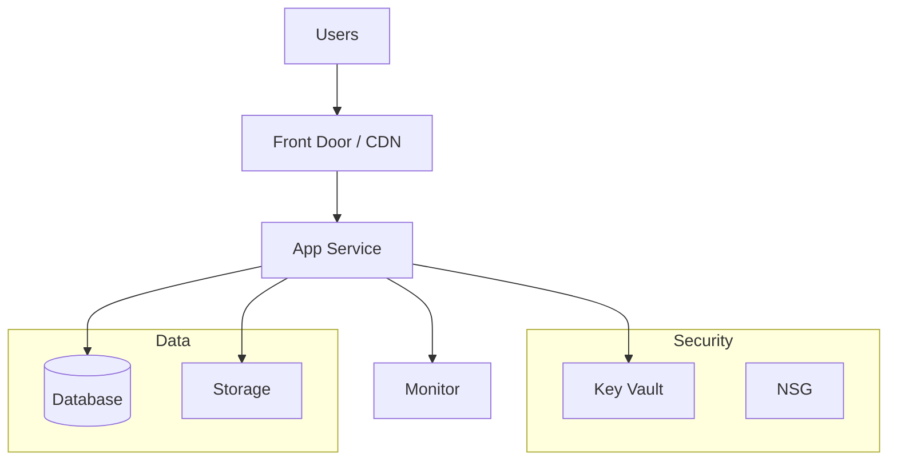

# Step 2: Architecture Assessment - {project-name}

Assessment Contents

- [Requirements Validation](#requirements-validation)
- [Resource SKU Recommendations](#resource-sku-recommendations)
- [Architecture Decision Summary](#architecture-decision-summary)
- [Implementation Handoff](#implementation-handoff)

---

## Requirements Validation

| Scope | Design response | Acceptance evidence |
| --- | --- | --- |
| {industry and exact businessUnits} | {personas, app/data and handoffs} | {tests} |

### Agentic runtime contract

Trace the [selected pattern](../../az-scenario-requirements/references/agentic-patterns.md)
to the requirements' industry/unit outcome. Do not select infrastructure first and invent a workflow around it.

| Contract | Design and evidence |
| --- | --- |
| Pattern selection | {IDs/names, overlays, business fit and rejected simpler alternative} |
| Implementation support | {dated official SDK/language/hosting evidence; native versus app-hosted orchestration} |
| Runtime roles and control | {entry point, ownership, route/handoff/aggregation rules and typed payloads} |
| State and recovery | {store, checkpoint, version/conflict handling, retries, idempotency and cancellation} |
| Permissions and human gates | {managed identities, scoped tools/data, deterministic limits and decision lifecycle} |
| Operational budgets | {numeric time/call/token/round/concurrency/cost limits and exhaustion behavior} |
| Acceptance and observability | {business result, correlation/receipts and positive/negative coordination tests} |

### Management and deployment access

For private workloads, apply the
[management-access contract](../../hack-builder-workflow/SKILL.md#private-workload-management-access).
For public-only workloads, state why a separate management network is unnecessary.

| Operation | Execution host and identity | Network/DNS path | Bootstrap and acceptance |
| --- | --- | --- | --- |
| Provision/publish | {host; scoped identity} | {control/data endpoints} | {ordering; checks} |
| Initialize/test | {connected host; identity} | {DNS, routing, egress} | {positive/negative tests} |
| Troubleshoot | {VPN or private VM/Bastion} | {remote/service access} | {sign-in; lifecycle; cleanup} |

Record the recommended option, rejected alternatives, additional resources/SKUs, quota and ongoing costs.
Distinguish supported public-IP exceptions from private-only access; do not silently weaken requirements.
Include management components in the diagram and the consolidated deployment scope.

### Recommended Architecture

> Replace the above with actual architecture for the project.

---

## Resource SKU Recommendations

| Service   | Recommended SKU | Configuration |
| --------- | --------------- | ------------- |
| {service} | {sku}           | {config}      |

---

## Architecture Decision Summary

| Decision   | Choice | Rationale |
| ---------- | ------ | --------- |
| Decision 1 |        |           |
| Decision 2 |        |           |

---

## Implementation Handoff

### Ready for bicep-plan

The architecture is ready for implementation with the following key parameters:

| Parameter      | Value    |
| -------------- | -------- |
| Region         | {region} |
| Environment    | {env}    |
| Resource Count | {count}  |

### Resources to Provision

| #   | Resource   | SKU   | Key Config |
| --- | ---------- | ----- | ---------- |
| 1   | {resource} | {sku} | {config}   |
| 2   | {resource} | {sku} | {config}   |

---
