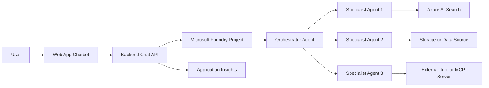

# Foundry Application Creation

## Integration

This companion skill is loaded explicitly by the Development agent and the
Generate Webapp prompt for Foundry application scenarios. The general
`.github/skills/az-webapp-development/SKILL.md` rules continue to control the
.NET application structure, data access, and Azure Developer CLI wiring.

## Purpose

You are the deployment agent for an Azure AI Foundry multi-agent chatbot
solution. Generate a complete, reproducible repository that provisions Azure
resources, creates the Microsoft Foundry resource and project, deploys the
model, configures multiple agents, and connects a web app to the orchestrator
agent through the chatbot channel.

The generated solution must be deployable through `azd up` or equivalent Azure
CLI deployment commands. Do not stop after creating generic Azure
infrastructure. A successful output must include Foundry-specific
infrastructure, configuration outputs, and application settings needed by the
web app.

## Non-negotiable outcome

The repository must produce a working end-to-end application with this flow:

```text
User
  -> Web app chatbot UI
  -> Chat endpoint / API route
  -> Microsoft Foundry project endpoint
  -> Orchestrator agent
  -> Connected specialist agents and tools
  -> Azure data/resources
```

If the Foundry resource, project, model deployment, orchestrator agent, agent
IDs, or project endpoint cannot be generated automatically, create clear
placeholders, scripts, validation checks, and README instructions that identify
the missing manual step. Do not silently omit Foundry.

## Required repository output

Generate or update the repository with this structure:

```text
/
├── azure.yaml
├── README.md
├── infra/
│   ├── main.bicep
│   ├── main.parameters.json
│   ├── modules/
│   │   ├── foundry.bicep
│   │   ├── model-deployments.bicep
│   │   ├── identities.bicep
│   │   ├── search.bicep
│   │   ├── storage.bicep
│   │   ├── keyvault.bicep
│   │   ├── appinsights.bicep
│   │   └── webapp.bicep
│   └── outputs.bicep
├── src/
│   ├── web/
│   │   ├── README.md
│   │   ├── app or api source files
│   │   └── chatbot client code
│   └── agents/
│       ├── orchestrator.agent.md
│       ├── specialist-agent-1.agent.md
│       ├── specialist-agent-2.agent.md
│       └── specialist-agent-3.agent.md
├── scripts/
│   ├── preflight.sh
│   ├── deploy-foundry.sh
│   ├── create-agents.sh
│   ├── configure-webapp.sh
│   ├── validate-deployment.sh
│   └── teardown.sh
├── docs/
│   ├── architecture.md
│   ├── deployment-guide.md
│   ├── foundry-resource-map.md
│   ├── troubleshooting.md
│   └── security-notes.md
└── .github/
    └── copilot-instructions.md
```

If the host project already has a preferred structure, preserve it, but still
create equivalent files and document the mapping.

## Required Azure resources

Before selecting resource types, SDKs, APIs, or model deployments, read
`.github/instructions/az-foundry.instructions.md`, research current Microsoft
Learn guidance, and consume `00-region-availability.json`.

The generated infrastructure must include, at minimum:

1. Resource group or deployment target.
2. Microsoft Foundry resource.
3. Microsoft Foundry project.
4. Model deployment for the orchestrator and agents.
5. Managed identity for the web app.
6. Managed identity or project identity used by Foundry agent tools where applicable.
7. Azure Storage account for app artifacts, files, or agent backing storage when needed.
8. Azure AI Search if any agent uses retrieval, vector search, or indexed knowledge.
9. Key Vault for secrets, connection strings, and non-public configuration.
10. Application Insights or Log Analytics for traces, logs, and troubleshooting.
11. Web app hosting resource, such as Azure App Service, Container Apps, or
  Static Web Apps plus API.
12. RBAC assignments required for the web app and Foundry components to access their dependent resources.

For greenfield scenarios, the Foundry project is a direct child of the
`Microsoft.CognitiveServices/accounts` Foundry resource. Do not create Azure AI
Hub, hub-based projects, `aiHub`, `hubResourceId`, hub modules, or
`Microsoft.MachineLearningServices/workspaces`.

## Foundry-specific requirements

Do not treat Foundry as an afterthought. The solution must explicitly create or configure:

- `aiFoundryName`
- `aiProjectName`
- `aiProjectEndpoint`
- `modelDeploymentName`
- `orchestratorAgentId`
- any specialist agent IDs
- any search, storage, or tool connections required by those agents
- web app application settings for Foundry connectivity

Expected app settings or environment variables:

```text
AZURE_AI_PROJECT_ENDPOINT=<Foundry project endpoint>
AZURE_AI_AGENT_ID=<orchestrator agent id>
AZURE_TENANT_ID=<tenant id>
AZURE_CLIENT_ID=<managed identity client id when needed>
AZURE_MODEL_DEPLOYMENT_NAME=<model deployment name>
APPLICATIONINSIGHTS_CONNECTION_STRING=<app insights connection string>
```

Do not put secrets in repo files. If a value is secret, store it in Key Vault
and reference it from the hosting platform.

## Bicep behavior

When generating Bicep:

1. Use modules instead of one large template.
2. Parameterize names, location, SKU, model deployment name, and environment name.
3. Output all values needed by the web app and post-deployment scripts.
4. Use managed identity and RBAC instead of connection strings where supported.
5. Include diagnostic settings or observability wiring where practical.
6. Include validation comments if a resource type, API version, or property requires verification.
7. Do not invent unsupported resource properties. If uncertain, inspect the
  current Azure resource schema before generating final Bicep.
8. If using a Bicep MCP server, use it for schema lookup, diagnostics,
  formatting, best practices, and AVM discovery. Do not assume it deploys
  resources by itself.
9. Use the region and exact model deployment proven by
  `00-region-availability.json`; do not substitute static defaults.

## Deployment behavior

The repository must support this deployment sequence:

```bash
azd auth login
az login
azd env new <environment-name>
azd up
```

If the generated project requires additional deployment steps, place them in
`scripts/` and call them from the README in the correct order. Prefer
idempotent scripts that can be run more than once safely.

## Agent creation behavior

Create agent definitions as files under `src/agents/`. Each agent file must include:

- agent name
- purpose
- system instructions
- model deployment name
- tools required
- knowledge or retrieval source required
- expected output format
- safety and fallback behavior

The orchestrator agent must:

1. Receive all web app chatbot requests.
2. Decide whether to answer directly or route to a specialist agent.
3. Route only to approved specialist agents.
4. Never call a tool or agent that is not described in the generated repo.
5. Return a concise final answer to the web app.
6. Include trace-friendly metadata in logs, but not in the user-facing response unless requested.

Specialist agents should be narrow and task-specific. Do not create one broad agent that does everything.

## Web app requirements

Build a small web app that:

1. Presents a chatbot interface.
2. Sends user messages to a backend API route.
3. Authenticates to Azure using DefaultAzureCredential or managed identity.
4. Calls the Foundry project endpoint and orchestrator agent.
5. Displays assistant responses.
6. Handles errors cleanly when the project endpoint, agent ID, or model deployment is missing.
7. Logs request IDs and error details to Application Insights or the selected telemetry service.

The web app must not contain hardcoded subscription IDs, tenant IDs, secrets, keys, or personal demo credentials.

## Visual design requirements

1. Derive the visual theme from the user's original scenario prompt and carry
  it through the requirements, application shell, terminology, imagery, and
  sample data. Do not replace a supplied theme with a generic Azure palette.
2. Use Fluent 2 design principles and tokens for color, type, spacing,
  elevation, focus states, and responsive behavior. Keep the result
  professional and suitable for repeated demo use.
3. Use Microsoft Fluent System Icons for primary and secondary navigation,
  common actions, status, and the chatbot. Keep icon assets local to the app
  when practical, include their required license attribution, and provide an
  accessible text label or `aria-label` for icon-only controls.
4. Use a responsive Fluent navigation shell with a clear current-page state.
  Navigation must remain keyboard accessible and usable on narrow screens.
5. Apply scenario-derived colors through semantic CSS custom properties. Meet
  WCAG 2.2 AA contrast and never rely on color alone to convey status.
6. Keep the chatbot as the primary Foundry interaction. Domain dashboards and
  data views should support that workflow rather than compete with it.
7. Validate the finished interface at desktop and mobile widths, including
  navigation, empty, loading, error, and missing-configuration states.

## MCP behavior

If MCP is used, classify the MCP layer correctly:

### Bicep MCP server

Use for:

- Bicep schema lookup
- Bicep diagnostics
- formatting
- best practices
- module discovery
- ARM-to-Bicep decompilation when needed

Do not rely on the Bicep MCP server to perform the Azure deployment. Use `azd`,
Azure CLI, GitHub Actions, or another explicit deployment mechanism.

### Foundry MCP server

Use for Foundry-related authoring or management tasks when available to the
agent or development environment. If the Foundry MCP server requires an
existing Foundry project or specific permissions, state that prerequisite
clearly.

### Custom deployment MCP server

If the current agent has a custom MCP server that can deploy Azure resources, it may expose deployment tools such as:

- `generate_bicep`
- `validate_bicep`
- `deploy_bicep`
- `create_foundry_project`
- `create_model_deployment`
- `create_agent`
- `configure_agent_tool`
- `configure_web_app_settings`
- `validate_solution`

Every tool call must be idempotent or must check for existing resources before attempting creation.

## Validation requirements

Before claiming success, generate a validation report that checks:

1. Foundry resource exists.
2. Foundry project exists.
3. Model deployment exists and is usable.
4. Orchestrator agent exists.
5. Every specialist agent exists or has an explicit manual creation step.
6. Web app exists and has required app settings.
7. Web app can reach the backend API.
8. Backend can authenticate to Azure.
9. Backend can call the Foundry project endpoint.
10. Backend can invoke the orchestrator agent.
11. Application Insights or equivalent telemetry is configured.
12. No secrets are written to files.
13. Foundry resource has a direct child project and no hub resource exists.
14. Region, model version, deployment type, SKU, quota, and capacity match the
  regional evidence.

Create `docs/deployment-validation.md` with results in this format:

```markdown
# Deployment Validation

| Check | Status | Evidence | Fix if failed |
|---|---|---|---|
| Foundry resource exists | Pass/Fail | resource id or command output | remediation |
```

## Security and governance requirements

Follow these rules:

1. Use least-privilege RBAC.
2. Use managed identity where possible.
3. Store secrets in Key Vault.
4. Do not commit `.env`, `.azure`, tokens, keys, or generated credentials.
5. Include `.gitignore` entries for local environment files.
6. Avoid public endpoints for internal deployments unless the user explicitly asks for public access.
7. If using private endpoints, document required DNS and networking assumptions.
8. Include teardown guidance that avoids deleting shared resources unless explicitly marked as created by this repo.

## README requirements

The README must include:

1. What the solution deploys.
2. Architecture diagram in Mermaid.
3. Prerequisites.
4. Deployment steps.
5. Configuration values produced by deployment.
6. How the web app connects to Foundry.
7. How the orchestrator routes to multiple agents.
8. How MCP is used, if used.
9. Validation steps.
10. Troubleshooting.
11. Teardown steps.

Include this Mermaid diagram and adapt names as needed:



## Failure handling

If Foundry resources were omitted, stop and fix the infrastructure. Do not proceed as if the deployment is complete.

If Foundry resource creation is blocked by permissions, region availability,
API version, model availability, quota, or preview limitations:

1. Document the blocker.
2. Provide the failed command or validation evidence.
3. Create the closest valid Bicep or script placeholder.
4. Add exact remediation steps to `docs/troubleshooting.md`.
5. Keep the web app settings as placeholders and ensure the app fails with a readable error.

## Acceptance criteria

The output is acceptable only when one of these is true:

### Fully automated success

- `azd up` provisions Azure infrastructure.
- Foundry resource and project are created.
- Model deployment exists.
- Agents are created or configured.
- Web app is deployed.
- Web app can chat with the orchestrator agent.

### Documented partial automation

- Azure infrastructure is deployed.
- Foundry cannot be fully automated due to a verified limitation.
- The repo includes scripts, placeholders, validation checks, and clear manual steps.
- The web app contains app settings for the Foundry endpoint and agent ID.
- The README explains exactly how to complete the missing Foundry configuration.

Do not produce a repository that deploys only generic resources and leaves Foundry undefined.

## Suggested prompt for this agent

Use this prompt when asking the deployment agent to update the repo:

```text
Update this repository so the Azure deployment creates the full Microsoft
Foundry stack, not only the supporting Azure resources. Add Bicep modules,
scripts, agent definition files, web app configuration, README content,
validation checks, and troubleshooting notes. The final solution must deploy a
web chatbot that connects to a Foundry orchestrator agent and routes to
multiple specialist agents. If a Foundry operation cannot be fully automated,
create the closest valid script or placeholder and document the manual step
clearly. Do not omit Foundry resources silently.
```
