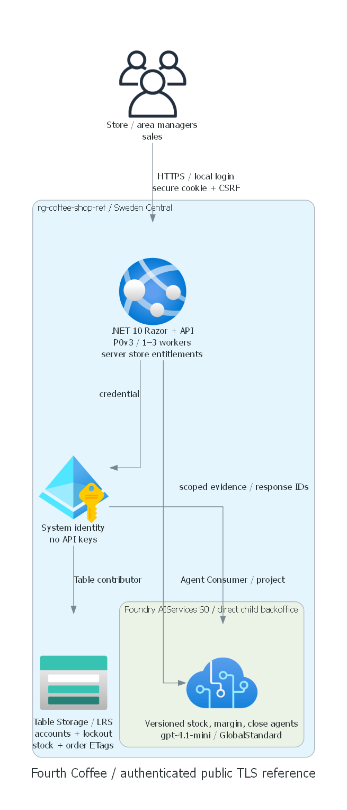
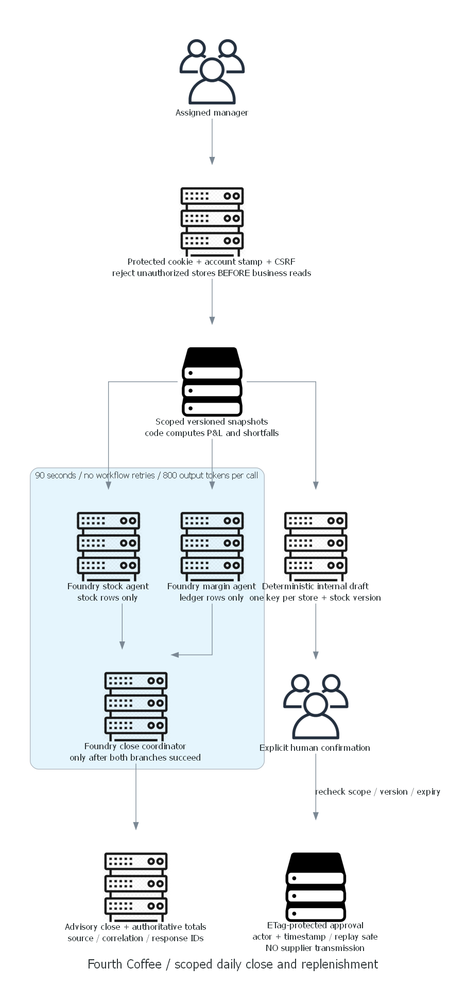

# Fourth Coffee architecture assessment

## Requirements Validation

Exact intake: Hospitality & Travel; businessUnits `["sales"]`; services `["foundry"]`;
pillars `["performance-efficiency"]`; domains `["scaling"]`.
Sales-led stock availability and daily margin review drive every persona, seed record and API.
Three stores are a vertical slice, not evidence of large-scale capacity.

## Recommended architecture

Browser local login -> secure HttpOnly session cookie -> .NET 10 Razor Pages + authenticated APIs.
Server verifies a salted PBKDF2 password hash and persistent account lockout, then issues a protected cookie
with server-owned role/store claims. Every authenticated request rechecks the account security stamp and lockout.
CSRF tokens protect login, logout and all business POST APIs; cookies expire after 30 minutes without renewal.
No store IDs from prompts or request bodies override server entitlements.
Application system identity reads/writes store-partitioned Azure Tables and invokes version-pinned Foundry agents.
Foundry is one AIServices account with a direct child project, not a hub.

## Agentic runtime contract

- Primary pattern 03 Concurrent / Fan-Out-Fan-In: stock and margin branches, then coordinator.
- .NET application orchestration invokes real persisted declarative/prompt agents in Foundry.
  It is not a Foundry-hosted workflow definition or a claim that native workflow execution has been proved.
- Single-agent baseline is simpler; two independent evidence domains and partial-failure visibility justify separation.
- Stock agent sees only stock rows; margin agent sees only daily ledgers; coordinator sees scoped branch receipts.
- Deterministic code owns totals, shortages, permissions and approval. Agents receive no write tools.
- Shared state: Table partition = store ID; snapshot row + order rows with ETags.
  Approval mutates one order row atomically and preserves actor/time. Same store/snapshot yields one draft.
- No supplier side effect, reservation or ledger posting. A stock update invalidates unapproved older drafts.
  External integrations need transactional reservations/outbox before real supplier transmission.
- Limits: 5 stores, 2 parallel branches, 1 coordinator, 800 output tokens each, 90 seconds overall,
  2 close requests per app instance, 6 requests/user/minute/instance. Limits are per-instance, not global.
- No model loops or automatic retry. Any branch failure blocks coordinator/success.
  This is no application/workflow retry; SDK transport retries remain within the shared deadline
  and may increase billed tokens. No ordering side effect is accessible to any agent.
  Responses are stateless per request and stored-output disabled. Narrative is advisory and safely text-rendered.
- Source IDs/versions and correlation/response IDs enable review without hidden chain-of-thought.
  Missing ledger blocks close, but inventory remains inspectable.

## Resource SKU Recommendations

| Resource | Proposed configuration |
| --- | --- |
| Resource group | `rg-coffee-shop-ref`; tagged with scenario/environment/management metadata |
| Foundry account | AIServices S0, local auth disabled, public TLS, project management enabled |
| Direct child project | `backoffice`; system identity |
| Model | gpt-4.1-mini / 2025-04-14 / GlobalStandard / capacity 30 |
| App Service plan | Linux P0v3, 1 baseline worker, automatic scaling cap 3, no zone redundancy |
| Web app | .NET 10, TLS >= 1.2, system identity, affinity off, FTP/basic SCM publishing disabled |
| Storage | StorageV2 Standard_LRS, Table service, TLS >= 1.2, shared keys/public blobs disabled |
| User authentication | Three local Table-backed accounts; no Entra registration, consent or directory account |

Region: swedencentral, approved after actual ARM what-if; eastus2 rejected by actual P0v3 validation.
GlobalStandard may process prompts outside the resource region. No residency requirement was supplied.
No availability-zone requirement was supplied; one baseline worker is not high availability.
No Search, Cosmos, Key Vault or container registry is added: scoped structured grounding requires none;
there are no service API keys or client secrets. Local account hashes remain in Tables.
Monitor is structured app logs and platform metrics for this reference,
not a centralized production audit or distributed-tracing stack.

## Local login and backend identity

The user explicitly replaced Entra browser authentication with application-local accounts on 24 October 2026.
`storeman001` sees 001, `storeman002` sees 002, and `petender` sees 001/002 as AreaManager.
No Graph write, directory application, service principal for user login, consent or tenant admin action is required.
Azure system-assigned managed identities remain for backend service authentication and least-privilege RBAC.

Postprovision bootstrap installs users with independently salted ASP.NET Identity PBKDF2 hashes
(SHA-512, 210,000 iterations), stable security stamps and Table ETag-protected lockout state.
Five failures cause a 15-minute account lockout shared by all web workers; login is also rate-limited per IP/worker.
Existing accounts are verified rather than silently overwritten on retries. Passwords enter through process
environment only; no plaintext password is passed to ARM, azd environment files, source or logs.
The area password is generated separately and retained only in an operator-local Windows DPAPI credential receipt.

Secure, HttpOnly, SameSite=Strict cookies expire after 30 minutes; all POST APIs require antiforgery tokens.
Data Protection keys persist under the App Service shared HOME for scale-out/restart continuity.
Keys use the platform filesystem's access/encryption boundary, not an additional application-level key vault.
Changing an account security stamp revokes its sessions. These shared dummy credentials are demo-only:
no MFA, password-reset workflow or production account lifecycle is claimed.

App identity: Foundry Agent Consumer at project scope, resolved by exact current role name during authorized readiness.
The recent role rename/consumer role is in Learn conceptual guidance but absent from the fetched built-in-role listing.
Do not guess its GUID or silently substitute the broader Foundry User.
If the actual tenant lacks it, stop for design review.
Installer user: Foundry User on account for version installation, Storage Table Data Contributor on scenario storage.
Project MI: Foundry User on its own parent account per official guidance.
App MI: Storage Table Data Contributor on scenario storage. This spans all scenario stores:
application-level authorization is therefore a critical boundary, not storage-enforced per-user isolation.

Runtime repair verified on 24 October 2026: Consumer does not authorize the project developer Responses route.
Bootstrap configures each agent's Responses endpoint with a 100% fixed-ratio selector for its installed version.
The application uses `GetProjectResponsesClientForAgentEndpoint`, not the project development API.
The app retains project-scoped Foundry Agent Consumer; no broader developer role was granted.
The installed SDK supports this endpoint API without a package upgrade.

## Management and deployment access

No private-only workload was requested. Approved public TLS/managed-identity/RBAC services let this actual Windows
VS Code host publish via ARM/SCM, install Tables/agents over service endpoints, and run authenticated tests.
No private DNS, Bastion, VM, VPN or implicit connected-runner assumption is introduced.
Local azd hooks use the current authorized installer; deployed calls use only system managed identity.
If public endpoints are rejected in review, redesign network AND management path before provisioning.

Lifecycle: authorized readiness -> ARM what-if -> deployment consent -> preprovision exact-target assertion ->
ARM resources/RBAC -> postprovision local account/fixture/agent installation ->
real app settings -> azd package/publish -> live acceptance. No directory installation phase remains.
No remote image build or Docker is needed. Generated endpoint strings must be verified against deployed outputs.

## WAF assessment and scaling trade-offs

Performance efficiency: store partitioning, exact-key reads, bounded payload/concurrency and independent agents.
App Service can scale to 3 instances; Azure model quota is shared and can throttle before web compute.
At that cap, up to 6 closes / 12 simultaneous branch calls are possible; do not describe this as unbounded scale.
Do not add gateways/queues/caches before measuring. Load target: 10 concurrent users, close p95 < 60 s,
scoped read p95 < 1 s; live load proof remains pending.
Security: local authenticated public entry, no WAF/private endpoints; dummy accounts are reference-only.
Reliability: LRS and one worker deliberately lower cost, no disaster recovery or regional failover.
Operational excellence: version/hash-pinned agent install, ETags, safe failure, explicit dependency outputs and logs.
Cost optimization: one small model deployment, no retrieval index or container dependencies.

## Cost estimate

Planning estimate, USD/pay-as-you-go, 730 h/month, 24 October 2026; not an Azure quote or spending cap:
P0v3 Linux budget $60–$100/month per active worker, 1–3 workers = $60–$300.
Storage/transactions and modest diagnostics/egress allowance $5–$20/month.
Illustrative 10,000 closes/month, 3 calls/close, 6,000 total input and 1,500 output tokens/close:
60M input + 15M output tokens. At illustrative $0.40/M input and $1.60/M output = $48/month inference.
Expected reference budget $115–$370/month under these assumptions; burst, pricing changes and extra load increase it.
These are explicit assumptions, not fetched live prices. Refresh regional retail prices during authorized readiness.
No paid directory licensing feature or user-login directory installation is required.
Stopping the web app does not stop plan charges. Resource cleanup requires a separate explicit request.
There are no scenario-created user-login registrations to clean up.

## Evidence and unresolved review

Official public sources read 24 October 2026:

- [New Agent Service and role separation][agents]
- [C# Responses API quickstart][responses]
- [Classic migration and persisted agent version model][migration]
- [Current regions/limits][limits]
- [Model catalog and availability links][models]
- [Foundry RBAC and consumer role][rbac]
- [SPA configuration][spa]
- [Direct child project schema][project]

Resolved SDK packages through actual NuGet restore: Azure.AI.Projects 3.0.0-beta.5,
Azure.AI.Extensions.OpenAI 3.0.0-beta.5, Azure.Identity 1.21.0, Azure.Data.Tables 12.13.0.
SDK APIs were inspected, compiled and exercised against real deployed agent endpoints.
Preview SDK/service compatibility remains an operational risk.
AVM versions/interfaces were checked in official source and the public MCR registry, then compiled.

Initial construction was local-only. After explicit read-only confirmation on 24 October 2026,
actual subscription, provider, model/quota, runtime, ARM and directory observations were collected.
East US 2 failed actual ARM P0v3 validation despite apparently sufficient usage metadata.
Sweden Central what-if succeeded with 16 creates and no deletes; a three-worker validation also succeeded.
Sweden Central was recommended, then explicitly approved for deployment in the next user response.
The model is currently listed Legacy with reported inference deprecation on 14 April 2027.
The same response removed Entra user authentication; local credentials replace the directory installation.
No directory writes were performed. Local authentication, model inference, all three agents,
application chat, grounding, order replay, negative cases and actual branch-failure recovery are now verified.
Fetched Sweden Central Linux P0v3 price is USD 0.089/hour; approximate total is USD 120-270/month
under the same illustrative inference/storage assumptions. This supersedes the initial worker estimate above.
See [the current region matrix](00-region-availability.json) and
[consolidated review](06-deployment-review.md) for the authorized scope.

## Architecture Decision Summary

The deployed reference demonstrates sales-led stock readiness, human-approved internal ordering and daily close.
Actual browser evidence is in `evidence/browser-checks.json`; the deployed URL is in the deployment summary.
One area close took 9.50 s. Ten concurrent reads measured p95 2.41 s against the original 1 s target.
Ten simultaneous close attempts completed 2 and explicitly rejected 8 under the reviewed per-instance guard.
The ten-user close p95 cannot be claimed and the performance targets remain unmet.
No thresholds were relaxed and rejected closes were not counted as successful latency samples.
This bounded demo and its public-network, single-baseline-worker, preview-SDK and legacy-model limitations
are presented for explicit suitability review, not as production certification or automatic hack approval.

Endpoint migration guidance:
https://learn.microsoft.com/en-us/azure/foundry/agents/how-to/migrate-agent-applications

[agents]: https://learn.microsoft.com/en-us/azure/foundry/agents/overview
[responses]: https://learn.microsoft.com/en-us/azure/foundry/agents/quickstarts/responses-api
[migration]: https://learn.microsoft.com/en-us/azure/foundry/agents/how-to/migrate
[limits]: https://learn.microsoft.com/en-us/azure/foundry/agents/concepts/limits-quotas-regions
[models]: https://learn.microsoft.com/en-us/azure/foundry/foundry-models/concepts/models-sold-directly-by-azure
[rbac]: https://learn.microsoft.com/en-us/azure/foundry/concepts/rbac-foundry
[spa]: https://learn.microsoft.com/en-us/entra/identity-platform/scenario-spa-app-configuration
[project]: https://learn.microsoft.com/en-us/azure/templates/microsoft.cognitiveservices/2025-06-01/accounts/projects
