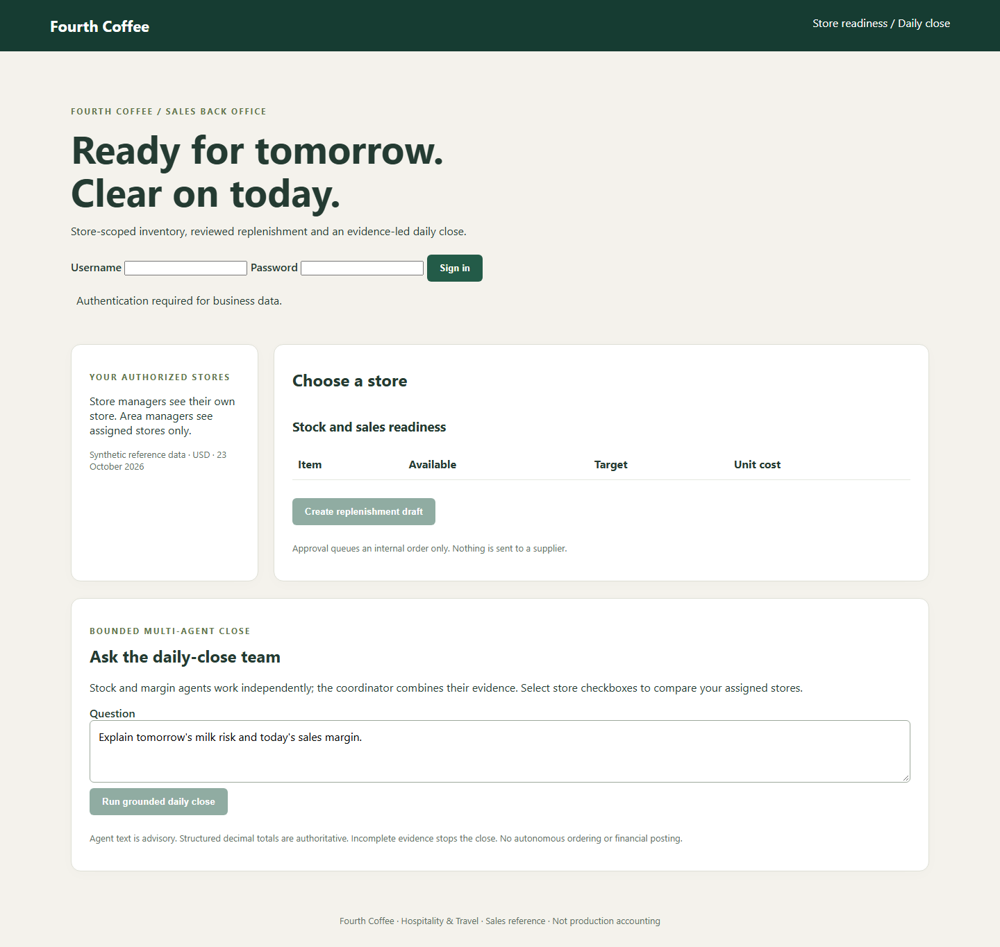
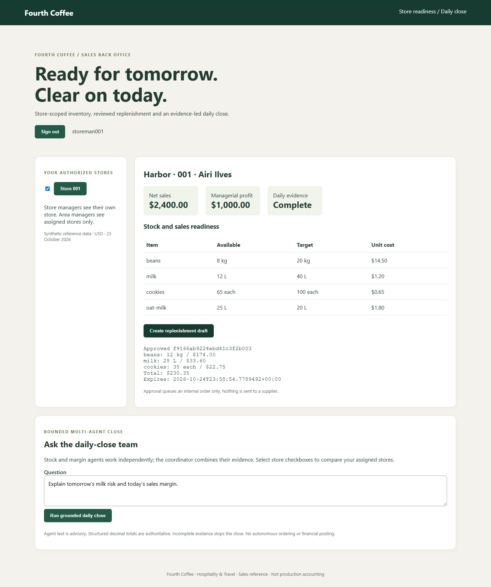
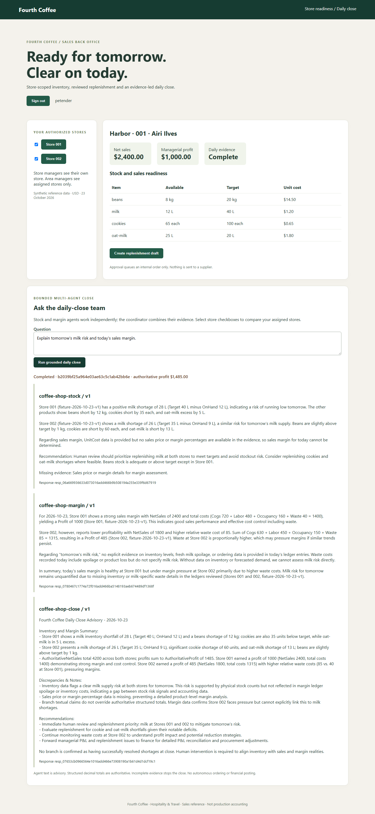

# Fourth Coffee reference walkthrough

## Status and audience

**Executed deployed walkthrough, 24-25 October 2026 UTC.**
App: https://web-fc-keegvmxonq3wc.azurewebsites.net/
Audience: store/area sales managers and technical reviewers in Hospitality & Travel.
Business-unit scope remains `["sales"]`; finance is the daily-close recipient, not an added selected unit.

Story: Airi Ilves reviews Harbor store 001; Hasan Ibrahimov manages Station 002.
Nemanja Milatovic is the north-area fixture persona. Nino Kapanadze manages Park 003 in the south.
All display names come from the repository people CSV; technical login accounts are separate.

## Prerequisites

Deployment was approved for Sweden Central with local account authentication.
`azd up` and the endpoint-repair `azd deploy` succeeded; real agents and local grants are installed.
The actual browser and API walkthroughs passed. No directory installation or consent is required.
Use separately supplied store credentials and the operator-local protected area-manager receipt.
Do not expose password fields, cookies or tokens in screenshots.

## Ten-minute live walkthrough

1. Open the deployed HTTPS URL. Landing page is public but contains no store data.
   Sign in as local account `storeman001`, assigned StoreManager and store 001.
   Use the separately supplied installation password; never place passwords in screenshots or this guide.
1. Verify only 001 appears. Harbor inventory has 8 kg beans, 12 L milk and 65 cookies.
   Daily managerial profit is $1,000 from $2,400 net sales minus $720 COGS,
   $480 labor, $160 occupancy and $40 waste. UI states USD and fixture date.
1. Create a replenishment draft. Expect 12 kg beans, 28 L milk and 35 cookies; total $230.35.
   Oat milk is above target and must not be ordered. Review quantities, units and price before confirming.
1. Confirm internal approval. Record draft ID, approver account/time. Retry the same action:
   it returns the same receipt, not another supplier order. No supplier message is sent.
1. Ask "Explain tomorrow's milk risk and today's sales margin." Capture the real stock/margin/coordinator
   agent names, immutable versions, response IDs and close correlation. Verify source citations and structured totals.
   No receipt or plausible prose alone proves that the model respected grounding.
1. Sign out and sign in as `petender` using the operator-local protected credential receipt.
   Select 001/002. Expect $4,200 net sales and $1,485 managerial profit.
   Compare milk shortages and waste; avoid unsubstantiated explanations of causality.
1. Negative: store 001 session requests `/api/stores/002` or posts close for 002.
   Expect 403 before business data reads/inference; account-state validation still reads the account partition.
   Anonymous business API request must return 401. A crafted `X-MS-CLIENT-PRINCIPAL` header cannot authenticate.
1. Both deployed store accounts and the area account must be denied store 003.
   Incomplete-ledger and branch-failure recovery are also covered by isolated tests;
   do not grant a new live user/store merely to demonstrate a negative case.
1. Explain the finance handoff: human-reviewed managerial close, not a posted statutory P&L.

## Failure and recovery

- Agent 429/timeout/unavailable: do not mark completed. Capture real dependency failure and correlation.
  Retry a close after the fault clears; no order should have been written by chat.
- Missing ledger: fix authorized source evidence with a new snapshot version, then rerun close.
  Never invent ledger figures or change `Complete` to conceal missing evidence.
- Stale/expired draft: approval is blocked. Refresh evidence and regenerate/renew draft; review again.
- Competing approvals: ETag update/re-read returns one approved receipt; preserve the original actor/time.
- Sign-in denial: verify initialized local account, store grants, password and lockout expiry.
  Missing/invalid CSRF tokens require a fresh session request, not disabling antiforgery.
- MI 403 immediately after install: inspect exact scope/role, propagation and endpoint route.
  Agent Consumer must call the agent endpoint, not the project developer Responses API.
  Do not substitute API keys or silently broaden the runtime role.
- Cleanup is separately authorized. This design created no Entra user-login registrations or consent.

## Executed branch failure and recovery

The actual missing-margin-endpoint fault returned HTTP 503 in 4.12 seconds with:
`Dependency unavailable; no successful close claimed.`
The body contained a trace ID and no completed close or agent receipts.
See [actual fault receipt](../evidence/live-branch-failure.json).
Restoring the setting and restarting recovered the real three-agent close, verified by the complete live runner.
An earlier attempt hit the old process before settings applied; it is retained as a failed transition test,
not represented as proof of failure handling.

To repeat only under the reference's authorized runtime-test scope, pause other demonstrations.
From this scenario directory, first supply installation passwords in the current process environment,
then run the bounded fault and mandatory restoration:

```powershell
$target = @('--subscription', 'efd64343-6ef4-4926-951f-d3229f38bd76',
    '--resource-group', 'rg-coffee-shop-ref', '--name', 'web-fc-keegvmxonq3wc')
try {
    az webapp config appsettings set @target `
        --settings Foundry__margin__Name=coffee-shop-margin-failure-check --output none
    if ($LASTEXITCODE -ne 0) { throw 'Fault configuration failed.' }
    az webapp restart @target --output none
    if ($LASTEXITCODE -ne 0) { throw 'Fault restart failed.' }
    Start-Sleep -Seconds 20
    python scripts\validate_live.py --authorized --branch-failure
    if ($LASTEXITCODE -ne 0) { throw 'Actual branch-failure check failed.' }
} finally {
    az webapp config appsettings set @target --settings Foundry__margin__Name=coffee-shop-margin --output none
    if ($LASTEXITCODE -ne 0) { throw 'RESTORE FAILED: restore the margin agent setting.' }
    az webapp restart @target --output none
    if ($LASTEXITCODE -ne 0) { throw 'Recovery restart failed.' }
}
python scripts\validate_live.py --authorized
if ($LASTEXITCODE -ne 0) { throw 'Recovery is not verified.' }
```

This is a real dependency fault, not a hidden production simulation switch.
The close path cannot approve an order. Fault testing must not alter account/store entitlements or ledgers.

## Proof and limitations

Local results: [31 passing tests and exact commands](../evidence/local-checks.json).
Live results: [real model, grounded close, orders and negatives](../evidence/live-checks.json).
UI results: [executed Playwright assertions](../evidence/browser-checks.json).
Load results: [ten actual simultaneous close attempts](../evidence/live-concurrency.json).







The screenshots were captured from the deployed HTTPS app, after password fields were cleared.
Azure Portal screenshots are not available; actual ARM/azd receipts and live calls are the labeled fallback.

One complete area close took 9.50 seconds.
Ten concurrent HTTPS reads had p95 2.41 seconds, so the original 1-second target was not met.
Ten simultaneous closes produced 2 completed responses and 8 explicit HTTP 409 busy responses.
The ten-user close target is **not met**; no p95 over successful work alone conceals rejected work.
These are ten-request smoke samples using three identities; sustained load and automatic scale-out are unproved.
The two-close-per-instance guard remains intentional; retry admitted work after the burst subsides.

Estimated USD 120-270/month is illustrative, not a cap.
Public networking, no WAF, non-HA baseline, shared dummy credentials, preview SDK and legacy model remain.
No production SLO, supplier transmission or statutory ledger posting is claimed.
Present the fingerprinted functional reference and these limitations, then wait for explicit suitability approval.
Deployment consent did not authorize hack composition, event rollout or publication.
