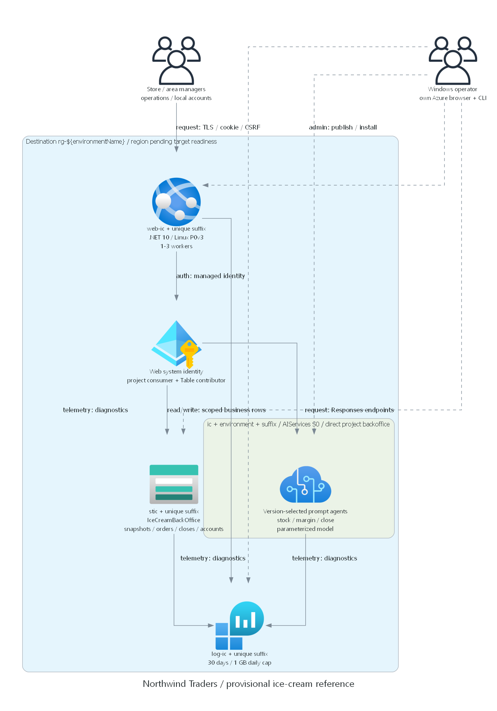

# Northwind Traders reference architecture

> Generated by az-01-conductor agent | 2026-10-29

## Requirements Validation

Hospitality & Travel / operations drives recipe consumption, spoilage, replenishment and managerial close.
Ten stores form two five-store areas; area scope never means all stores.
Source application and AVM patterns are reused, not source targets, consent or runtime claims.

### Agentic runtime contract

Browser -> local cookie authentication -> entitlement checks -> authorized snapshots -> variable work assignments.
For N stores, create N stock and N margin tasks, execute at most four concurrently per request,
then invoke a real Foundry close synthesizer. Typed assignment receipts carry store/domain/snapshot version.
Any missing or duplicate receipt fails the report. Deterministic calculations remain authoritative.
Synthesis receives only authorized authoritative ledger/closing-stock snapshots alongside worker receipts.
Prompt corrections alone have not eliminated unsupported cost commentary; semantic acceptance remains failed.
Persist the resulting report as AwaitingReview; explicit manager confirmation and version checks finalize it.
Agents cannot transmit orders, update stock or post financial entries.
One store needs three logical calls; an area of five needs eleven; maximum ten needs twenty-one.
Output cap 400 tokens/call, input cap 24,000 characters/call, shared 55-second deadline.
Ten concurrent workflows and forty agent calls/instance prevent the source's two-workflow bottleneck.
These settings are testable limits, not proof the live latency target is met.
SDK transient retries may consume more tokens inside the same deadline; no independent action retries.

Foundry prompt agents are invoked through the existing C# Responses endpoint adapter.
Orchestration is application-hosted, not a claim that Foundry native workflows were deployed.
Basic service-managed state is sufficient for stateless structured grounding without files, vector stores or tools.
Standard customer-managed agent state adds services and operations with no current requirement.
The business Table account is distinct from Foundry's managed state.

### Management and deployment access

Proposed public authenticated TLS allows the user's current Windows VS Code host to publish and initialize.
Human browser/CLI administration uses that user's own Entra credentials, not the web app identity.
No private VM, Bastion, VPN, network or unrestricted management port is introduced.
Public service access is a review item, not inherited source authorization.
If private-only service access is required, redesign operator browser/CLI access AND unattended execution first.

Initialization order: confirm target -> authorized readiness/what-if -> explicit deployment consent ->
ARM/RBAC -> generated private local credentials -> Table fixtures and versioned Foundry agents ->
endpoint settings -> publish -> runtime/deployer acceptance.
Readiness, what-if, explicitly approved provisioning, initialization and publishing are complete.
Operator and business/security checks passed; latest read-latency and narrative-grounding acceptance failed.
Local hooks run on the Windows host, not magically inside an Azure VNet.

### Deployment-user access matrix

Authorized target: subscription `efd64343-6ef4-4926-951f-d3229f38bd76`,
tenant `16b3c013-d300-468d-ac64-7eda0820b6d3`.
Deploying user object ID: `214d672b-df87-4f3b-94fd-7863032546c1`.
Existing inherited Owner and Foundry User grants were verified and are reused, not duplicated.
New role assignments are scoped to this scenario, never the subscription or tenant.

| Component | Control administration | Full data management | User-credential acceptance |
| --- | --- | --- | --- |
| RG / app / plan | Inherited Owner | Publish, settings, restart, logs | Read/update safe setting |
| Foundry/project/model | Inherited Owner + Foundry User | Agent CRUD and inference | Disposable agent + inference |
| Table account | Inherited Owner | Storage Table Data Contributor | List/read and disposable entity CRUD |
| Log Analytics | Inherited Owner | Log Analytics Contributor | Query diagnostic data, inspect retention/settings |
| Role installation | Existing scoped grant authority | No tenant elevation | Verify before provisioning |

The app gets Table Data Contributor and project-scoped Agent Consumer only.
Project identity receives the documented account-level Foundry User grant.
The deployer's workload administration rights are not copied to the app.
Missing grant authority or any unverified data administration blocks reference completion.

### Recommended architecture

## Resource SKU Recommendations

| Resource | Reviewed and deployed configuration |
| --- | --- |
| Foundry | AIServices S0; system identity; disable local keys; direct project backoffice |
| Model | gpt-4.1-mini / 2025-04-14 / GlobalStandard; Legacy, inference deprecation 2027-04-14 |
| Model capacity | 300 units = 300,000 TPM; observed 4,980 available against global limit 5,000 |
| App plan | Linux P0v3, one baseline, automatic scale cap three; not HA/zone redundant |
| Web | .NET 10; secure local cookies; managed identity; TLS; no basic SCM/FTP credentials |
| Business data | StorageV2 Standard_LRS; IceCreamBackOffice Table; shared keys/public blobs disabled |
| Diagnostics | Log Analytics PerGB2018, 30 days, 1 GB/day ingestion cap; cap is not a hard spend ceiling |

Read `00-region-availability.json` for the selected region: Sweden Central.
On 30 October 2026, exact-target metadata, providers, quota and ARM what-if passed.
Linux P0v3 is listed in-region; Microsoft.Web reports 0/11 total regional VMs against a three-worker cap.
West Europe and UK South have supporting metadata but were not subjected to a complete target what-if.
GlobalStandard processing may leave the resource region; no residency requirement was supplied.
Do not silently migrate the model: retain the reviewed Legacy version only with explicit deployment acceptance.

## Architecture Decision Summary

- Keep reusable Table, .NET and Foundry adapters; retain internal CoffeeShop namespace to minimize unrelated churn.
  All user-visible business behavior, data and deployment ownership become target-specific.
- Change fixed agent panel to bounded input-dependent work partitions.
- Import one store/business-day packet atomically; update its snapshot version and import receipt together.
  The snapshot contains closing stock plus authoritative daily ledger; imported raw inputs retain recipe evidence.
- P&L and units are deterministic decimals; agents narrate and explain variance, not invent missing amounts.
- Persist draft report and reviewer identity; missing data cannot become a final close.
- Public TLS without WAF is an explicitly accepted synthetic-reference exception, not production certification.
- Exact-target readiness, what-if, price/security review and explicit deployment consent preceded installation.

### Observed retail prices and planning cost

USD retail Consumption prices fetched from the official Retail Prices API on 30 October 2026;
exact filters, meter IDs and results are saved in `evidence/prices.json`.
No negotiated, Dev/Test, reserved or free-tier discount is assumed.

- Sweden Central Linux P0v3: $0.089/hour, or $64.97 per 730-hour worker-month.
  One-to-three workers running for the whole month: $64.97-194.91.
- GlobalStandard base-model inference: $0.0004/1K input and $0.0016/1K output tokens
  ($0.40/M and $1.60/M); these are not fine-tuning, batch or cached-token meters.
- Analytics Logs ingestion: $2.99/GB; retention beyond included retention $0.13/GB-month.
  Reference retention is 30 days. Ten GB/month costs $29.90; thirty GB costs $89.70.
- Standard LRS Table storage: $0.045/GB-month and $0.00036 per 10,000 transaction operations.
  One GB plus one million billable operations is approximately $0.081/month.

At 10,000 five-store closes/month, eleven calls/close, 12,000 input plus 3,000 output tokens/close:
120M input + 30M output = about $96/month; about $0.0096/close.
With ten GB of logs, one GB of Table data and one million Table operations:
approximately **$191-321/month**, depending on worker occupancy.
With thirty GB of logs: approximately **$251-381/month**.
Both exclude tax/support, unusual egress, additional retries, larger reports and external governance charges.
Autoscaling, the daily logging cap and the model quota are not monetary spending caps.
No monthly monetary cap was authorized; these workload estimates are for deployment review, not a quote.

### Actual readiness, policy and review boundary

The initial readiness grant allowed exact-target reads and ARM what-if only.
The subsequent actual response, "Approve reviewed deployment and runtime validation", authorized installation
and bounded runtime tests, including the reviewed roles, lifecycle, cost and public-network exception.
It did not authorize suitability approval, composition, event rollout, directory writes or publication.
CLI and azd identity match the selected account; the helper retained metadata, not authentication tokens.
Final what-if: **22 creates, zero modifications, zero deletions**, including five role assignments.
These are: deployer Table and Log Analytics access, app Table and project Agent Consumer access,
and project-identity account Foundry User. No duplicate human Contributor/Foundry User grant remains.
Foundry Agent Consumer was resolved as `eed3b665-ab3a-47b6-8f48-c9382fb1dad6`.
All six required providers are Registered; .NET 10 Linux runtime is Active.
Model-capacity API reports 4,980 available units in each candidate; this is global quota, not additive capacity.
The reviewed allocation was provisioned. The latest read-latency acceptance run nevertheless failed.

Twenty effective policy assignments include inherited governance and MFA requirements.
Classic resources and ProvisionedManaged model deployments are denied; neither is requested.
The inherited storage-public-network policy explicitly excludes resources/RGs tagged `SecurityControl=Ignore`.
That existing repository-standard tag is present in this design: it is a security exception requiring
explicit review, not proof this reference meets a private-only policy objective.
No policy exemption, policy edit, tenant change or MFA relaxation was performed or is proposed.
An observed future policy/MFA denial stops the affected operation; it is not permission to bypass controls.
The actual deployment consent covered the Legacy model lifecycle, public TLS/no WAF, tag exception, costs and roles.

### Public evidence and pending checks

Official design pages read on 29 October 2026; quota/capacity guidance refreshed on 30 October:

- [Prompt-agent quickstart](https://learn.microsoft.com/azure/foundry/agents/quickstarts/prompt-agent)
- [Agent regions, models and setup](https://learn.microsoft.com/azure/foundry/agents/concepts/limits-quotas-regions)
- [AVM account source](https://github.com/Azure/bicep-registry-modules/tree/main/avm/res/cognitive-services/account)
- [AVM logging source](https://github.com/Azure/bicep-registry-modules/tree/main/avm/res/operational-insights/workspace)

The quickstart confirms C# declarative agents and direct project endpoint usage.
The region guide lists Sweden Central, Basic/Standard state choices and gpt-4.1-mini compatibility.
Reused pinned SDK beta packages require local compilation; published documentation can describe newer packages.
AVM manifests and resource schemas are checked during local Bicep validation.
Public evidence never proves subscription capacity or live success.

## Implementation Handoff

Local implementation, authorized readiness, reviewed deployment and operator administration passed.
Version-3 runtime evidence is retained, including the 3.4644-second read p95 and unsupported steady-cost claims.
Do not present the reference for suitability approval until acceptance issues are resolved and demonstrated.
All IDs, endpoints and principal settings are target outputs or authorized identity inputs; none are inherited.
Use azd lifecycle hooks with explicit reviewed-scope assertions and generated private access notes.
Refresh target source reconciliation and catalog metadata after local edits.
