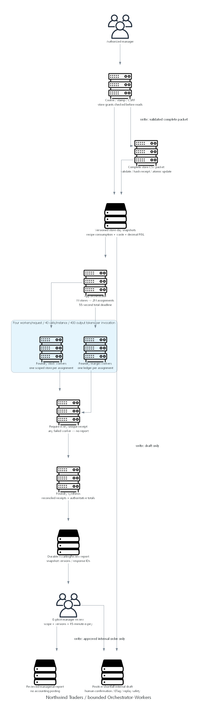

# Ice-cream reference implementation plan

> Generated by az-01-conductor agent | 2026-10-29

## Overview

Adapt fingerprint-bound coffee-shop reference code in an isolated target.
Preserve working account/access/order helpers; replace business inputs, worker scheduling and reporting.
Local preparation, exact-target readiness/what-if and explicitly approved provisioning are complete.
Runtime validation is authorized and has exposed remaining latency and narrative-grounding failures.

## Resource Inventory

| Resource | SKU/configuration | Module |
| --- | --- | --- |
| Scenario RG | rg-azd-environment, destination tags | Subscription entry point |
| Foundry | AIServices S0, model capacity parameter | AVM account 0.19.1 |
| Project | Direct child backoffice, system identity | Raw child resource; account AVM lacks this child contract |
| Business Table account | Standard_LRS, IceCreamBackOffice, no keys | AVM storage 0.33.1 |
| Linux plan | P0v3, baseline 1, scale cap 3 | AVM serverfarm 0.7.0 |
| Web | .NET 10, secure cookies, managed identity | AVM site 0.24.0 |
| Diagnostics | PerGB2018, 30 days, 1 GB/day | AVM workspace 0.16.1 |

No private networking or management VM is deployed. The public TLS/RBAC exception was explicitly reviewed.
Full deployer control and data access are part of the target design; no new subscription-wide grants.
Reuse verified inherited Owner/Foundry User; add only scenario-scoped Table/log data access for the human.

## Module Structure

- `infra/main.bicep`: subscription entry point, RG, model and identity inputs.
- `infra/resources.bicep`: pinned AVM resources, direct project and separate workload/deployer grants.
- `infra/main.parameters.json`: azd environment substitutions; no copied destination values.
- `azure.yaml`: App Service publish and scenario-owned lifecycle hooks.

## Implementation Tasks

1. Replace raw fixtures with ten catalog-provenance store-day packets and strict CSV samples.
1. Calculate recipe usage, closing base units, sold COGS, spoilage and managerial profit in decimal code.
1. Add atomic Table snapshot/import receipt transaction and stale-version enforcement.
1. Partition selected stores into independent stock/margin assignments and reconcile real invocation receipts.
1. Persist AwaitingReview reports, enforce authorized explicit review and reject changed evidence.
1. Install twelve unique per-destination local credentials privately, without copying source users/passwords.
1. Install target-owned versioned prompt agents and bind their Responses endpoints before publish.
1. Verify app/build, local behavioral assertions, frontend/scripts, diagram rendering and Bicep.
1. Reconcile every baseline artifact and refresh curated target manifest.
1. Stop for consolidated design and authorized target preparation; no cloud writes until explicit deployment consent.

## Dependency Graph

Authorized readiness -> reviewed what-if/cost/scope -> actual consent -> ARM resources and role assignments ->
private credentials, fixtures and agents -> app endpoint settings -> publish -> runtime and operator CRUD checks.
Provisioning account/project names and IDs are generated outputs, not business questions.
Missing exact role GUID is resolved through authorized readiness, never guessed.

## Runtime Flow Diagram

Both diagram images are rendered by `03-architect-diagram.py`.

## Naming Conventions

Resource group: `rg-${environmentName}`.
Globally unique names derive once from `uniqueString(resourceGroup().id)` in the resource module.
Foundry prefix `ic`, business storage `stic`, web `web-ic`, plan `plan-ic`, logs `log-ic`.
Target-owned agents use `coffee-to-icecream-stock`, `coffee-to-icecream-margin` and `coffee-to-icecream-close`.
Internal CoffeeShop namespace/folder is retained to avoid unrelated file churn; it conveys no ownership or consent.

## Execution Handoff

Run local validations and record results in `06-deployment-summary.md`.
Authorized target reads and what-if are recorded in `evidence/` and `00-region-availability.json`.
Final what-if succeeded: 22 creates, zero modifications/deletions, including five role assignments.
The actual reviewed deployment decision preceded provisioning, five role assignments, initialization and publish.
Sweden Central / `coffee-to-icecream-ref` is deployed; all three owned agents currently use version 3.
Fifty local assertions pass. Business/security and real worker-failure recovery passed.
Latest read p95 and unsupported steady-cost narratives still fail acceptance; authenticated browser proof is pending.
Do not treat compiled templates, a homepage, fake test receipts or source logs as deployed proof.
