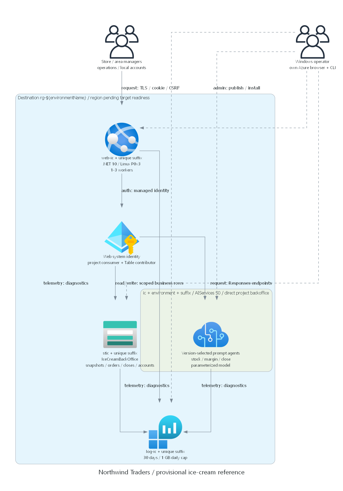

# Northwind Traders ice-cream operations

> Generated by az-01-conductor agent | 2026-10-29

Local reference adaptation for recipe stock, spoilage, reviewed replenishment and daily managerial P&L.
Business scope is Hospitality & Travel / operations. The reference is deployed; no hack composition has occurred.
Latest acceptance is **failed**, not review-ready:
read p95 exceeded two seconds and agent text still invents cost trends.

Live application: https://web-ic-gyhmp4vgxvkwy.azurewebsites.net/

## Installation

Reuse configured repository tooling; .NET 10, Python diagrams/Graphviz, Bicep, Azure CLI and azd are needed by stage.
Do not install or sign in merely to read this reference. No credentials or source environment settings are shipped.
Source: read-only coffee-shop; baseline and reconciliation files record file-level reuse, not runtime proof.

## Deploying the scenario in 4 steps:

1. Review [requirements](01-requirements.md), [architecture](02-architecture-assessment.md)
   and pending cost/security scope.
1. Explicitly authorize exact-target read-only readiness and what-if; resolve current identity and all regional quotas.
1. Approve the actual destination, what-if, model lifecycle, public endpoints, roles and complete cost scope in chat.
1. Only then configure a destination azd environment and execute its guarded provision/initialize/publish flow.

These are review boundaries, not instructions to deploy now.
The guarded installation ran only after the actual reviewed deployment decision.
Any future cleanup also needs explicit resource scope; this document does not authorize deletion.

### Current readiness review

Authorized readiness and ARM what-if passed, followed by explicit deployment/runtime consent on 30 October 2026.
The deployed configuration is Sweden Central, environment `coffee-to-icecream-ref`, one-to-three Linux P0v3 workers,
Foundry/direct project, gpt-4.1-mini version 2025-04-14 at 300,000 TPM, Table and Log Analytics.
What-if predicts 22 creates and no modifications/deletions, including five scoped role assignments.
The user accepted the Legacy model's 14 April 2027 inference deprecation, public TLS/no WAF and the policy's
explicit `SecurityControl=Ignore` storage-network exclusion for this deployment.
Observed retail-based planning cost is $191-321/month at ten GB of logs, not a spending cap.
See [architecture](02-architecture-assessment.md) and [deployment summary](06-deployment-summary.md) for scope.

## What is the demo scenario about?

Ten stores across two areas convert sold scoops into stock consumption, account for spoilage and review orders.
An application orchestrator assigns store/domain evidence to real Foundry workers and synthesizes a managerial report.
Managers review the exact evidence before finalizing; agents cannot spend, transmit purchases or post journals.



## Feedback and Contributing

Changes to business scope, security or model choices require a fresh affected review.
GitHub publication, learner content, coach packages and event rollout remain separate later user choices.

## Local checks and status

```powershell
dotnet build src\CoffeeShop.Web\CoffeeShop.Web.csproj --configuration Release
dotnet run --project tests\Operations.Tests\Operations.Tests.csproj --configuration Release
node --check src\CoffeeShop.Web\wwwroot\js\workspace.js
az bicep build --file infra\main.bicep --outfile infra\local-build.json
az bicep lint --file infra\main.bicep
```

See [deployment summary](06-deployment-summary.md) for exact executed commands and honest limitations.
The local executable assertion suite has no extra test-framework dependency.
Its explicit test gateway validates coordination only; the app always registers the real Foundry gateway.
Fifty local assertions pass. Latest version-3 HTTP checks all pass, but read p95 was 3.4644 seconds
and close p95 7.4583 seconds; overall acceptance failed the strict read threshold.
Real missing-worker failure/recovery and own-user operator CRUD passed.
Version-3 narrative review still found unsupported steady-cost commentary; browser sign-in walkthrough is pending.
Historical failed and passing runs are retained. No suitability snapshot or approval has been created.
Synthetic data can be regenerated with `python scripts\create_fixtures.py --repository C:\HackBuilder`.
CSV schema and operational steps are in [the walkthrough](demoguide/demoguide.md).
Actual passwords are created only at authorized installation in `.private/reference-access.json` with restricted ACLs.
Never publish or export this private file. No learner or coach credentials/packages are created at this phase.
