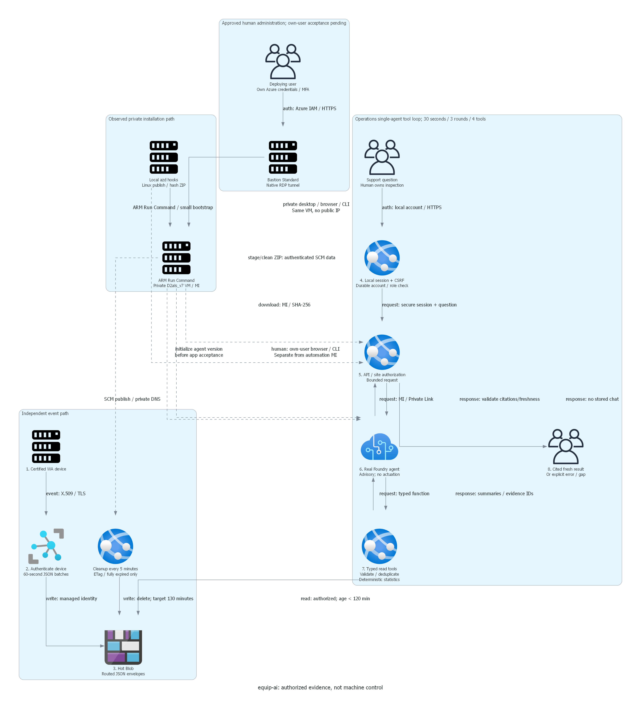

# Implementation plan: equip-ai

> Generated by az-01-conductor agent | 2026-10-23

### Approved human-access amendment: 2026-10-28

The actual user approved Bastion Standard and a desktop/browser on the existing management VM,
subject to exact readiness and what-if. See the separate dated approval and access matrix in
`local-evidence/resume-20261028/`; this does not approve the scenario or hack composition.
Preserve the deployed Central US target, identities, private workload endpoints and existing VM SKU.
Authorized reads confirmed `10.247.0.192/26` is free within the existing /24: no VNet expansion is needed.
The installed local Bastion extension supports native tunneling without workstation installation.

1. Keep the addition opt-in with `enableHumanManagement`; add AzureBastionSubnet through the existing VNet owner.
1. Add only Bastion-origin TCP 3389 before the management NSG's existing deny-all rule. SSH stays blocked.
1. Deploy AVM Bastion 0.8.2 Standard, two included scale units, and a Standard static Bastion IPv4.
1. Add deploying-user IoT Hub Data Contributor at this hub only; never grant it to workloads.
1. Validate build/lint, provider/region, policies, subnet overlap, refreshed prices and exact what-if before allocation.
1. Install a signed-package desktop/browser/CLI on the approved guest, not this shared workstation.
1. Set a unique VM-local desktop password through authenticated private staging; keep it separate from app/Azure login.
1. Prove native tunnel/RDP, guest private DNS/TLS and browser/CLI availability. Then require actual own-user
   interactive Azure sign-in for private browser access and safe service-data CRUD proof.

Incremental continuous illustration: USD 216.08/month; combined USD 465.50/month, excluding extra traffic/tax.
VM stop does not stop Bastion/IP/disk charges. Exact allocation and human access are not yet proven.
The original October 23 local-only sections below are historical, superseded by recorded target-specific approvals.

## Overview

Implement the confirmed Operations reference locally. No cloud account, subscription, tenant or group is assigned.
Use the existing provisional model evidence without treating public support as live capacity.
The separate portal design answer permits implementation, not Azure queries, deployment or hack composition.

## Resource Inventory

| Resource | SKU / configuration | AVM version | Status |
| --- | --- | --- | --- |
| Foundry account | AIServices S0; direct child project; private inbound | account 0.19.1 | Authoring |
| Model | Evidence-configured GlobalStandard deployment | Account deployments | Authoring |
| Storage | Hot Standard_LRS; trusted IoT exception; no shared keys | storage-account 0.33.1 | Authoring |
| IoT Hub | B2; X.509 only; native JSON batching | iot-hub 0.4.0 | Authoring |
| Hosting | One Linux B2 plan, two independent apps | serverfarm 0.7.0; site 0.24.0 | Authoring |
| VNet and DNS | Integration subnet; three private endpoints | virtual-network 0.10.2; DNS 0.8.1 | Implemented |
| Monitoring | Workspace; sanitized metrics and application events | workspace 0.16.1; component 0.8.0 | Authoring |
| IoT route identity | Dedicated user-assigned identity | user-assigned-identity 0.6.0 | Authoring |

Official module sources and published MCR tags were inspected on 2026-10-23.
The account module does not expose direct child projects; declare that child using the current ARM schema.
RBAC resources extend existing AVM-managed scopes rather than redeclaring infrastructure.
Private cleaner/SCM access adds one endpoint without enabling public access.
The custom cleaner role allows blob read/delete but not upload or overwrite.

## Module Structure

`infra\main.bicep` composes pinned AVM modules.
`infra\modules\blob-access.bicep` assigns container-only reader/contributor roles.
`infra\modules\foundry-access.bicep` assigns project-scoped runtime and installer roles.
The hub AVM module assigns IoT Hub Registry Contributor to the existing azd deployer identity at that hub only.
Fixture-registration access is an IaC installation dependency, not a postdeployment user-role questionnaire.
`azure.yaml` wires self-contained Linux publish/ZIP deployments; no Docker build is selected.
Release targets Linux x64; Debug stays portable for genuine Windows local acceptance.
Both the private SCM deployment and Foundry agent installer need a VNet-connected authorized execution context.
This is a deployment-preparation network check, not a claim that this worker has that connectivity.

## Implementation Tasks

1. Create isolated VNet/DNS, monitoring, route identity and secure Storage.
1. Grant the IoT identity container access before hub routing validation.
1. Create Foundry account/project/model and independent web/cleaner identities.
1. Apply container/project RBAC; wire all endpoints and Entra settings.
1. Build real app-executed function tools, bounded retrieval and cleanup, PKCE browser and certificate publisher.
1. Run local build/lint, deterministic telemetry/security tests and browser shell checks.
1. Prepare but do not execute exact-target what-if; require separate portal preparation authorization first.

Implementation detail: the IoT route uses a dedicated user-assigned rather than system-assigned identity
so its container grant can exist before endpoint validation. Privileges and network boundaries are unchanged.
Do not attach this identity to other resources.

## Dependency Graph

VNet -> linked DNS -> private endpoints.
Route identity -> Storage container grant -> IoT route.
Plan + data/model endpoints -> web and cleaner -> independently scoped RBAC.
Model + installer access -> explicit agent installation after deployment authorization.
Nothing depends on hack packages.

## Runtime Flow Diagram

Source: `04-runtime-diagram.py`. This is a confirmed design view; no deployment is represented.

## Naming Conventions

The proposed environment is `equip-ai-reference`; the group convention is `rg-equip-ai-reference`.
These are previews, not assigned cloud targets.
Generate one suffix from the resource group ID and reuse it in globally unique resource names.
All name, address-space and model parameters remain explicit; region comes from the evidence file.
Apply Environment, ManagedBy, Project and SecurityControl tags including the resource group.

## Execution Handoff

Continue local construction and validation without additional routine approval.
Before any cloud operation, obtain exact-target preparation permission through the portal.
After actual what-if and priced cost review, obtain a separate matching deployment authorization.
No agent runtime, endpoint, quota, Entra assignment or provisioning success is claimed by this plan.

### Public implementation sources

Module schemas: [official AVM repository][avm].
Published versions: [Microsoft container registry][mcr].
Agent function contract: [current C# function-calling guide][functions].

[avm]: https://github.com/Azure/bicep-registry-modules/tree/main/avm/res
[mcr]: https://mcr.microsoft.com/v2/bicep/avm/res/cognitive-services/account/tags/list
[functions]: https://learn.microsoft.com/azure/foundry/agents/how-to/tools/function-calling
# Management-path amendment: 2026-10-24

The concrete scoped repair, cost, lifecycle, azd ordering, consent reconciliation and pending acceptance are in
`local-evidence/management-repair-20261024/deployment-review.md`.
`infra/modules/management-network.bicep` creates AVM egress/NSG before the complete core VNet declaration.
`infra/management.bicep` creates the AVM VM and scoped project/site grants after subnet/apps/project.
The addition is opt-in (`enableManagement=false` by default); no cloud operation is authorized by this code.
`private_lifecycle.py` replaces workstation SCM deployment with local Linux publish plus private execution.
`private_runner.py` performs serial hash-verified artifact delivery; `runner_guest.py` uses IMDS and private DNS.
New-scope readiness/what-if must pass before enabling/provisioning this addition.
