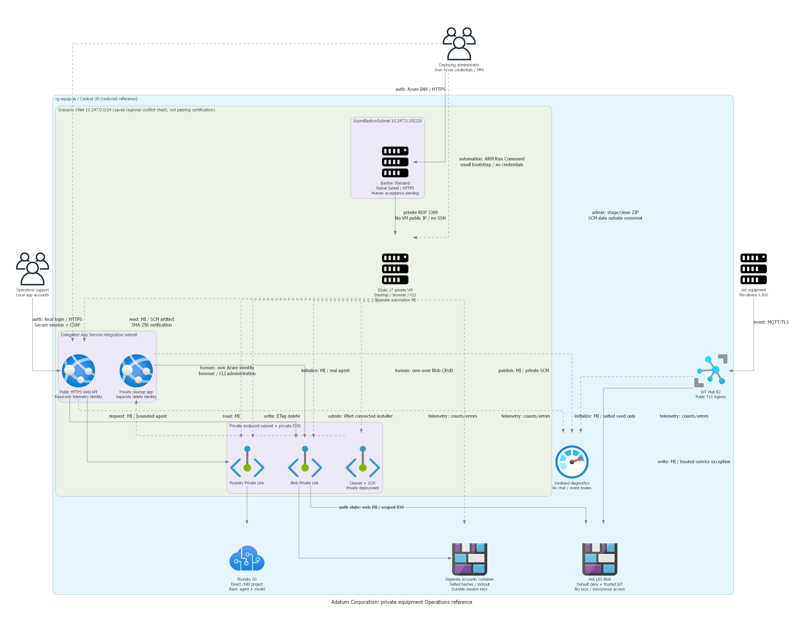
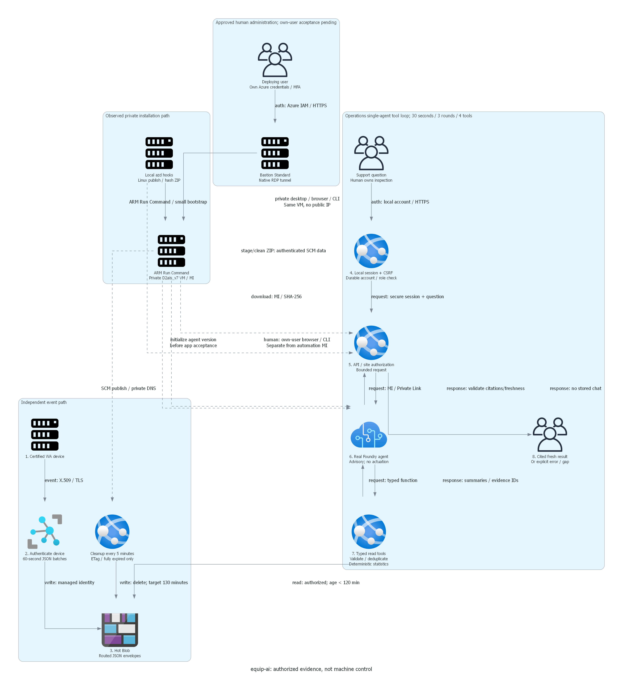

# equip-ai

> Generated by az-01-conductor agent | 2026-10-23

## Current state: 2026-10-26 UTC

The exact-target group was observed absent at resumption; the user explicitly approved restoring it.
The guarded installation restored the private Central US reference, including its soft-deleted Foundry account.
No purge, alternate region, directory-consent change or resource deletion was performed during this resumption.
Local sample authentication now uses unique private accounts with preserved Tacoma/statewide isolation.
There are 63 passing executable app checks and 37 passing installer/acceptance tests.
Private managed-identity publication, agent version 1 installation and local-account provisioning passed.
Actual local login, server-enforced site/CSRF boundaries, X.509 ingestion and outside-network denials were observed.
Twenty real checks passed, including the strict burst, exact routed counts and expired/stale/missing evidence.
**Full validation is blocked:** native Foundry Responses returns HTTP 403 for the web managed identity.
The UI surfaces a correlated 502 rather than pretending inference succeeded. This is not local sign-in consent.
Consult [the validation index](scenario-validation.json) for the exact endpoint, identity and remaining checks.
The reference is not approved for hack composition.
See [the current rebuild review](local-evidence/resume-20261026/deployment-review.md)
for restoring the same private Central US reference with local app accounts and scoped deployer RBAC.
The [demo guide](demoguide/demoguide.md) documents participant/coach credential delivery and the real acceptance runner.
Old deployment URLs and installation statements below are historical, not current runtime evidence.

## Historical continuation: private-management repair, 2026-10-24

The Central US ordered ARM/dedicated Entra approval is retained, not revoked by a later read-only answer.
The private execution path and named user roles were conditionally approved; installation checks remain required.
Review [the consolidated addition](local-evidence/management-repair-20261024/deployment-review.md):
private VM, NAT/IP/NSG, managed-identity publishing, real agent initialization and azd hook wiring.
At the user's explicit substitution request, the restricted B2s is replaced by Standard_D2als_v7 in Central US.
It retains 2 vCPUs/4 GiB and private-network controls; subscription SKU restrictions are empty with quota headroom.
Current Linux PAYG $0.0804/hour increases the 730-hour estimate by $22.27/month.
Estimated management addition $97.83/month; combined illustrative total $249.36/month.
SKU, quota and public-price observations are in `local-evidence/management-sku-substitution-20261024`.
Integrated Bicep build/lint and 24 Python tests pass; the unchanged 49 app/browser checks remain dated evidence.
Updated diagrams include the replacement host. Authorized read-only Azure eligibility checks passed.
Following the user's "go for it", ARM provisioning, private publication of both apps and real agent installation succeeded.
Actual application: <https://app-equip-web-equipai-kex72v.azurewebsites.net/>.
Large inline transfer was repaired using authenticated SCM data staging on the existing web site and VM SHA-256 checks.
No resources/permissions or endpoint exceptions were added for that repair; the staged ZIP was deleted after success.
The nominated user has temporary Tacoma/API and SPA access; no sign-in or grounded chat pass is claimed.
The IoT registry 401002 exposed a missing installation role, not a missing business decision.
The local Bicep repair now includes IoT Hub Registry Contributor for the existing deployer principal at this hub only.
It is part of scenario installation, not a separate manual temporary-role workflow; no cloud assignment was applied here.
The app's Entra sign-in comes from the confirmed authenticated-user/site-isolation requirements, not from the portal.
Human sign-in acceptance remains unverified, but does not stop independent build, deployment, fixture or backend work.
The delegated-token requirement is preserved; automated user-login success is not claimed.
See the current installation section of [the deployment summary](06-deployment-summary.md).
The following old resume summaries incorrectly inferred revocation; the current review supersedes those inferences.

> [!IMPORTANT]
> Current VS Code resume, 2026-10-24 22:34 UTC: local implementation revalidated without cloud operations.
> The legacy brief and decisions are in `.abcbuilder-portal/projects/equip-ai.json` in the repository.
> The retained design has local validation consent. Prior exact-target read-only consent covers East US only.
> It does not authorize deployment, directory writes, alternative regions or new management resources.
> Current local evidence is in `local-evidence/resume-20261024T2233Z`.
> All nine validation commands passed: Bicep build/lint, 15 installer tests, 49 app/browser checks and Linux publish.
> See [the current resume review](local-evidence/resume-20261024T2233Z/resume-review.md) for the next decision.
> `scenario-validation.json` is explicitly blocked: no live endpoint, inference or agent invocation is proved.
> The offline Checkov scan remains nonpassing: 14 appsettings-related findings are individually assessed,
> not suppressed or represented as a policy pass. That earlier scan was not rerun in this resume.
> East US B2 quota failed in the last authorized preparation; saved settings retain Central US.
> A private publishing/agent-test execution path and its full cost remain unresolved.
> Decisions belong in this VS Code chat. The portal reports progress only.
> The chronology below is historical; it grants no current deployment or directory authority.

The following narrative and execution table retain the original installation chronology.
Their target, permission and installed-state statements are historical, not current canonical authorization.

Adatum Corporation's proposed Operations assistant for fresh Washington machinery telemetry.
The portal recorded **design confirmation for local implementation** on 2026-10-23.
The infrastructure, application and local validation stages are reconciled with actual passing checks.
The recorded reporting-blocker verification passed under unchanged permissions.
The portal selected new dedicated Entra registrations.
Their [installation plan](entra-registration-plan.md) is complete.
The later user correction supersedes the manual identity-receipt questionnaire:
deployment must create and capture solution-owned IDs under separate directory authorization.
Current Central US preparation has positive worker/model eligibility and complementary partial ARM previews.
The interrupted identity installer, endpoint ordering and Responses-role repairs are retained and locally validated.
Full-reference preparation remains incomplete: generated identities, final appsettings and role propagation
require installed identities and actual propagation checks.
The portal recorded ordered ARM/dedicated-directory authorization on 2026-10-23 at 17:05 PDT.
Both dedicated registrations and assignment-required service principals are now installed and read back.
Actual generated IDs were captured automatically; no support-user assignments were authorized or made.
Deployment is blocked on private publishing/agent-runner connectivity: this host routes the reviewed private range
through its Internet default gateway, and no connected authorized runner is recorded.
Earlier East US quota rejection and West US 2 missing-model results remain historical.
No ARM resources, application deployment or live runtime success is claimed.
See [the deployment preparation summary](06-deployment-summary.md) for exact evidence and remaining inputs.

## Installation

The logical workspace is `generated-scenarios\equip-ai`, backed by `C:\azd-projects\equip-ai`.
The initial requirements prerequisite audit passed on 2026-10-23.
Current local evidence records builds and 49 deterministic/browser checks, not live Azure behavior.
No shared tooling was installed by this attempt.

## Deploying the scenario in 4 steps:

1. Reuse the retained design and local implementation; current local revalidation has passed.
1. Resolve target eligibility and private management access in this VS Code chat, within authorized read-only scope.
1. Review exact targets, actual what-if coverage, directory operations, complete costs and limitations together.
1. Approve deployment in chat, then deploy through azd hooks, prove live behavior and review suitability separately.

The following paragraph records the earlier Central US preparation, not the latest East US result or current consent.
The portal historically authorized read-only preflight and what-if for `rg-equip-ai` / `equip-ai` in `centralus`.
Actual independent what-if returns 35 creates; complementary foundation preview returns 34 creates/one Unsupported.
Neither returns deletes/modifies. Skipped expansions and generated-identity dependencies are disclosed;
complementary previews are not a passing full-reference preview or deployment authorization.
Scoped regional readiness is persisted with the current infrastructure fingerprint.
Refreshed Central US illustrative public retail cost is USD 151.53/month, including USD 99.95 fixed charges,
with explicit usage assumptions and exclusions in the preparation summary.
The recorded authorization covers the reviewed ARM and dedicated directory installation only.
Private runner creation, user assignments, hack composition and teams are not authorized.

## What is the demo scenario about?

Operations support engineers ask natural-language questions about equipment across five Washington sites.
A real Foundry prompt agent will use deterministic, authorized tools over recent device telemetry.
IoT Hub provides certificate-authenticated event ingestion and native batching into low-cost Hot Blob Storage.
The public web app requires Entra login. Device commands and automatic repairs are out of scope.

## Feedback and Contributing

Use the local portal for progress; handle decisions and approvals in this VS Code chat.
Publication, event deployment and hack authoring are separate choices and have not started.

## Project Summary

| Property | Value |
| --- | --- |
| Created / last updated | 2026-10-23 |
| Industry | Manufacturing & Mobility |
| Business Units | `["operations"]` |
| Read-only candidate/model | Retain Central US; saved B2/model eligibility passes, not reserved capacity |
| Phase A status | Local checks passed; identity ownership and private execution path not currently verified |
| Deployment | Existing Central US grant retained; management addition pending; no live URL/runtime proof |
| Key confirmation | Trusted IoT-to-Storage network exception and two-hour validity versus strict erasure |

## Architecture

See [requirements](01-requirements.md), [architecture assessment](02-architecture-assessment.md)
and [provisional official evidence](00-region-availability.json).

Diagram sources are `03-architect-diagram.py` and `04-runtime-diagram.py`.
They show the confirmed design, not an existing deployment.
The [manifest](scenario-manifest.json) contains curated catalog metadata, not approval or runtime evidence.

## Execution record

| Date | Step | Result |
| --- | --- | --- |
| 2026-10-23 | Intake/read and preflight | Choices reused; local consent present; checks passed |
| 2026-10-23 | Workspace and scoped catalog refresh | Exact workspace created; shared catalog unchanged |
| 2026-10-23 | Public research and requirements | Persisted dated official evidence and Operations-specific acceptance |
| 2026-10-23 | Architecture | Prepared design, cost allowances, limits and security/retention trade-offs |
| 2026-10-23 | Design checkpoint | Explicit confirmation recorded; local implementation permitted |
| 2026-10-23 | Diagrams | Both Python sources rendered; PNG integrity and visual review passed |
| 2026-10-23 | Read-only preflight | Identity, providers, quota and regional hosting checked; what-if not run |
| 2026-10-23 | Workflow blocker | Portal setup required: preparation reports incorrectly demand deployment consent |
| 2026-10-23 | Setup retry | Recorded verification passed; blocker cleared with exact evidence |
| 2026-10-23 | Local reconciliation | Bicep/build pass; misplaced test fixed; 49 local checks pass |
| 2026-10-23 | Resumed preparation | Identity matches; group absent; Entra SPA/API client inputs unresolved |
| 2026-10-23 | Identity source resolved | New dedicated registrations selected; plan written; no Entra mutation |
| 2026-10-23 | Administrator handoff | Selected route retained; receipt requested in portal; no installation claimed |
| 2026-10-23 | Corrected identity boundary | Manual receipt request withdrawn; IDs are future deployment outputs |
| 2026-10-23 | Independent preparation | Model capacity 5000; actual what-if fails B2 quota 0 versus 1 required |
| 2026-10-24 UTC | Central US resumed | Repairs retained; partial previews; installation decision required |
| 2026-10-24 UTC | Authorized installation | Dedicated identities captured; private runner connectivity blocks ARM |
