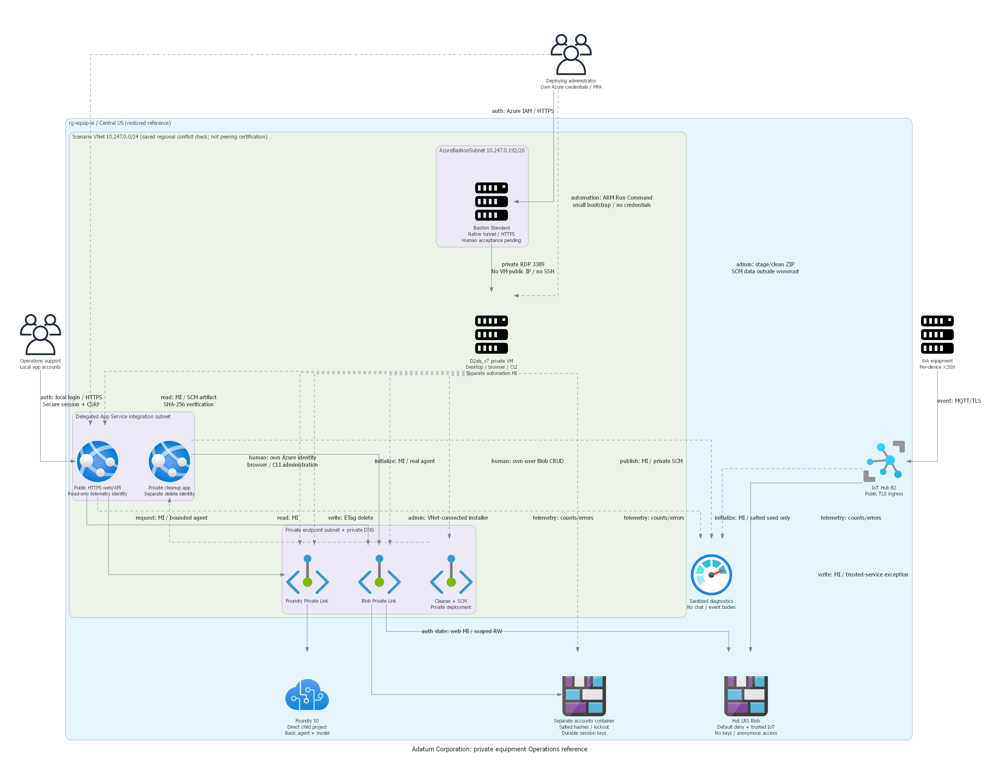
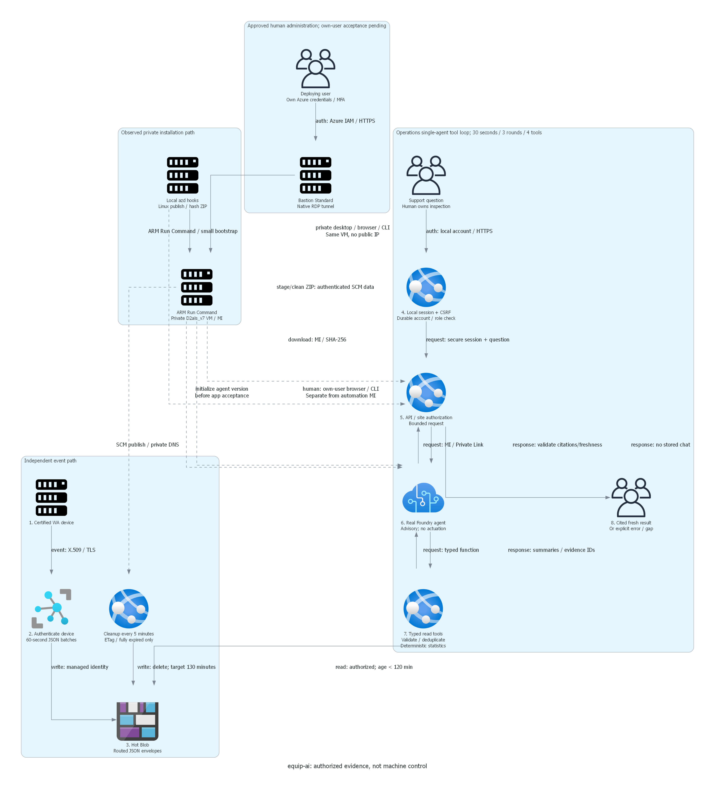

# equip-ai resume review

Recorded 2026-10-24 after the local checks at 22:33-22:34 UTC.
This is a preparation review, not deployment consent or a working-scenario suitability review.

## Scope and authority

- Workspace: `C:\HackBuilder\generated-scenarios\equip-ai`, junction to `C:\azd-projects\equip-ai`.
- Brief: repository `.abcbuilder-portal/projects/equip-ai.json`, revision 29.
- Local design confirmation and execution consent were retained.
- Decision `ecf2d376abd84bbea662a9f547bcd1ca` permits East US read-only preparation and what-if only.
- No deployment or directory-write authorization is inferred from historical installation records.
- No scenario-specific legacy worker was observed. Portal status is display-only.
- No Azure or Graph operation was performed during this resume.

## Retained business and architecture

Adatum Corporation Operations support investigates equipment across five Washington sites.
Tacoma support and the statewide lead retain separate entitlements, enforced outside the model.
One Foundry prompt agent requests typed read tools; deterministic code validates and aggregates fresh telemetry.
No device control, automatic repair or authoritative diagnosis is implemented.

The design retains Foundry, Hot LRS Blob, IoT Hub B2 certificate ingress, a Linux B2 plan with web and cleaner apps,
Entra PKCE, managed identities, VNet integration, three private endpoints, five DNS zones and sanitized monitoring.
Foundry stays private. App-to-Blob uses Private Link. Storage keeps the documented default-deny,
trusted-service exception for identity-authorized IoT routing. It is not an entirely private-only design.
Two-hour grounding validity does not promise irreversible platform-wide erasure.

Both retained diagrams are intact. Crossing labels impair readability; the architecture still labels an earlier
proposed group instead of `rg-equip-ai` and does not identify an actual management execution host.
Revise both design and diagram together after resolving that host; do not present them as deployment-ready.

## Current local evidence

All nine commands in `local-checks.json` returned zero:

| Check | Result |
| --- | --- |
| Bicep build and lint | No diagnostics |
| Installer contract tests | 15 passed; fake Graph transport only |
| NuGet source listing | Existing scenario configuration; no feed changes |
| Application restore and build | Passed; zero build warnings/errors |
| Application test executable | 49 deterministic, owned-loopback and Chromium checks passed |
| Linux runtime restore and self-contained publish | Passed |

The local security cases include forged site/device rejection, invalid tool arguments, expired grounding,
invented citations, and 401 responses for equipment, evidence and chat without authentication.
The 120,000-event deterministic aggregation took 277.2 ms; cloud storage latency and chat p95 remain unmeasured.
The browser correctly disables login and submission when Entra configuration is missing.
Screenshots are local-shell evidence, not successful Entra login or agent answers.

`artifact-checks.json` records source parsing, PNG integrity/hashes and published ELF64 x86-64 verification.
The default Python lacked Pillow; the existing repository `.venv` passed the affected check without installation.
The earlier Checkov result remains nonpassing with 14 assessed appsettings findings; it was not rerun.
No overall governance or security-scan pass is claimed.

## Target, what-if and cost limitations

| Target field | Retained read-only scope |
| --- | --- |
| Account | petender@microsoft.com |
| Subscription | efd64343-6ef4-4926-951f-d3229f38bd76 |
| Tenant | 16b3c013-d300-468d-ac64-7eda0820b6d3 |
| Resource group / environment | rg-equip-ai / equip-ai |
| Authorized region | eastus |
| Saved azd/preview/identity-receipt region | centralus; not reconciled or silently changed |

At 2026-10-24 20:34 UTC, East US B2 and aggregate worker quotas were 0 used / 0 limit for demand 1.
The independent ARM what-if failed with `InternalSubscriptionIsOverQuotaForSku`.
There is no passing complete change count, destructive-change assessment or full Policy result.
The partial preview excludes runtime configuration and cannot validate Graph operations or private data-plane access.
Earlier Central US partial previews and capacity observations remain historical, not current eligibility.
No quota request, alternate-SKU substitution, region change or allocation probe was performed.

The old Central US estimate is USD 151.53/month, including USD 99.95 fixed charges.
It excludes the management execution path, egress, applicable Entra licensing, taxes and support.
It is not a current complete quote, spending cap or authorization.
Reprice the eligible target and selected management path before the single consolidated deployment review.

## Private management path required before deployment

Preferred order is to reuse an existing authorized VNet-connected runner with verified DNS/routing and identity.
No such runner is currently evidenced; the local VS Code host is not assumed connected.
Run publishing, agent installation and private acceptance on that runner, not merely from a local azd hook
that has access to ARM. Transfer immutable application artifacts and return redacted receipts using an approved
artifact channel. Validate private DNS, TLS and authenticated operations from the actual execution host.

If no existing runner is available, prepare a scenario-owned VNet-connected automation host as a material design
addition for the consolidated review. Its exact host/SKU, bootstrap, artifact transport, outbound package access,
identity, lifecycle, quota and ongoing compute/disk/connectivity cost must be specified before provisioning.
Do not create a VM, Bastion, VPN, peering or firewall exception under existing read-only consent.
Do not expose private Foundry or cleaner SCM publicly as a workaround.

## Required directory operations

Preserve existing scenario identity receipts without copying credentials or assuming current ownership.
Under separately reviewed directory-read authority, verify tenant and stable ownership before reusing SPA/API objects.
Use the idempotent installer for required configuration/redirect repairs only after explicit write authorization.
Capture actual client/object IDs automatically; the user is not asked to supply generated IDs.
Keep `Equipment.Read`, `Operations.Tacoma` and `Operations.Statewide`, assignment-required service principals,
and the exact deployed HTTPS redirect. No broad tenant consent, replacement registrations,
credentials or default statewide assignment are authorized.
Assign support/lead roles only to explicitly nominated principals under appropriate directory authority.
Actual tenant denial is a blocker, not permission to weaken authentication.

## Next decision requested in this chat

Recommended next step: extend read-only preparation to **Central US** in the same account, subscription,
tenant, group and environment above, preserving the same services, SKUs, model and security boundaries.
This is the existing saved candidate, not a new target selection or deployment consent.
Scope the extension to subscription eligibility/quota/model/provider/Policy reads and ARM what-if.
Do not create resources, submit quota requests, write to Entra, change saved target settings or shared defaults.
Alternatively, keep the reference local-only and defer cloud preparation.

Once an eligible target and management design exist, present one consolidated architecture/deployment review:
exact resource and directory changes, actual what-if coverage, full costs, identity authority and limitations.
No deployment approval is requested prematurely here.

## Runtime and suitability boundary

No live application URL is known. Deployment, model inference, managed-identity agent invocation,
authenticated app chat, routed device grounding/tools and live negative cases are unverified.
`scenario-validation.json` is blocked and contains no passing live checks.
The demo runbook is preparatory only. Do not create a review snapshot or record suitability approval yet.
No hack plans/packages, team rollout, composition or publication were created.
