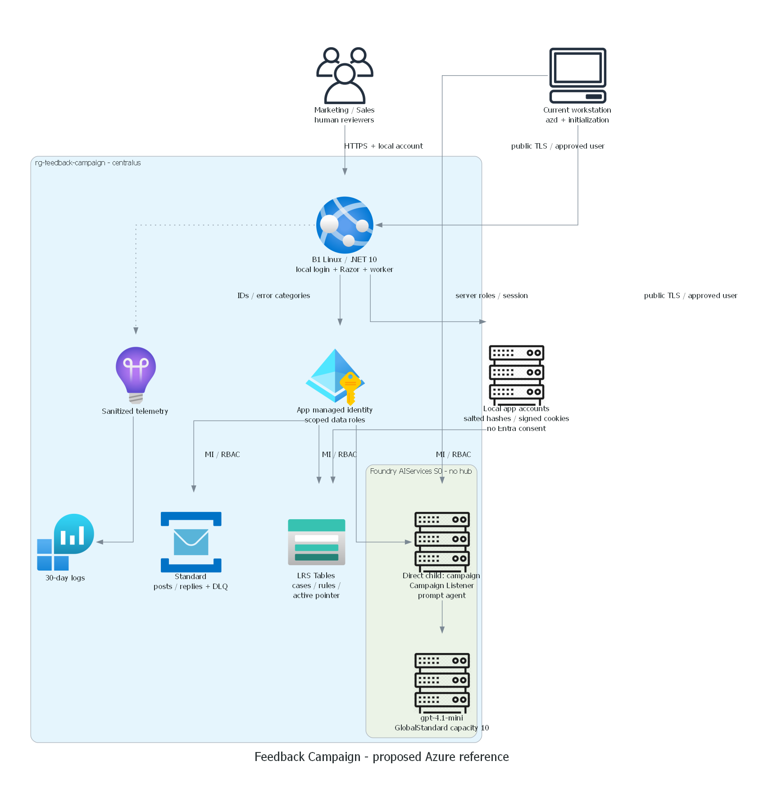
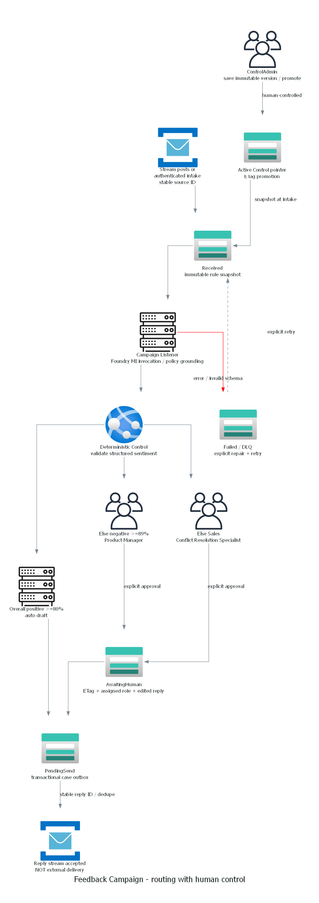

# Architecture assessment: Feedback Campaign

## Requirements validation and runtime contract

The marketing campaign-to-sales-recovery handoff implements routing plus the
user-selected HITL overlay. The .NET 10 Razor Pages app invokes a native Foundry
prompt agent over the documented project Responses REST API using managed
identity. Control is deterministic application code; durable checkpoints and
human approval live in Azure Tables, not a pretend native Foundry workflow.
REST agent administration uses `?api-version=v1`; inference uses the current
project `/openai/v1/responses` route, confirmed against the official SDK URL
resolver. The installed agent version is pinned in runtime configuration.

| Resource | Proposed SKU/configuration | Rationale |
| --- | --- | --- |
| Foundry account + direct child project `campaign` | AIServices S0, local keys disabled | Current non-hub resource model |
| Model `campaign-model` | gpt-4.1-mini 2025-04-14, GlobalStandard capacity 10 | Bounded low-cost classification/drafting; live eligibility pending |
| App Service plan/site | Linux B1, .NET 10, Always On, one instance | Durable queue worker + authenticated review UI, no container registry |
| Service Bus | Standard, `posts` / `replies`, duplicate detection | Queue ingress, outbound stream, DLQ; Basic lacks deduplication |
| Storage | StorageV2 Standard_LRS, `campaignstate` table | ETag case transitions and immutable policy snapshots |
| Monitor | Log Analytics PerGB2018 + workspace Application Insights | Error/correlation telemetry without source post bodies |
| Local application accounts | Salted Identity password hashes in existing Tables, signed secure cookies | No directory/consent dependency; separate participant and coach roles |

Resource suffix is `uniqueString(resourceGroup().id)`; names use `fc-<suffix>` or
`stfc<suffix>`. Proposed environment `feedback-campaign`, resource group
`rg-feedback-campaign`. Bicep requires explicit location; no shared CLI defaults
are modified. All tags include Environment, ManagedBy, Project and SecurityControl.

## State, recovery and coordination

Case ID = SHA256(source ID). Insert-if-absent prevents duplicate intake. A persisted
case stores source, rule snapshot, sentiment, exact Foundry response ID, owner,
version, decision audit and outbound state. ETag update prevents two reviewers
or workers committing conflicting decisions. Cases move Received -> AwaitingHuman
or PendingSend -> Queued. Agent failures persist Failed; explicit retry reuses
case and rule snapshot. Restart/reconciliation scans Received/PendingSend.

The case row itself is a transactional outbox. Dispatcher publishes deterministic
`reply-<caseID>` and then marks Queued. Service Bus duplicate detection is seven
days; this is at-least-once, not an unlimited exactly-once guarantee. A production
external channel adapter must persist its own idempotency receipt and acknowledge
actual delivery. Worker limits intake, handles poison messages through five
deliveries, and logs only IDs/error categories. The UI displays at most 200
authorized cases; the worker traverses all Table continuation pages. Production
needs UI paging, archive and scalable indexed outbox partitions instead of full scans.

Control version records are immutable. The active pointer update uses its ETag;
promotion requires ControlAdmin and an explicit reason. Product-aspect routing is
off until an administrator intentionally promotes a version that enables it.
Assessments suggest investigation and future capabilities, not executable tools.

## Identity and security boundaries

App managed identity: Storage Table Data Contributor on this storage account;
Service Bus Data Sender/Receiver on the two scenario queues; Azure AI User on this
Foundry project. Runtime cannot write Entra or ARM. Operator needs scoped ARM
deployment/RBAC and agent initialization rights, separately from Graph rights.

Local lab accounts replace the original EasyAuth/Entra sign-in after an observed
admin-consent restriction and the user's explicit redesign request. Application
cookie authentication now protects APIs (401 anonymous, 403 wrong role).
Roles remain CampaignOperator, ProductManager, ConflictResolutionSpecialist and
ControlAdmin. Never trust `X-MS-CLIENT-PRINCIPAL` or a role selector.
All JSON writes require same-origin and a valid antiforgery token; login/logout
also use antiforgery. Login has a 30/minute per-connection limit and a durable
15-minute account lockout after five failures. Cookies are Secure, HttpOnly,
SameSite Strict, nonpersistent and expire after four hours. Each request checks
the durable security stamp and roles; account rotation invalidates old sessions.

The installer generates unique passwords and saves them only in private,
gitignored `.private/participant-access.json` and `.private/coach-access.json`.
The existing Table backend receives salted framework password hashes, never
plaintext passwords. Public-safe access guides document retrieval and roles.
No self-registration, passwordless role switch or shared hard-coded password.
App Service session keys persist outside published content under HOME/data;
platform disk protection and filesystem permissions protect the single-instance
lab store. Production would need a separately reviewed key protection/identity design.

New installations do not create Entra applications or grant consent. The original
dedicated registration is unused and retained; no deletion or tenant-policy change
was authorized or performed. Azure workload managed identity/RBAC is unchanged.

## Management and deployment access

| Operation | Host / identity | Path | Ordering |
| --- | --- | --- | --- |
| Provision, package and publish | Current C:\HackBuilder host / existing CLI+azd user | Public ARM, SCM HTTPS | Installer object-ID discovery -> Bicep -> local account hashes -> azd publish |
| Initialize Foundry | Same host / existing Azure CLI credential | Public project data endpoint TLS | RBAC propagation -> idempotent agent create -> capture version |
| Runtime worker | App Service / managed identity only | Public authenticated service endpoints | Configured endpoints -> Table checkpoints -> Foundry -> Service Bus |
| Acceptance | Same host + signed-in browser | TLS application, project and queues | Model/agent/app/grounding/human/DLQ/negative/restart tests |

Separate management network is unnecessary for the proposed public-only reference.
A restricted-IP exception is not a substitute for private endpoints. No private
VM, Bastion, VPN, runner or networking change is included or authorized.

## Product Manager technical options

| Option | Pros | Cons |
| --- | --- | --- |
| Recommended: dedicated authenticated web inbox | Strong typed workflow, ETag conflict control, editable reply, audit and shared Sales handoff; no connector license | Custom UI/operations; users must open inbox |
| Teams adaptive card + bot/Workflow | Familiar notifications and fast response | Additional app/bot installation, tenant policy and callback verification; license/version constraints; stale cards still need durable backend |
| Power Apps + Power Automate Approvals | Low-code admin experience, mobile approval | Connector licensing/DLP and solution ownership; asynchronous callback/idempotency integration |
| Outlook actionable mail or monitored shared mailbox | Familiar authoring | Weak audit unless integrated, forwarding/authentication risks, Graph mail permission and channel setup |

Recommend the web inbox first; later notifications can deep-link without moving
the approval authority out of the durable backend. No Teams/Mail/Power Platform
resource, license or consent is included in current infrastructure or costs.

## WAF trade-offs, cost and limitations

No pillar priorities were selected. Security: MI and Entra versus public data
endpoints. Reliability: durable queue/Table state versus one worker/LRS and no
production SLA. Operational excellence: correlation and DLQ versus manual poison
repair. Performance: bounded serial model work versus throughput. Cost:
pay-per-token model and low-cost hosting versus no dedicated capacity guarantees.

Planning allowance USD/month, 730 hours, synthetic demo, 10,000 posts, average
2,000 input + 500 output tokens, 5 GB logs: B1 $13-20; Service Bus Standard $10-15;
Storage $1-5; Monitor $0-15 after applicable free allowances; model $16-40;
total **$40-95/month**, with **$100/month review ceiling**. These are nonbinding
planning estimates, not a live Azure quote. No existing approved baseline: all
cost is incremental. Budget alerts do not cap spend. Egress/tax/channel integration
and production identity licenses excluded. Refresh exact regional retail rates
and inference usage before deployment.

## Dated technical evidence

Checked official public guidance 2026-10-25:

- https://learn.microsoft.com/azure/foundry/agents/quickstarts/prompt-agent
  (REST agents create `?api-version=v1`, project OpenAI Responses and agent_reference).
- https://learn.microsoft.com/azure/foundry/agents/concepts/limits-quotas-regions
  (Central US agents and Responses support; per-model eligibility checked separately).
- https://learn.microsoft.com/azure/foundry/foundry-models/concepts/models-sold-directly-by-azure
- https://learn.microsoft.com/azure/app-service/configure-authentication-provider-aad
- https://learn.microsoft.com/azure/service-bus-messaging/duplicate-detection
- https://github.com/Azure/bicep-registry-modules/tree/main/avm/res
  (registry version lists and current module schemas consulted).

User selected centralus; authorized live catalog/quota/capacity, policy and
parameter-complete what-if checks completed, followed by successful installation.
Direct installer model and agent inference passed; signed-in app MI/HITL acceptance
remains pending. Linux B1 regional retail rate is USD 13.14 at 730 hours.
See `00-region-availability.json`, `05-deployment-review.md` and `06-deployment-summary.md`.
