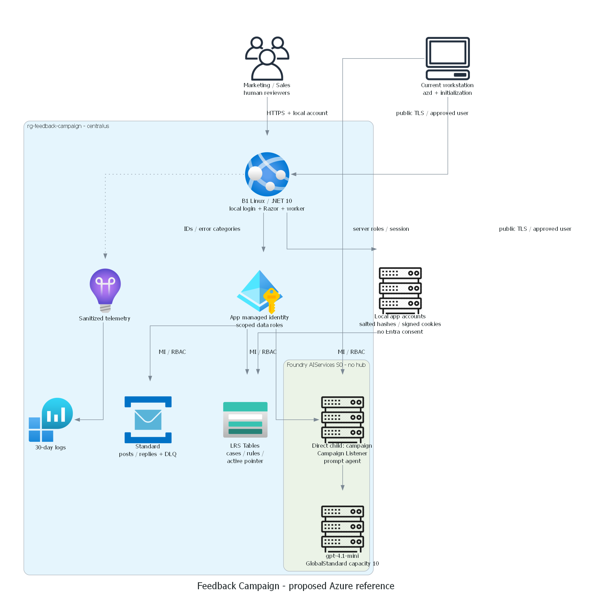
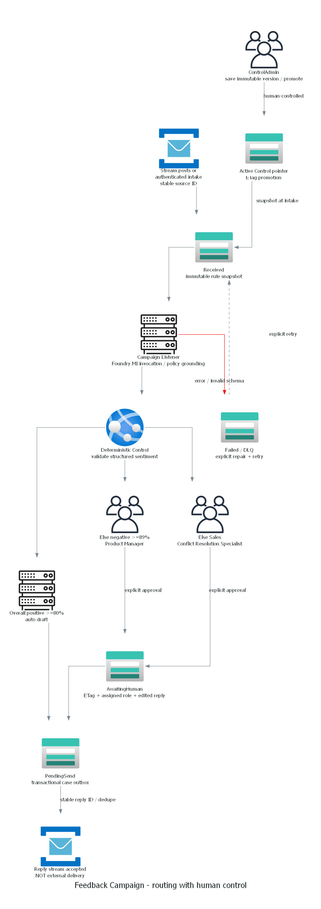

# Feedback Campaign

Adatum Corporation's Media & Communications campaign reference for **Sales and
Marketing**. Routing/triage with the selected Human-in-the-Loop overlay.

**Local reference prepared; cloud deployment is not authorized or validated.**
No live app URL, external reply delivery, suitability approval or packages exist.

## Review and artifacts

- [Requirements and exact routing](01-requirements.md)
- [Architecture and Product Manager options](02-architecture-assessment.md)
- [Consolidated deployment review](05-deployment-review.md)
- [Actual local checks](evidence/local-validation.json)
- [Truthful runtime status](scenario-validation.json)
- [Deployment runbook](docs/deployment-guide.md)
- [Prepared demo and recovery walkthrough](demoguide/demoguide.md)




## Behavior and implementation

`Campaign Listener` uses real Foundry project Responses over managed identity.
Control is deterministic code; Azure Table ETags protect persistent cases,
reviewer decisions and human-promoted immutable rule versions. Service Bus is the
actual inbound/outbound stream, not an email/social-provider simulator.

Initial routing: overall positive >=80% auto reply; else overall negative >=89%
Product Manager; rest Conflict Resolution Specialist. The illustrative 80%
negative rule is not active. Product-aspect extension starts disabled.

The .NET 10 Razor app has intake, reviewer inbox, editable rule JSON, explicit
promotion and grounded campaign chat. Real runtime has no mock fallback.
Test doubles are confined to tests and never count as runtime acceptance.
Model numbers are estimates, not calibrated probabilities.

## Local validation

From the scenario root:

```powershell
python scripts/check_local.py
```

This runs local app build/tests, Bicep build/lint, syntax, catalog fixture and
installation contract checks, and diagram generation using existing tools.
It never runs deployment, Graph or cloud resource queries.

Local unauthenticated preview:

```powershell
dotnet run --project src/FeedbackCampaign.Web --configuration Release --urls http://127.0.0.1:5187
```

APIs intentionally deny local requests, including spoofed EasyAuth headers.
Preview proves layout and error state only. Deployed EasyAuth and real runtime
acceptance are separate authorized operations. Do not introduce a local auth
bypass to manufacture a successful demo.
