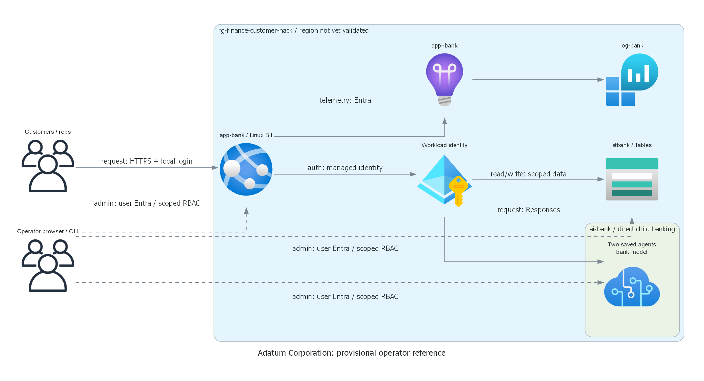
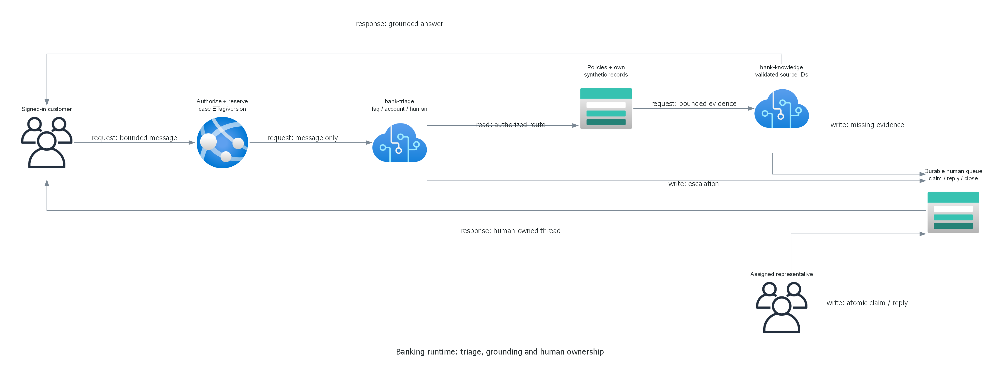

# Architecture assessment: finance-customer-hack

> Generated by az-01-conductor agent | 2026-10-30

## Requirements Validation

Financial Services, `["generic"]`, maps to customer self-service and accountable human case ownership.
The operator reference is complete in design; no learner architecture or hack package is being prepared.
All target eligibility remains provisional in [region evidence](00-region-availability.json).

### Agentic runtime contract

Application-hosted routing invokes saved Foundry `bank-triage` and `bank-knowledge` prompt agents.
The current documented project Responses API supports `agent_reference`; REST administration uses `v1`.
The app pins the actual created version recorded by the installer, rather than assuming version 1.
This bounded REST adapter avoids unnecessary orchestration SDK dependencies.
Source: [prompt agent quickstart][agents] and [project Responses API][responses], read 2026-10-30.

Basic platform-managed agent storage is sufficient: the specialist consumes explicitly selected synthetic
policy/account evidence. No hosted file search, private agent networking or customer-owned Foundry backing
stores are required. Standard/customer-owned backing services would add cost and access complexity without
improving this bounded workflow. The app's own accounts/cases remain in customer-owned Azure Tables.
Search, Cosmos DB, queues, container registries and additional agents are not justified.

Cases contain customer ID, status, owner, monotonic version, bounded transcript and redacted execution receipts.
Table ETags implement conditional updates. Processing is reserved before inference; no lock is held in memory.
Agent failures mark the durable case Failed with an explicit error and allow escalation, not canned success.
A timed-out/abandoned processing case may be recovered to AwaitingHuman after two minutes.
Human case ownership is enforced server-side and never overridden by an agent.

Two calls maximum, no inference retry, 800 output tokens per call, 90 seconds per turn, 20 messages per case.
Typed JSON routes and source allowlists are validated; malformed outputs are failures.
Grounding is application-side authorized retrieval, not native Foundry file search.
The UI displays response IDs, agent/version, route, evidence IDs and state, never chain-of-thought.

### Management and deployment access

The confirmed synthetic public-HTTPS design needs no private management VM, VPN or Bastion.
Human browser, Azure CLI, azd publishing and installer execute on the current operator workstation.
Entra-authenticated data operations use public service DNS/TLS; no data endpoint allows anonymous/key access.
Workload execution uses only its own managed identity. Human probes use the signed-in deploying user.
No Entra applications, directory writes or admin consent are required.

Deployment order: resource group, monitoring/storage/plan/Foundry, child project/model, web identity,
RBAC, then authorized predeploy installation of fixtures/accounts/agents, then application publication.
The installer generates credentials once per destination and saves participant and coach files separately
under a gitignored destination-specific `.private` subdirectory, with restricted local ACLs.
The destination digest includes subscription, resource group and web app, preventing cross-deployment reuse.
Passwords never enter azd configuration.
Data-protection keys persist outside published content in `/home/data/bank-keys` on the single-worker
App Service persistent platform-encrypted volume. The directory is restricted to the process user.
This lab relies on platform disk encryption, not application-level XML key encryption.
Scale-out and production key management need a separately reviewed external protected key store.

### Deployment-user access matrix

The human tenant/object ID is unresolved until authorized CLI context verification.
All roles below are limited to this scenario resource group or individual resources.
Resource-group Contributor and Role Based Access Control Administrator provide scoped administration/grants;
reuse inherited effective assignments only after verification, otherwise explicitly install reviewed grants.

| Component | Control administration | Full scenario data access | User-credential proof |
| --- | --- | --- | --- |
| RG, plan/site, monitoring | RG Contributor | Resource-context log query | Safe app-setting update; log query |
| Foundry account/project/model | Contributor; Foundry Owner | Agent lifecycle; inference | Disposable agent CRUD |
| Table state/accounts/fixtures | Storage Contributor | Table Data Contributor | Disposable entity CRUD |
| Workload identity/RBAC | Scoped RBAC administrator | Separate human credentials | Effective grants; access path |

Workload: Foundry User at project; Table Data Contributor at its storage account; Monitoring Metrics Publisher
on Application Insights. Current published role names are Foundry User/Owner, replacing older Azure AI labels.
The IDs were verified in the official built-in AI role definitions on 2026-10-30.
Workload receives no ARM Contributor, RBAC administration or human Azure credentials.
Missing rights, unreachable endpoints or unverified CRUD block reference completion.
The exact role-definition semantics and effective inherited grants must be checked within authorized cloud scope.

### Recommended architecture

## Resource SKU Recommendations

| Service | Proposed configuration | Reason |
| --- | --- | --- |
| Foundry account/project | AIServices S0; direct child `banking`; key auth off | Current non-hub model |
| Model | gpt-4.1-mini 2025-04-14; GlobalStandard capacity 10 | Parameterized; live eligibility pending |
| App Service | Linux B1, one worker, .NET 10 | Native zip publication; no Docker dependency |
| Storage | StorageV2 Standard_LRS; one table | Durable cases, banking fixtures and login lockout |
| Log Analytics | PerGB2018, 30 days, 1 GB/day cap | Bounded diagnostic retention |
| Application Insights | Workspace-based web | Correlation and explicit failures without customer text |

Planning envelope: USD 20-50/month fixed platform/storage/log costs plus model usage and tax.
This is a nonbinding total estimate, not a subscription quote.
The retrieved public eastus2 Linux B1 meter is USD 0.017/hour, or USD 12.41 for 730 hours;
storage, diagnostics and model usage remain provisional in the total envelope.
Assume 730 plan hours, tiny synthetic storage and low diagnostics.
At 1,000 automated turns, allow up to 2,000 inference calls and 1.6 million output tokens;
input volume depends on evidence and history. Refresh actual model pricing and calculate input/output costs
before deployment consent. GlobalStandard processing is not a regional residency guarantee.
The 1 GB/day diagnostic ingestion cap is not a dollar budget; sustained use at that cap can exceed this envelope.
No team environments, production SLA, WAF, private networking or management hosts are included.

## Architecture Decision Summary

| Decision | Choice and trade-off |
| --- | --- |
| Runtime | Two saved Foundry agents with application-owned state; simpler than dynamic multi-agent planning |
| Human gate | Durable in-app queue; no external connector or unapproved consequential action |
| Data | Server-filtered synthetic records only; no model-selected customer identity |
| Network | Public authenticated HTTPS by confirmed assumption; not production private isolation |
| Authentication | Local accounts, salted hashes, secure cookies; no consent-dependent Entra app login |
| Region | None selected; eastus2 and swedencentral are proposed candidates only |
| Authorization | Local preparation only; cloud reads/writes and what-if remain unauthorized |
| Validation | Local tests do not establish deployment, agent availability or runtime success |

## Implementation Handoff

Use AVM resource modules after checking current metadata. The direct child project is native Bicep:
no separate project AVM was found in the public registry on 2026-10-30.
Retain explicit region/model parameters and no subscription defaults.
Prepare idempotent install and user-access probes as part of the same reference.
Only after local preparation, request missing exact-target cloud preparation authority;
present real what-if, target, cost and dependent checks before deployment consent.

[agents]: https://learn.microsoft.com/en-us/azure/foundry/agents/quickstarts/prompt-agent
[responses]: https://learn.microsoft.com/en-us/azure/foundry/agents/quickstarts/responses-api
