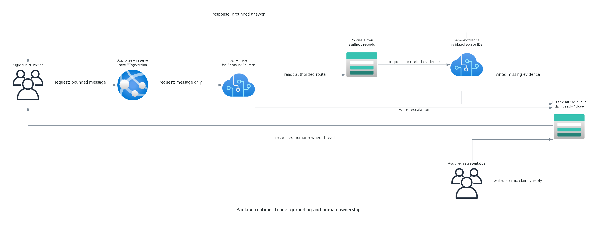

# Implementation plan: finance-customer-hack

> Generated by az-01-conductor agent | 2026-10-30

## Overview

Implement a .NET 10 Razor Pages banking-service reference with two real saved Foundry agents,
Azure Tables case/account state, local sign-in and an explicit human queue. Cloud execution is not authorized.

## Resource Inventory

Foundry S0 account, direct child project and model deployment; Linux B1 plan/site;
Standard_LRS storage with Tables and key blobs; Log Analytics and Application Insights.
No private management host is needed for the confirmed public authenticated synthetic demo.

## Module Structure

Current registry metadata was queried on 2026-10-30:

| AVM resource | Pinned version |
| --- | --- |
| cognitive-services/account | 0.19.1 |
| web/serverfarm | 0.7.0 |
| web/site | 0.24.0 |
| storage/storage-account | 0.33.1 |
| operational-insights/workspace | 0.16.1 |
| insights/component | 0.8.0 |

`infra/main.bicep` orchestrates these modules and native direct-project/RBAC resources.
Public registry checks found no `account/project` or `account/projects` AVM.
Resource schemas and published AVM parameter definitions were inspected before implementation.

## Implementation Tasks

1. Implement typed durable documents, ETag concurrency, customer authorization and human ownership.
1. Implement local login, throttling/lockout, secure cookies, CSRF and persistent protected keys.
1. Implement strict real Responses adapter, typed triage/knowledge outputs and source validation.
1. Seed catalog-backed synthetic records and versioned policies via an authorized idempotent installer.
1. Wire installer into azd predeploy after infrastructure and RBAC, before application publication.
1. Validate build, focused authorization/state/adapter tests, Bicep build/lint and rendered diagrams.

## Dependency Graph

Monitoring/storage/Foundry/plan -> project/model/site -> workload/deployer grants ->
fixtures/accounts/agent versions -> app publish -> deployed acceptance -> suitability review.
No current step authorizes the next cloud operation.

## Runtime Flow Diagram

## Naming Conventions

Environment: finance-customer-hack; resource group: rg-finance-customer-hack.
Globally unique names use a single resource-group-derived suffix.
All resources receive Environment, ManagedBy, Project and SecurityControl tags.

## Execution Handoff

Run local builds/tests and preserve exact results. Defer cloud what-if, grants and installation.
Never write passed runtime validation or approve the reference without real evidence and the user's decision.
