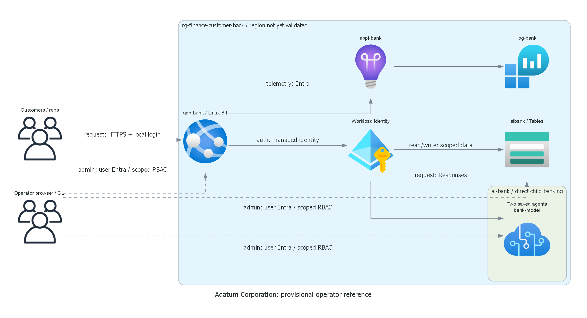
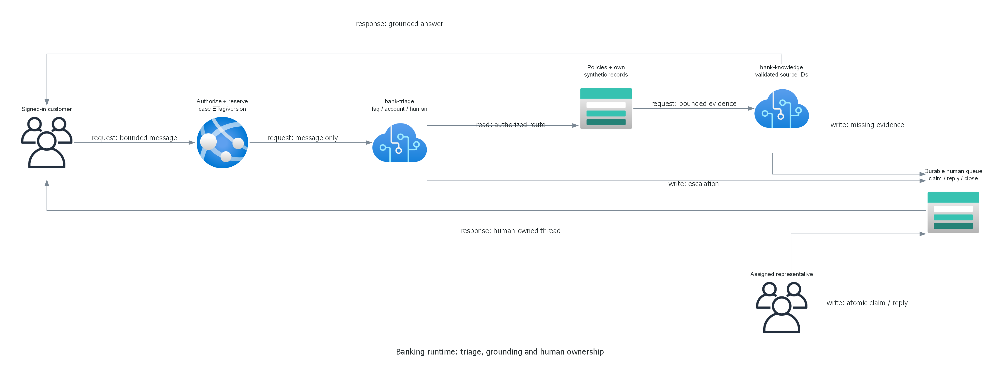

# finance-customer-hack

Adatum Corporation's synthetic banking service combines two real Foundry agent integrations,
read-only customer account activity and a durable representative-owned human queue.
Local preparation is implemented and tested; the reference has not been deployed.

> Generated by az-01-conductor agent | 2026-10-30

## Installation

Use the existing .NET 10 SDK, Azure CLI with Bicep, azd, PowerShell 7 and repository diagram environment.
No shared tools were installed or shared Azure defaults changed.
This working folder is the local junction to the external scenario workspace.
No source reference was copied; company/person provenance is in [requirements](01-requirements.md).

Run local validation from the repository root:

```powershell
dotnet test generated-scenarios\finance-customer-hack\tests\BankSupport.Tests
az bicep build --file generated-scenarios\finance-customer-hack\infra\main.bicep
az bicep lint --file generated-scenarios\finance-customer-hack\infra\main.bicep
```

Production startup requires `STORAGE_TABLE_ENDPOINT`, `FOUNDRY_PROJECT_ENDPOINT`,
`SESSION_KEYS_PATH` and `APPLICATIONINSIGHTS_CONNECTION_STRING` from the reviewed deployment.
Runtime uses managed identity only. Test doubles are injected exclusively by the test assembly.
The explicit Testing environment disables telemetry export; it does not bypass login, roles, CSRF or data access.

## Deploying the scenario in 4 steps:

These are future authorized actions, not instructions to bypass review.
Do not run `azd up` until target eligibility, what-if, exact cost and deployment scope have been reviewed in chat.

1. Review the [architecture and access matrix](02-architecture-assessment.md), obtain exact-target cloud
   preparation authority and verify the configured Azure CLI/azd identity with the shared context helper.
1. From this scenario folder, create azd environment `finance-customer-hack` using the confirmed subscription
   and validated location; set `AZURE_TENANT_ID` from the confirmed CLI observation, without changing defaults.
   The standard resource group is `rg-finance-customer-hack`.
1. Run authorized provider/model/quota/policy checks and `azd provision --preview`; review actual what-if,
   role assignments and costs. Obtain explicit deployment consent for the exact target and resource scope.
1. Run `azd up`. The predeploy hook installs fixtures/accounts/owned agent versions after provisioning,
   then azd publishes the web app. Run the entire acceptance matrix, including deploying-user safe CRUD.

Installation creates a restricted destination-specific directory under `.private`, identified by the
subscription/resource-group/web-app digest and printed by the hook.
It contains `participant-access.json` and `coach-access.json`. Deliver only the matching file privately;
never print passwords into chat,
commit the files or include them in public exports. They are reference access notes, not hack packages.
Retry retains existing passwords, verifies account hashes/roles and reuses matching owned agents.
Different destinations receive distinct directories and newly generated credentials.
Missing or mismatched private records are not permission to reset accounts silently.

## What is the demo scenario about?

Industry: Financial Services. Business units: `["generic"]`, not department-specific.
Customers ask bank policy or own synthetic account questions. The triage agent selects a route;
the knowledge specialist receives only authorized evidence. Human escalation changes durable ownership.
Only the assigned representative can view/reply to a claimed conversation.
No financial action can be committed.




Use the [reference demonstration runbook](demoguide/demoguide.md).
Its expected outcomes are not live evidence. There is no running Azure app URL yet.

## Project Summary

| Area | State |
| --- | --- |
| Requirements, provisional architecture | Complete locally |
| Both diagrams | Rendered and inspected |
| Application and infrastructure | Implemented; local checks recorded in the deployment summary |
| Azure region/quota/policy/what-if | Not authorized; unknown |
| Deployment, managed-identity runtime, operator CRUD | Not run |
| Suitability approval and hack composition | Not requested or authorized |

Last updated: 2026-10-30 UTC. No fabricated overall completion percentage is used.
The preparation boundary is not scenario completion.

## Feedback and Contributing

Keep changes within this reference and preserve the original intake.
GitHub publication, hack composition and event rollout are separate user choices.
Do not publish access records, identity receipts, `.azure`, `.private` or runtime evidence.
