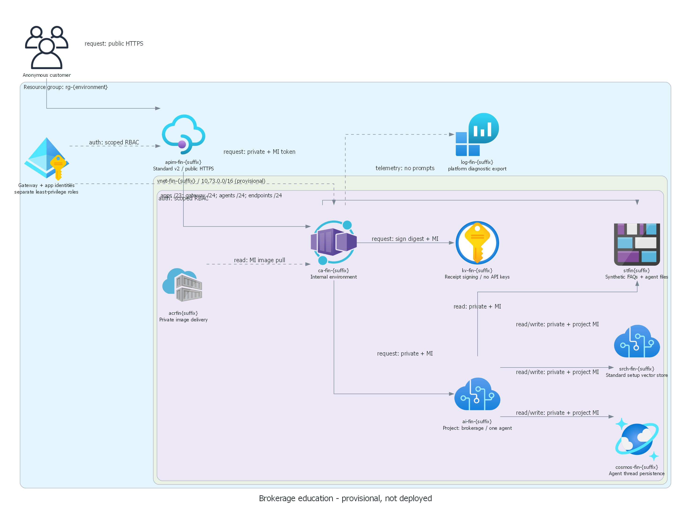

# Finance security reference architecture

> Generated by az-01-conductor agent | 2026-10-22

## ✅ Requirements Validation

This is an implemented **provisional local reference**, not a deployment-ready or live-validated environment.
The user clarified that account confirmation, budget and scale sizing must not block local scenario construction.
Region and model choices are delegated for this design; actual capacity, policy and target checks remain deferred.

Adatum Corporation's single agent answers synthetic brokerage education questions, not retail banking questions.
All five selected services remain present. Anonymous customer access ends at APIM; anonymous backend access is denied.
No hack challenges or packages are authored. Optional customer authentication is a recorded future authoring request.

### Basic versus Standard

Basic setup is smaller but does not provide the documented customer-controlled persistence and network injection
required by this reference. Standard private setup uses a direct child project, injected agent subnet, and BYO
Storage, Cosmos DB and Search. These additional dependencies were confirmed by the user as D6.
Search is the Standard vector-store dependency, not a separate chatbot search tool in this minimal design.
Grounding is a small approved FAQ blob, read privately by the app and supplied as bounded context to the real agent.
This avoids embeddings, indexers, public websites, and additional business databases.

## 📦 Resource SKU Recommendations

| Component | Provisional choice | Purpose / limits |
| --- | --- | --- |
| Foundry account/project | AIServices S0, direct child `brokerage` | No hub resources |
| Model | `gpt-4.1-mini`, `2025-04-14`, GlobalStandard | Documented candidate, not live capacity proof |
| Region | `eastus2` | Documented project/model/agent candidate; all SKU checks deferred |
| Agent | `brokerage-educator`, immutable installed version | One prompt agent; no specialists or external tools |
| APIM | Standard v2, one unit, outbound VNet integration | Public HTTPS gateway, private upstream |
| Container Apps | Internal workload-profile environment, Consumption | 0.5 CPU / 1 GiB, 1-10 replicas |
| Key Vault | Standard, RBAC, private endpoint | RSA response-digest signing; no API keys |
| Storage | Standard LRS, private blob endpoint | Agent files and separate read-only `knowledge` container |
| Cosmos DB | Single-region provisioned account | Agent thread state; no customer-account schema |
| AI Search | Standard, one partition/replica | Standard setup vector store; not a production SLA design |
| Container Registry | Premium, private endpoint, admin disabled | Private image push/pull |
| Logs | Log Analytics, 30 days | Azure platform diagnostic export and sanitized application events |
| VNet / DNS | Four subnets; private DNS links and service endpoints | Required private resolution and segmentation |
| Entra API registration | Single tenant, no secret/certificate | Unique audience for APIM-to-app tokens |

The Entra registration is indispensable to a distinct backend token audience, not a replacement for managed identities.
Register an API with an application ID URI and access-token version 2 in the target tenant during authorized setup.
Do not require user consent or customer login for the gateway. The app allows only the gateway identity object ID.
No service principal secret is generated or stored.

### Identity and data paths

1. Browser obtains UI/assets and posts `/api/chat` through public APIM without a customer credential.
1. APIM replaces any incoming authorization with its own managed identity token for the registered API audience.
1. APIM reaches the internal Container Apps FQDN over VNet integration and private DNS.
1. The app validates token signature, lifetime, issuer, audience, tenant and gateway identity object ID.
1. App managed identity reads the `knowledge` blob, invokes a pinned agent version and signs the answer digest.
1. Foundry project identity accesses its Standard setup dependencies privately with documented service roles.
1. Response contains answer, source IDs, correlation ID, actual agent response ID, digest, signature and key version.

| Identity | Access |
| --- | --- |
| Gateway MI | Token acquisition for backend audience; no Foundry, source or signing data roles |
| Application MI | Project-scoped Foundry Agent Consumer; knowledge-container Blob Reader; key-scoped Crypto User |
| Application MI | AcrPull solely for this registry; no app-management or customer-account access |
| Project MI | Account Foundry User, Blob Contributor, Search service/index contributors and Cosmos Operator |
| Project MI | Post-host agent blob-tag ownership condition and enterprise-memory Cosmos data contributor |
| Installer user | Project Foundry User, Blob Contributor, key Crypto Officer, AcrPush, enterprise-memory access |

The runtime app does not receive Foundry User or permission to create agents.
The Consumer role GUID is an explicit parameter because the documentation names the role but its built-in catalog
entry was not discoverable during this run. Resolve and inspect the actual role in the confirmed subscription.
Do not replace it silently with a broader role. Installer access is separate and should be removed after installation.
Service-required project roles are broader than consumer roles; this is a platform limitation, not app privilege.

### Network controls and boundaries

- Foundry, Storage, Cosmos, Search, Key Vault and ACR data planes disable public access and local/shared-key auth.
- Foundry trusted-service bypass is disabled. ACR network bypass is disabled.
- App environment is internal; app ingress is VNet-visible so APIM can reach it, not internet-visible.
- Private DNS includes the three Foundry account zones and each dependency zone.
- Provisional address space is `10.73.0.0/16`; operator must check overlap before deploying or peering.
- Agent and app subnets use separate `Microsoft.App/environments` delegations.
- APIM uses a dedicated `Microsoft.Web/serverFarms` integration subnet with an NSG.
- APIM outbound integration is not a private APIM gateway.
  Premium v2 injection is unnecessary for this public-edge story.
- Entra metadata/token acquisition, Azure management, platform diagnostics and container base-image download are
  platform/control-plane exceptions, not private application-data hops. ACR runtime image access is private.
- This template does not implement a general egress firewall or telemetry AMPLS isolation. It must not be described
  as a zero-internet environment. If those exceptions are unacceptable, revise before deployment.

### Operations and safety

APIM applies per-IP and global rate limits. The app admits at most eight concurrent chats per replica, no queue,
limits message length to 2000 characters, caps output at 600 tokens and applies a 60-second operation timeout.
These are adjustable local demonstration limits, not verified high-scale throughput guarantees.
Routine logs contain identifiers/counts, not prompts, answers or tokens. The API has no customer conversation ID,
account lookup, trading function, external browsing or personalized recommendation tool.
The signing receipt proves answer-byte integrity only; it is not evidence that the model answer is correct.

No WAF was added: this is a synthetic anonymous demonstration with basic rate controls, not a production public edge.
APIM rate limits are approximate, not a financial spending cap or distributed denial-of-service guarantee.
An IP-shared audience can experience shared throttling.
Capacity tests and a production edge/WAF review remain future work.

## 🎯 Architecture Decision Summary

| Decision | Choice and rationale |
| --- | --- |
| Customer entry | Anonymous APIM; optional authentication request retained for later post-approval authoring |
| Backend identity | Distinct MIs and unique Entra API audience; signed JWT checks are mandatory |
| Private setup | Standard injected Foundry account, direct project, BYO persistence, no trusted-service bypass |
| Grounding | Private small FAQ context, cited IDs validated; no vector search feature needed by business story |
| Key Vault | Nonexportable signing key gives a real integrity use without backend shared credentials |
| Region/model | Delegated provisional candidate only; GlobalStandard can process outside the account region |
| Dependencies | D6 confirmed; ACR is required for private image delivery and logs for operational evidence |
| Deployment | Two stages avoid public placeholder images and opening firewalls for installation |
| Cost | Not a local blocker per user; dated target-specific pricing required before deployment consent |

### Cost and readiness

No currency, pricing quote, monthly amount or exact change set is fabricated.
Chargeable baseline includes APIM Standard v2, Search Standard, ACR Premium, private endpoints, logs, Cosmos throughput,
one warm app replica and model tokens. Scale-out, data ingestion, requests and diagnostics increase costs.
No PTU reservation is selected. Model quota and budget alerts are deployment-time checks, not local blockers.
User statement that budget is not relevant to construction does not authorize cloud spending.

### Current evidence

See `00-region-availability.json` for dated source URLs, exact versions and evidence limitations.
Current SDKs use stable `v1` Foundry data-plane APIs.
Infrastructure follows the official network-secured Standard sample
using `2025-04-01-preview` for child project/capability-host wiring.
The OpenAI SDK marks Responses types experimental; only that diagnostic is suppressed in the integration file.
No unrelated repository standards were rewritten to accommodate a provisional scenario.

General app-template prohibitions on authentication and health probes do not apply to this required private backend:
customer entry remains anonymous, workload JWT authentication enforces the story, and TCP probes serve operations.
Brokerage FAQs replace retail-bank Customer/Account/Transaction CRUD. No people fixtures are needed.

### References

- [Foundry private Standard setup][private]
- [Foundry regional features][regions]
- [Model availability by region][models]
- [Foundry least-privilege roles][rbac]
- [APIM private outbound integration][apim]
- [Container Apps networking][aca]
- [Current .NET Foundry agent integration][sdk]

[private]: https://learn.microsoft.com/azure/foundry/agents/how-to/virtual-networks
[regions]: https://learn.microsoft.com/azure/foundry/reference/region-support
[models]: https://learn.microsoft.com/azure/foundry/reference/region-support#foundry-features
[rbac]: https://learn.microsoft.com/azure/foundry/concepts/rbac-foundry
[apim]: https://learn.microsoft.com/azure/api-management/integrate-vnet-outbound
[aca]: https://learn.microsoft.com/azure/container-apps/networking
[sdk]: https://github.com/Azure/azure-sdk-for-net/tree/main/sdk/ai/Azure.AI.Extensions.OpenAI
