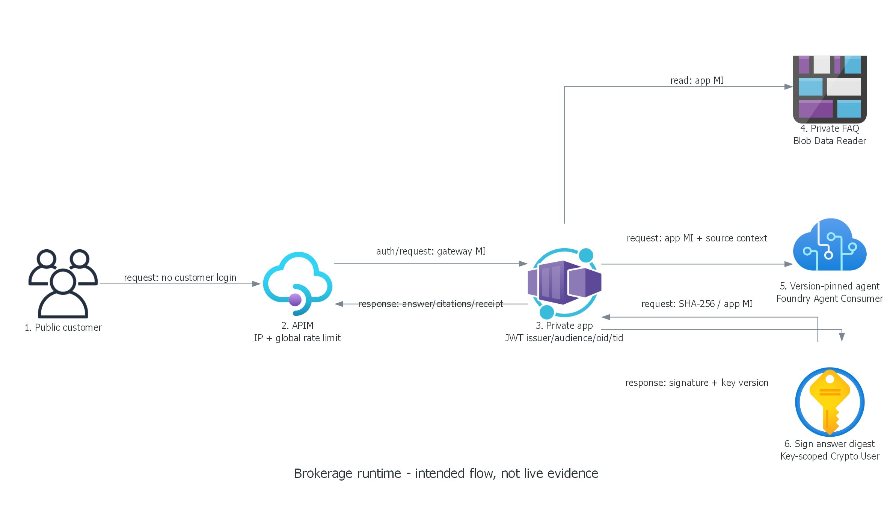

# Finance security local implementation

> Generated by az-01-conductor agent | 2026-10-22

## 📋 Overview

Implement the anonymous public gateway/private brokerage reference locally.
No targets, deployment permission, live service checks or what-if execution are inferred from this plan.
The implementation predates deployment; this is not a hack package plan.

## 📦 Resource Inventory

The architecture assessment contains SKUs, purpose and trust boundaries.
All resource parent services use current pinned AVM releases verified against the public MCR tags endpoint.
The exact API-version schemas are exercised by local Bicep compilation.

## 🗂️ Module Structure

| File | Responsibility |
| --- | --- |
| `infra/main.bicep` | Tagged root, network, identities, private services, endpoints, diagnostics and conditional app |
| `infra/modules/project.bicep` | Direct child project, AAD connections, RBAC and Standard capability host |
| `infra/modules/post-host.bicep` | Service-created persistence scope access after capability host creation |
| `infra/modules/workload.bicep` | Real image, internal ACA app, gateway API operations and managed-identity policy |
| `infra/gateway-policy.xml` | Anonymous rate controls, token replacement, sanitized explicit failures |
| `infra/main.parameters.json` | azd environment bindings; not concrete what-if inputs |
| `azure.yaml` | Docker build from scenario root; no automatic cloud-mutating hooks |
| `src/Brokerage.Web` | .NET 10 Razor UI, JWT boundary, Blob/Foundry/Key Vault SDK integration |
| `data` | Twelve synthetic FAQ topics and versioned agent instructions; no person records |
| `tests/Brokerage.Tests` | Local deterministic logic and HTTP boundary tests, not live inference |
| `scripts` | Guarded operator installation and confirmed-target what-if preparation |

AVM modules pinned on 2026-10-22:

| Resource module | Version |
| --- | --- |
| `operational-insights/workspace` | 0.16.1 |
| `managed-identity/user-assigned-identity` | 0.6.0 |
| `network/network-security-group` | 0.5.4 |
| `network/virtual-network` | 0.10.2 |
| `network/private-dns-zone` | 0.8.1 |
| `network/private-endpoint` | 0.12.1 |
| `storage/storage-account` | 0.33.1 |
| `document-db/database-account` | 0.21.1 |
| `search/search-service` | 0.13.0 |
| `key-vault/vault` | 0.14.2 |
| `container-registry/registry` | 0.13.1 |
| `cognitive-services/account` | 0.19.1 |
| `app/managed-environment` | 0.16.0 |
| `app/container-app` | 0.23.0 |
| `api-management/service` | 0.15.0 |
| `api-management/service/api` | 0.2.2 |

Raw extension resources are justified:
the account AVM exposes neither child project, AAD connections nor capability host.
The checked project subdirectory is metadata only, not a published deployable module.
Conditional Blob ownership and Cosmos SQL data assignments match the official Standard setup extension resources.
Raw role assignments and resource-group tags are governance extensions, not replacement service implementations.

## 🔨 Implementation Tasks

- Build the real API integration with current pinned SDKs; no application mock or success fallback.
- Keep deterministic doubles exclusively in the test project.
- Publish source fixtures in the app distribution for explicit operator installation, not runtime local fallback.
- Authenticate runtime through the app managed identity; use Azure CLI only in explicit operator initialization.
- Version-pin agent execution and print the real installed version.
- Implement source-ID validation, response-digest signing, explicit error output, request bounds and timeouts.
- Validate configuration at startup, JWT authorization and customer-facing error/empty/loading states.

## 🚀 Deployment Phases

These are future operator steps, not commands executed or deployment consent.

1. Confirm exact Azure CLI and azd targets using existing user account information at deployment time.
   Check service regions, feature registrations, quota/capacity, policies, subnet overlap and private operator access.
1. Resolve Foundry Agent Consumer role GUID and create or identify a single-tenant backend API registration.
   Set its application ID URI and access-token version 2; no client secret is needed.
1. Prepare and execute what-if only under explicit authorization.
   `scripts/Prepare-WhatIf.ps1` refuses an unconfirmed or unverified target.
1. Review actual changes and itemized dated costs, then obtain separate deployment consent.
1. Provision the foundation with `deployWorkload=false`; this creates no placeholder application.
1. From a private connected operator host, build/push the real container to the private registry.
   Run guarded initialization to upload/read back FAQs and create or reuse an identical agent version.
1. Re-preview workload changes using `deployWorkload=true`, the real immutable image and installed agent version.
   Confirm authorization covers this stage, then deploy the private application and public API operations.
1. Exercise live browser/API behavior, private data paths, unauthorized identities and observable failures.
   Only a fully passed live run can produce the required validation index and review snapshot.

The azd parameter file is intentionally nonconcrete. It binds target settings only after an operator confirms them.
Do not paste it directly into Azure CLI: azd resolves its environment expressions.
No generic `azd up` one-shot claim is made because initial private registry/image and agent installation are staged.

## 🔗 Dependency Graph

Logs/identities/NSG -> VNet -> DNS and private resources -> endpoints -> project/connections/roles -> capability host
-> post-host persistence roles -> private installation -> app and APIM routes.
The internal ACA environment and outbound-integrated APIM are foundation resources.
DNS for the internal environment is linked before the workload API points to its private FQDN.

## 🔄 Runtime Flow Diagram

Both images are generated by `03-architect-diagram.py`; retaining one source prevents diagrams drifting apart.

## 🏷️ Naming Conventions

Resource group is `rg-{environment}`. All service names use one `uniqueString(resourceGroup().id)` suffix.
Names in diagrams use the same `{suffix}` notation because no deployment target has been selected.
Synthetic branding stays Adatum Corporation; no domain ownership is implied.

## 🔒 Execution Handoff

Local validation results and limitations belong in `06-deployment-summary.md`.
Deployment, live inference, suitability review, authoring and event rollout remain separate gates.
