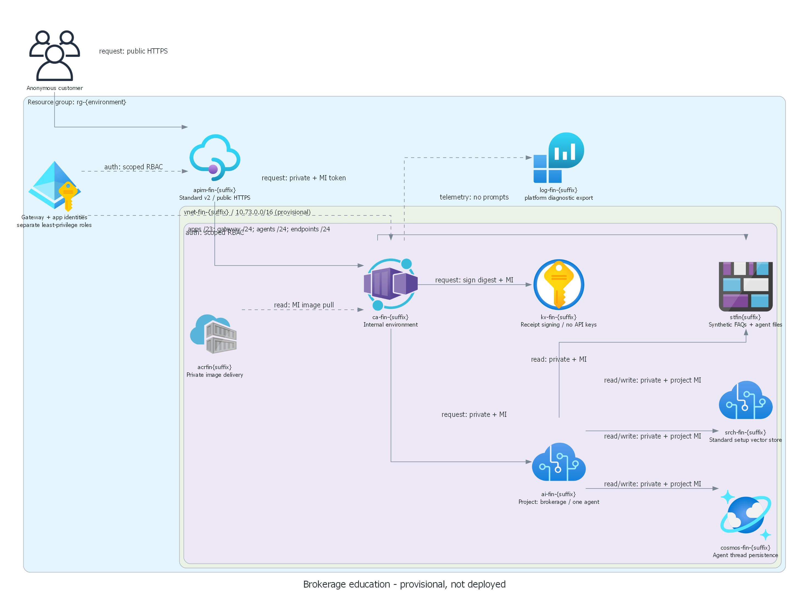
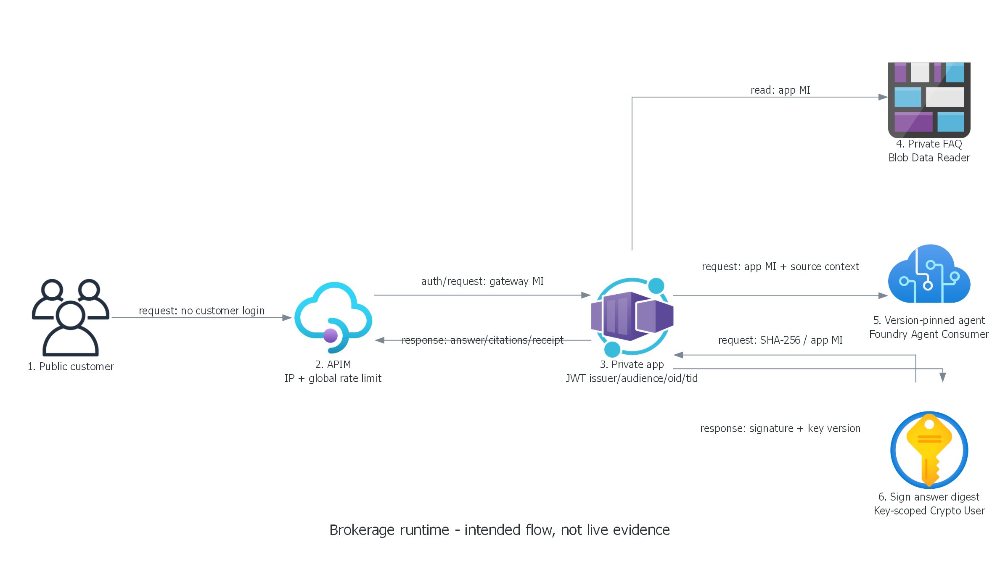

# Private solution overview

The deployable coach is a sanitized source copy of the approved reference, not a second design.
Adatum Corporation / adatum.com is company catalog record 1; there are no person-bearing fixtures.

## Evidence limitation

User statement: "the full scenario worked as expected, deployment was successful. I cant go back to the sub,
since it's a one-off hosted lab subscription. I deployed the scenario and it worked.
Deleted to save costs in my azure sub."
This is historical user attestation, not independent verification.
Former URL, exact deployment/test time, targets and logs are unavailable; no live URL is supplied.
New coach/team environments remain undeployed. Local tests do not certify cloud deployability or capacity.

## Full architecture — keep private

Anonymous browser -> public APIM Standard v2 -> private internal ACA application.
APIM replaces customer authorization with its gateway MI token for a distinct Entra backend audience.
App validates signature, issuer, audience, lifetime, tenant and allowed gateway identity object ID.
App MI reads the private knowledge blob, invokes a named versioned Foundry agent and signs the answer digest.

Foundry Standard private setup uses a direct child project, model, capability host,
Storage, Cosmos DB and Search. Search is a platform dependency, not an agent search tool.
VNet, delegated subnets, private endpoints/DNS and post-host persistence roles retain the approved sequencing.
ACR Premium privately serves the real app image; Logs holds diagnostics and sanitized identifiers.

FAQ grounding is bounded source context, not embeddings or a new search/indexing architecture.
Key Vault holds a nonexportable RSA signing key, not Foundry keys or artificial secrets.
SHA-256 exact UTF-8 answer digest plus RS256 signature protects integrity only.
There are no agent tools, trades, customer portfolios or multi-agent orchestration.

## Least privilege and setup

Runtime app: project-scoped Agent Consumer, knowledge-container Blob Reader,
key-scoped Crypto User, registry AcrPull.
Gateway: own MI for the backend audience, no model/source/key roles.
Installer: development/upload/key-management/image-push permissions, removed after setup.
Project MI: approved Standard service roles, including conditional post-host persistence access.
Resolve the Agent Consumer role definition in the actual target; never silently substitute a broader role.

## Private omission matrix summary

Participant preprovided: isolated empty team group/access contract and exact synthetic FAQ only.
Learners build all model, agent, host, gateway, signing, identity, networking and operational components.
Full app, agent instructions, initialization logic, tests and diagrams are coach-only.
No service modules, role assignments, source loaders or app outputs remain in the starter.

## Limits

Provisional eastus2 / gpt-4.1-mini 2025-04-14 GlobalStandard is not quota or capacity proof.
Anonymous rate controls are approximate; no WAF, general egress firewall or production-scale claim exists.
Entra/platform control-plane egress exceptions remain; do not call this a zero-internet environment.
Cold provisioning and private setup can exceed 150 minutes; event readiness must be checked beforehand.
Use partial fallback evidence honestly rather than weaken the approved security architecture.
