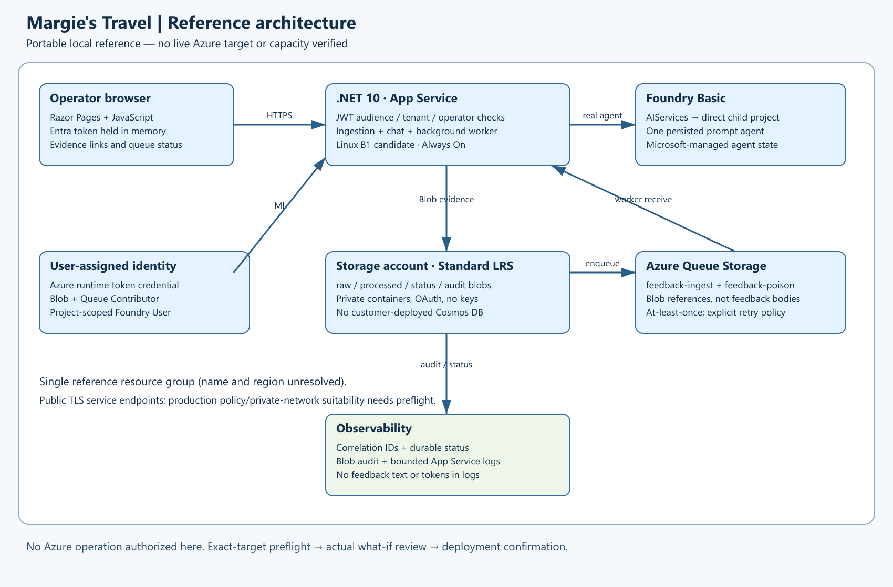
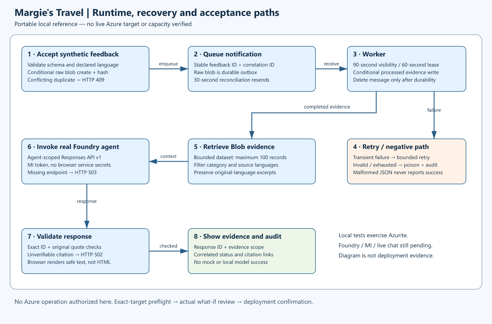

# Architecture Assessment — hospitality-feedback

## Requirements Validation

### Current resume review - 2026-10-24

The same reference is preserved. Current portal intake is Hospitality & Travel / Hotels,
`businessUnits: ["generic"]` as the documented legacy fallback, with no selected WAF priorities or domains.
Managers review multilingual service-quality evidence and proposed improvements; no hotel action is automated.
**The preserved design was explicitly confirmed in the portal at 2026-10-24 17:42:42 UTC.**
No cloud or directory authorization is recorded for this resumed run.
The dated preflight below and `00-region-availability.json` remain historical evidence, not current permission,
capacity, target selection or deployment completion. Do not run their commands based on their authorization fields.
The existing West US 3/model combination is a provisional reuse candidate only; refresh eligibility after authorization.

### Agentic runtime contract

Pattern 02, Sequential / Pipeline, is application-hosted with one real Foundry Basic prompt agent.
Deterministic ingestion and retrieval precede synthesis; server validation checks source IDs and exact excerpts.
This retains the simplest single-agent baseline without tool-selection or multi-agent claims.
Typed contracts and source ownership are described in requirements and existing implementation.
Guest names are withheld from agent input. Suggestions are drafts; the manager retains action authority.
The worker uses a 60-second blob lease, 90-second queue visibility and 45-second processing deadline;
the outbox reconciler runs every 30 seconds and retries stop after five deliveries.
Chat retrieves at most 100 records, limits each operator to ten requests/minute
and times out dependencies at 75 seconds.
There is no model call in the worker's lease window. Explicit model-output token/cost caps are not yet configured;
review these during post-design implementation rather than claim an enforced spend cap.
Acceptance must trace payload collisions, stale correlations, outbox recovery, retry exhaustion and poison handling,
as well as live model inference, agent invocation, grounded chat, unsupported claims and authentication denials.

### Management and deployment access

The preserved design uses public TLS service endpoints and private blob containers, not a private network.
No separate Bastion, VPN, management VM, container registry or image build is required for this App Service zip design.
This is a proposed design for confirmation, not inferred private/public-network approval.
The authorized local host would use explicit subscription and azd environment for ARM/publishing and preparation.
The App Service managed identity performs runtime Storage/Foundry operations.
Operator token acquisition is a separate Entra dependency; ARM access does not prove API access.
Target policy, real runtime data access and allow/deny tests remain deferred until authorized preparation/installation.

### Authorized Preflight Update — 2026-10-22

The current recommendation is **West US 3**, Foundry Basic account **S0**, direct child project,
`gpt-4.1-mini` version `2025-04-14`, regional **Standard**, capacity **10**.
Supporting SKUs are Linux App Service **B1 × 1**, `.NET 10`, and StorageV2 **Standard_LRS**, Hot.
Live model quota is 5000 units, used 0; the capacity endpoint reports 5000 available.
These are point-in-time results, not capacity reservations.
The model catalog labels this version **Legacy**, with inference deprecation `2027-04-14`;
it remains an available agent-compatible option for this short reference, not a long-term model commitment.
Standard avoids choosing global inference routing solely for capacity.

East US 2 failed provider what-if because this subscription's B1 quota is zero.
West US 3 then passed provider what-if without changing the architecture or hosting SKU:
24 creates, no modifications/deletions, and two unidentifiable runtime-identity Storage role assignments.
Those two assignments remain expected but are not fully analyzed by ARM what-if.
The Entra API audience is preview-only and must be replaced before another preview and deployment authorization.
See `00-region-availability.json`, `evidence/what-if.json`, and `evidence/preflight-report.md`.

Current Linux B1 public retail price is USD 0.017/hour (about USD 12.41 at 730 hours).
Allow USD 1–10/month for low-volume Storage and related usage, plus metered model tokens and any egress.
This replaces the earlier broad hosting allowance below; model-specific pricing remains unquoted.
For planning, reserve roughly USD 15–30/month **before model usage**; a budget is not yet created or authorized.

The original local design assessment below is retained as historical context.

**Locally implemented architecture. Deployment readiness remains unverified.**
Region, model/version, deployment SKU and capacity remain unresolved target-specific parameters.
Public documentation and current AVM schema/tag evidence support the portable implementation.
See `04-implementation-plan.md` for exact module versions and code paths.

### Executive Summary

Use one application, one processing worker, one Storage account and one Foundry resource with a direct child project.
Avoid a hub, Cosmos DB, a separate vector database and specialist agents.

### Recommended Architecture

Implemented data paths, awaiting live Azure acceptance:

1. Authenticated producer → application ingestion endpoint → immutable raw feedback blob.
1. Application → Queue Storage message containing event ID, correlation ID and blob reference, not feedback text.
1. Worker → raw blob → schema validation and normalization → processed evidence blob and status record.
1. Authenticated browser → application chat → bounded evidence retrieval from Blob Storage.
1. Application → real Foundry agent with grounded evidence context or a verified retrieval-tool path.
1. Agent response → server citation validation → browser, with original text and stable feedback IDs.

Use managed identity on runtime Azure resource paths. Browser credentials must not expose Foundry or Storage keys.
The application, not the queue, supplies near-real-time polling visibility and operational status.
Diagrams are generated from matching Python sources; they show implemented code, not proof of deployment.

## Resource SKU Recommendations

| Service | Provisional option | Constraint |
| --- | --- | --- |
| Storage | StorageV2 Standard LRS, hot blobs and queues | Modest synthetic data; no production resilience claim |
| Application hosting | App Service Linux B1 candidate | JWT and bounded colocated worker implemented; region pending |
| Foundry | Current resource and direct child project | Exact SKU/model/version/capacity unselected |
| Monitoring | Application diagnostics with small retention/caps | No feedback text or tokens in logs |

Worker hosting uses the same Always On application process.
Lease-based coordination, bounded processing, conditional evidence writes and outbox recovery are implemented.
Do not promise serverless scaling from an App Service background worker.

## Architecture Decision Summary

### Queue Storage versus Service Bus

Choose **Azure Queue Storage**: the same Storage platform supports small asynchronous notifications,
no FIFO ordering, sessions, broker transactions or topics are required, and it minimizes services and fixed cost.
Messages must stay below 64 KB; store the source text in blobs and send identifiers only.
Service Bus would be justified by ordered sessions, broker-managed dead-lettering, transactions or routing.
Those are not current requirements, so do not add Service Bus merely for its richer feature set.

Queue Storage is at-least-once and may reorder deliveries. Implement visibility renewal, bounded retries,
event-ID idempotency, explicit poison queue handling and durable state transitions.
An enqueue failure after raw upload needs an outbox/reconciliation mechanism; it must not become silent data loss.
Deleting a queue message occurs only after durable successful processing or durable poison disposition.
Reprocessing with an event ID must verify payload consistency rather than overwriting a different event.

### Foundry Basic versus Standard

Current official Standard setup guidance requires BYO Storage, Search and Cosmos DB for agent state.
That is incompatible with deploying no Cosmos DB resources. Do not generate Standard setup.
Basic setup is selected: Microsoft-managed resources handle agent state.
The user's prohibition covers customer-deployed Cosmos resources, not Microsoft-managed implementation details.
This is not evidence that Microsoft-managed internals use no Cosmos DB; it is a service caveat, not a blocker.
The application uses a persisted real prompt agent, not a direct-model-only replacement.
Private-network and customer-owned state requirements may prevent Basic; check target policy during preflight.

### Grounding and language handling

For a small bounded fixture set, deterministic Blob evidence selection avoids a separate indexing service.
Preserve original text, declared language, timestamps, hotel/service category and stable feedback ID.
Keep translation/interpretation distinct from original source and constrain claims to retrieved evidence.
Treat feedback as untrusted data, not instructions. Enforce request limits and authorized dataset scope server-side.
Validate returned citations; unsupported IDs and ungrounded claims must not be reported as passing acceptance.
Version evidence records and report the retrieval scope so omitted records do not imply global conclusions.

### Identity and data ownership

Storage owns application evidence and processing status.
Use separate producer/worker/chat privileges where practical, scoped to the required queues/containers.
Runtime identity requires Blob read/write and Queue send/receive only for its actual responsibilities.
Current official Foundry User role definition was inspected; the role is scoped to the direct child project.
The runtime can register its agent, requiring more than consume-only privileges.
APIs validate Entra JWTs, operator object IDs and scope/role. Live token/RBAC behavior remains to be verified.
Foundry retention and state deletion semantics remain service limitations to review before non-synthetic use.

### Consolidated identity installation plan

The existing token-entry UI and JWT API policy are retained. No approved caller/client or reusable registration
is established by local evidence; do not adopt the incompatible registration found in historical discovery.
Plan dedicated scenario-owned API and operator public-client registrations when no approved reusable inputs exist.
Expose delegated `access_as_user`, request v2 access tokens and retain the exact tenant/audience and operator checks.
Use a supported Microsoft authentication library with authorization-code/PKCE for the operator client;
the UI consumes its access token in memory and does not persist it or acquire broad Graph permissions.
Do not silently enable an application-permission caller; preserve the existing `Feedback.Operator` validation branch
without granting or assigning that role unless an authorized automation caller is actually needed.
The final operator token route must be verified during authorized installation, not assumed to work from a registration.

Local installation/validation automation is now prepared in `scripts/scenario_identity.py`.
It uses canonical exact-target deployment grants, the current writer lease and stable ownership markers.
It must capture actual application/client/object IDs, scope IDs, tenant, approved redirects and installation outputs,
and wire the API audience into azd automatically. Missing generated IDs are outputs, not user questionnaires.
`azure.yaml` now wires `scripts/Invoke-ReferenceHook.ps1`: preprovision installs identities, captures outputs and
runs the final-identity ARM preview; predeploy verifies installed identity configuration; postdeploy runs the
authenticated operator installation smoke. None of these cloud paths has been executed.
The operator helper builds locally and uses Azure.Identity/MSAL interactive browser authorization-code/PKCE only
with an explicit `--interactive` invocation. Noninteractive jobs require an approved process-local operator token.
No token or refresh cache is written. Tenant consent restrictions remain dependent live checks, not assumed success.
The smoke does not replace independent model inference, semantic grounding review or complete runtime acceptance.

Present one end-to-end deployment review covering ARM resources/RBAC, scenario-owned directory objects,
delegated scope consent, exact token route/redirects and operator access, with costs and dependent checks disclosed.
Directory writes require separate explicit coverage in that scope; read-only preparation does not authorize them.
Tenant policy may allow member registration but the historical deployer was a guest; current capabilities are unknown.
Do not assume administrator rights, installation success, broad Graph grants or permission to change tenant policy.
Independent ARM preview can precede generated IDs; disclose dependent what-if checks without fabricated audiences.
The historical preview-only audience must never reach provisioning.
No directory operation has run. Eleven local consent/ownership tests pass using isolated Graph fixtures.
These tests do not prove actual tenant rights, Graph installation, user consent or token acquisition.

Official identity guidance checked on 2026-10-24:
[default permissions][identity-permissions] and [authorization code with PKCE][identity-pkce].
These public references resolve implementation planning only, not tenant-specific permission or user consent.

### Well-Architected trade-offs

- Reliability: retries, poison handling and reconciliation; LRS is not zone-failure resilience.
- Security: managed identity, authenticated app, private blobs, bounded inputs and source-aware prompt handling.
- Cost optimization: one Storage account, one agent, small fixtures; avoid Search and multi-agent fixed overhead.
- Operational excellence: correlation IDs, latency/retry metrics, durable status and a replay/recovery runbook.
- Performance efficiency: bounded evidence context and asynchronous ingestion; no unbounded full-container chat scan.

## Cost Estimate and Limitations

Planning allowance only, **not a current regional price quote**:
approximately USD 20–70/month fixed application hosting, USD 1–10/month low-volume Storage and diagnostics,
plus model token usage. Total model cost cannot be estimated responsibly until model and expected tokens are known.
For a short dry run, prorate hosting and cap model calls/logging; set a budget before any authorized deployment.
Private networking, additional worker compute, retention or regional pricing can materially increase costs.
No Azure spend was incurred by this job's operations.

## Implementation Handoff

**Current gate:** local validation is complete; review the proposed Azure context in the portal and explicitly
authorize exact-target read-only preparation. Design confirmation is retained and must not be requested again.
Existing diagrams, Bicep, multilingual fixtures and provenance were not regenerated.
Identity/azd ordering is prepared locally. No Azure action is permitted until preparation is authorized.
Historical check results and the older handoff below are retained for provenance, not imported as current completion.

Portable AVM-first Bicep/azd, real application, fixtures, tests and PNG diagrams are implemented.
Next obtain exact account, tenant, subscription, resource groups and azd environments for live preflight.
Then collect current region/model/quota/capacity and governance evidence; no local check substitutes for it.
Prepare and review actual what-if before seeking separate exact-target deployment confirmation.
Deployment request alone does not satisfy that checkpoint.

## Execution Handoff

No delegation. Resume the same Phase A context with the missing decisions.
Local fixtures, diagrams and code are complete; no live deployment, model inference or real agent response is claimed.

## References

- [Queue comparison][queues]
- [Standard agent resource requirements][standard]
- [Current project creation][projects]

[queues]:
  https://learn.microsoft.com/azure/service-bus-messaging/service-bus-azure-and-service-bus-queues-compared-contrasted
[standard]: https://learn.microsoft.com/en-us/azure/foundry/agents/concepts/standard-agent-setup
[projects]: https://learn.microsoft.com/en-us/azure/foundry/how-to/create-projects
[identity-permissions]: https://learn.microsoft.com/en-us/entra/fundamentals/users-default-permissions
[identity-pkce]: https://learn.microsoft.com/en-us/entra/identity-platform/v2-oauth2-auth-code-flow
