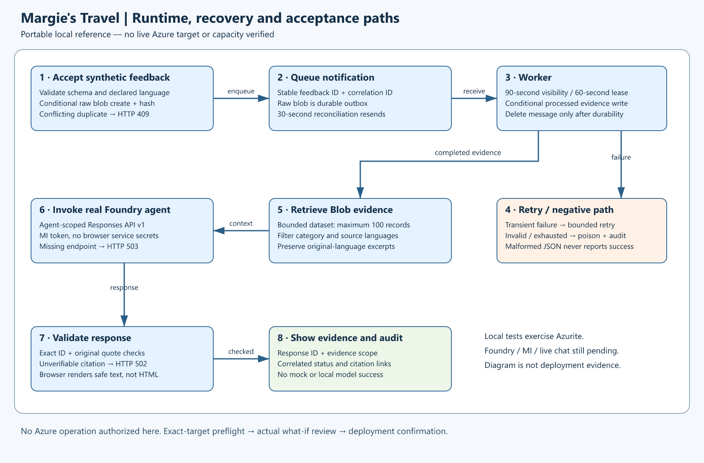

# Implementation Plan — hospitality-feedback

## Overview

This is the complete local Phase A reference implementation, not a learner starter or hack package plan.
Portable implementation is allowed without Azure target selection; live target validation and deployment are not.
The earlier design-only stop incorrectly treated code generation as target-dependent. This continuation corrects it.

## Resource Inventory

| Resource | SKU / configuration | Implementation |
| --- | --- | --- |
| Resource group | Exact confirmed name parameter | AVM `resources/resource-group:0.4.4` |
| Runtime identity | One UAMI for app/worker | AVM `managed-identity/user-assigned-identity:0.6.0` |
| Storage | StorageV2 Standard LRS, hot Blob + Queue | AVM `storage/storage-account:0.33.1` |
| Foundry resource | AIServices S0 | AVM `cognitive-services/account:0.19.1` |
| Model deployment | Name/version/SKU/capacity required parameters | Foundry AVM nested deployment |
| Direct child project | Basic, no BYO capability stores | Native `accounts/projects@2025-06-01` |
| Project role assignments | Foundry User, project scope | Native role-assignment extension |
| App Service plan | Linux B1, one instance, Always On | AVM `web/serverfarm:0.7.0` |
| Web app | .NET 10; JWT; same-host background worker | AVM `web/site:0.24.0` |

Public MCR tags were queried on 2026-10-22; these versions restored and compiled locally.
Standalone AVM paths `cognitive-services/account/project` and `authorization/role-assignment` returned HTTP 404.
Their native resources are justified exceptions. Storage children and RBAC use their parent AVM interfaces.
No Cosmos, Search, hub, Key Vault, Event Hubs, Service Bus or multi-agent components are deployed.

## Module Structure

```text
infra/main.bicep                 subscription target and explicit parameters
infra/workload.bicep             resource-group workload and AVM composition
infra/main.parameters.json       azd environment substitution; no real target values
azure.yaml                      web service → App Service
src/HospitalityFeedback.Web/     real .NET 10 Razor Pages app and queue worker
tests/HospitalityFeedback.Tests/ unit, protocol-contract and actual Azurite integration tests
data/                           12 multilingual synthetic records and catalog provenance
scripts/                        local checks, fixture import, diagrams, bounded browser check and guarded what-if
```

## Implementation Tasks

### Infrastructure and azd

Required parameters are environment, resource group, region, model name/version/deployment SKU/capacity,
deployer object ID, API token audience and authorized operator object IDs.
No region or model is selected from memory.
Use `rg-{environment}` when that exact target is authorized; the explicit RG parameter also honors other approved names.
Unique technical resource names derive from the resource-group resource ID, not synthetic company invention.
Required tags apply to taggable resources. Child queues/containers, role extensions and configuration resources
do not support independent tags.

### Application and access

Razor UI is public static content only. APIs require a valid Entra JWT in Azure, with tenant, audience, expiry,
operator-object-ID allowlist, and `access_as_user` scope or `Feedback.Operator` application role.
Configure an existing API app registration; no directory changes are automated.
Tokens remain in page memory; there is no browser local/session storage, no app key and no credential in source.
The explicit requirement for secured live APIs takes precedence over the generic sample-app no-auth recommendation.
REST via a typed HttpClient is limited to the officially documented Foundry protocol; it is not arbitrary data fetching.

All Azure runtime calls use a user-assigned MI. Deployer data-plane access is separately assigned.
The app can register its deterministic named prompt agent, so it uses Foundry User at project scope.
Split agent registration from runtime and use a Consumer role when hardening beyond this modest reference.
The role GUID was taken from current official role-definition source, not historical memory.
No raw feedback text, access token or dependency body is logged.

### Ingestion and evidence

The API validates feedback, conditionally creates an immutable-by-application raw blob with SHA-256 payload hash,
and sends an ID/correlation notification. Identical IDs/payloads are idempotent; content collisions return 409.
Raw blobs form the durable outbox: a 30-second reconciler resends pending notifications.
The worker receives at-least-once messages, acquires a 60-second raw-blob lease, validates source/hash/correlation,
and conditionally writes processed evidence before status completion and queue deletion.
Messages have a 90-second visibility interval; Storage processing has a 45-second cancellation deadline.
No model invocation runs inside this lease window.

Transient failures retry to five deliveries; invalid JSON/envelopes fail permanently.
Audit poison metadata and poison queue entries precede source-message deletion.
Poison records contain hashes/error codes, not raw feedback text. Poison notifications can duplicate after failures.
Source correlation checks prevent a stale/malicious envelope from poisoning another event.
The queue is not a true event stream: no replay offsets, FIFO, exactly-once guarantee or pub/sub is claimed.

### Chat and model path

The app deterministically retrieves up to 100 processed records, with optional category/language filters.
It refuses larger datasets rather than silently presenting a truncated population.
It invokes the persisted prompt agent using the current agent-scoped Responses API `v1` endpoint.
The model and exact deployment version remain parameters.
Prompt instructions require response-language awareness, source-language exact quotes
and insufficient-evidence behavior.
Server validation rejects unknown citation IDs, invented/translated quotations, missing citations and incomplete output.
Response IDs, scope and citation IDs are audited without persisting user prompts in application logs.
Quote validation does not prove semantic entailment or translation correctness; those require live human/runtime review.

### Fixtures and tests

Twelve records cover English, Spanish, French and Japanese across five hotel-service categories.
Guest names are exact `FullName` values from people catalog records 1–12.
`data/provenance.json` maps each stable guest/feedback ID to its catalog record; no nationalities are inferred.
Unit/protocol tests are explicitly not live Foundry evidence.
Azurite tests exercise actual SDK Blob/Queue operations, idempotency, Unicode, poison handling,
correlation protection, outbox recovery, retry exhaustion and evidence limits.

## Deployment Phases

### Confirmed-design continuation - 2026-10-24

Design confirmation is recorded in canonical portal history; no repeated design decision is needed.
The original Bicep, fixtures and diagrams remain unchanged.
The scenario's `NuGet.config` now uses only the approved MicrosoftPackageFeedProxy.
`Program.cs` maps the native Entra `roles` claim explicitly, preserving both authorized policy branches.
Ten signed-token middleware cases prove the scope/role paths and required authentication/authorization denials.

Prepared installation dependencies:

- `scripts/scenario_identity.py`: canonical scope/writer guard, ownership-marked application/SP creation,
  interrupted-creation recovery, drift verification and automatic nonsecret azd output capture.
- `scripts/Invoke-ReferenceHook.ps1`: preprovision identity/final-audience preview, predeploy verification and
  postdeploy authenticated installation smoke. Material/unexpected preview changes stop provisioning.
- `src/HospitalityFeedback.Operator`: built Azure.Identity/MSAL PKCE helper; retains credentials only in process.
  Explicit interactive sign-in is separate from noninteractive jobs. No production anonymous mode is introduced.
- `tests/test_scenario_identity.py`: eleven local consent/ownership/assignment-policy tests, not directory evidence.

Directory writes, user consent/token acquisition, hook cloud execution and final-identity what-if remain unverified.
Deployment consent must explicitly cover the two scenario applications/SPs as well as ARM resources and RBAC.
ARM what-if cannot preview Graph operations; missing generated identity IDs do not block independent preparation.
The final identity preview runs after authorized installation and before ARM provisioning, without routine phase cards.

1. Complete local checks and preserve results, diagrams and source. No Azure target needed.
1. Obtain exact account/subscription/tenant/RG/azd target and preflight authorization.
1. Validate policy, provider availability, App Service .NET stack, model version/SKU/quota and current capacity.
1. Resolve parameter values and run actual what-if in the confirmed scope.
1. Stop for separate post-what-if exact-target deployment confirmation.
1. Deploy root reference, ingest through app identity, test model, agent, grounded chat and negative cases.
1. Write live acceptance and demo evidence; only then create the review snapshot and stop for suitability approval.

## Dependency Graph

AVM resource group → independent UAMI + Storage + Foundry + app plan.
UAMI → Storage RBAC; Foundry → direct project → project RBAC; all runtime outputs → web app configuration.
The pre-existing user identity is not created or switched by infrastructure.

## Runtime Flow Diagram



Source: `04-runtime-diagram.py` and `scripts/draw_diagrams.py`.
The existing skill's grouped-resource diagram pattern is preserved.
SVG plus workspace-local resvg is used because Graphviz/Python diagram packages are absent; no global install needed.

## Execution Handoff

No delegation. Local evidence lives in `evidence/`; it is separate from a live `scenario-validation.json`.
This is not a production security/resilience certification, event deployment or suitability approval.
