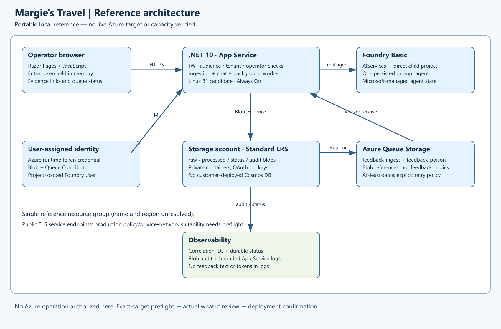

# Margie's Travel — multilingual hotel-service feedback

**2026-10-24 resume: preserved design confirmed; current local validation passed. Not deployed.**

Forty .NET tests, eleven Python identity-boundary tests, local application/browser checks and Bicep build/lint passed.
Original fixtures, identities, Bicep and diagram assets are preserved. The JWT app-role claim mapping was corrected;
tenant/audience validation, operator allowlisting and scope-or-role requirements remain enforced.
No current Azure/directory permission, live inference, scenario approval or composition is claimed.
See [current evidence and the single deployment preparation boundary](06-deployment-summary.md).

The 2026-10-22 preflight/authentication files are historical evidence only, not current target selection or consent.
Use the portal Azure context card to review the historical target proposal or replace it before authorizing
read-only preparation. Directory installation and provisioning require separate, consolidated deployment consent.

This Phase A reference uses .NET 10 Razor Pages, Azure Blob and Queue Storage,
and one real Microsoft Foundry Basic prompt agent. It deploys no customer Cosmos resource.
Basic agent state is Microsoft-managed; service internals are not represented as customer-owned Storage.

## Start Here

- [Requirements and provenance](01-requirements.md)
- [Architecture, costs and trade-offs](02-architecture-assessment.md)
- [Implementation/resource mapping](04-implementation-plan.md)
- [Commands, actual results and missing authorization](06-deployment-summary.md)
- [Local and future live demonstration](demoguide/demoguide.md)
- Local evidence: `evidence/local-validation.json`, `evidence/tests/local-tests.trx`



## Local Prerequisites

- Approved .NET 10 SDK; the resumed run used the host's existing SDK 10.0.402.
- Azure CLI Bicep command for **local** compilation/linting, without login or target selection.
- Node.js for Azurite, resvg and optional Playwright; Python 3.10+ for generation.
- `NuGet.config` enables only the host-approved MicrosoftPackageFeedProxy with normal certificate validation.

Prepare missing tools outside scenario workers using repository `PREREQUISITES.md`.
This resume reused existing Azurite and Playwright packages and installed no shared tools.

## Local Run

Use a dedicated emulator instance; integration tests reset its `raw`, `processed`, `status` and `audit` containers
and the two feedback queues. Never run the integration tests concurrently with a demo using that emulator.
No Azure Storage connection string is accepted by these tests; they hard-code development storage.

Terminal 1:

```powershell
node .tools/azurite/node_modules/azurite/dist/src/azurite.js `
  --silent --skipApiVersionCheck --location .local/azurite `
  --blobHost 127.0.0.1 --queueHost 127.0.0.1 --tableHost 127.0.0.1
```

`--skipApiVersionCheck` is emulator-only compatibility for the current Azure SDK service version.
It does not disable TLS checks or alter any Azure request.

Run checks before starting the application:

```powershell
.\scripts\Validate-Local.ps1 -Dotnet "$PWD\.tools\dotnet\dotnet.exe" -WithAzurite
.\.tools\dotnet\dotnet.exe publish src/HospitalityFeedback.Web -c Release -o .local/publish
```

Terminal 2:

```powershell
.\scripts\Start-Local.ps1 -Dotnet "$PWD\.tools\dotnet\dotnet.exe"
```

Import fixtures from another terminal:

```powershell
.\scripts\Import-Fixtures.ps1 -ApplicationUrl http://127.0.0.1:5080 -LocalOnly
```

Open `http://127.0.0.1:5080` **while that process is running**.
This is not a live Azure URL. Refresh status to see queue processing and evidence.
With no Foundry configuration, chat deliberately returns HTTP 503 and `mockFallback: false`.
Do not claim local ingestion or a rendered homepage proves real model/agent success.

The job stops its temporary servers before returning; it does not leave a hidden local service running.

## Reproduce Fixtures and Diagrams

```powershell
python scripts/generate_fixtures.py --catalog-root C:\HackBuilder
python 03-architect-diagram.py
python 04-runtime-diagram.py
```

Person records 1–12 are copied exactly from the repository CSV; narratives are authored synthetic feedback.
`data/provenance.json` records the mapping, exact company identity and rejected malformed company rows.
Existing generated fixtures do not need regenerating to run or deploy this scenario.

## Azure Configuration — Current Preflight and Remaining Gates

The historical local azd environment `hospitality-feedback` contains the previously reviewed subscription and tenant,
`rg-hospitality-feedback`, and candidate `westus3`. These are proposals, not current confirmed targets.
`API_AUDIENCE` intentionally remains unset until authorized scenario-owned identity installation captures it.
`infra/preview.parameters.json` contains a conspicuous **preview-only** audience,
not a deployable security configuration.
The operator allowlist provisionally contains the independently verified deployer object ID.
These are historical local configuration values, not current target authorization.
No application registration, provider registration, RBAC assignment or cloud resource was written during this resume.

The prepared `preprovision`, `predeploy` and `postdeploy` azd hooks enforce canonical deployment consent.
Identity installation creates only dedicated, ownership-marked API/public-client applications and their SPs.
It captures IDs and configures the selected azd environment automatically; no user ID transcription is needed.
Read-only preparation never permits directory writes. The planned directory actions must be explicitly covered
by eventual deployment consent; their appearance in a preparation scope describes the future plan only.
No broad Graph permission, app-role assignment, tenant-policy change or automatic admin consent is included.
The operator helper uses authorization-code/PKCE through Azure.Identity, with no persistent token cache:

```powershell
# Only in the authorized deployment session, after real identity and endpoint outputs exist:
dotnet run --project src\HospitalityFeedback.Operator -c Release -- --interactive
```

This signs in and runs authenticated installation checks in one process; it does not print bearer tokens.
Noninteractive postdeploy requires an already approved `FEEDBACK_API_TOKEN` or fails explicitly.
The helper's smoke receipt is not complete live acceptance or suitability approval.

The original portable configuration guidance follows; current evidence supersedes its missing-target statements.

Confirm account, subscription, tenant, reference resource groups and azd environment before live preflight.
Do not use the CLI's default account as authorization, switch accounts automatically, or infer a region/model.
The user must separately authorize deployment after reviewing actual what-if for that exact target.

`azure.yaml` maps `web` to the .NET project. `infra/main.bicep` is subscription-scoped.
`infra/main.parameters.json` consumes these **unfilled** environment values:

| Variable | Meaning |
| --- | --- |
| `DEPLOYMENT_ACCOUNT` | Exact account confirmed in the canonical portal target scope |
| `AZURE_ENV_NAME` | Exact confirmed reference azd environment |
| `AZURE_SUBSCRIPTION_ID`, `AZURE_TENANT_ID` | Explicitly selected target, compared before operations |
| `AZURE_RESOURCE_GROUP`, `AZURE_LOCATION` | Exact RG and live-validated region |
| `MODEL_NAME`, `MODEL_VERSION` | Exact target-supported model/version |
| `MODEL_DEPLOYMENT_SKU`, `MODEL_CAPACITY` | Validated deployment type/SKU and quota/capacity units |
| `AZURE_PRINCIPAL_ID` | Actual deployer object ID; not an email |
| `API_AUDIENCE` | Real v2 audience captured from the authorized scenario-owned API installation |
| `OPERATOR_OBJECT_ID` | Authorized operator's object ID |

For multiple allowed operators or a service-principal deployer, supply a resolved ARM parameter file with
`operatorObjectIds` and `principalType` set explicitly. Do not invent directory objects.
The installed API registration must issue v2 access tokens and expose delegated `access_as_user`
or an application role `Feedback.Operator`, with appropriate admin/user consent.
Obtain an authorized token using your organization's approved client flow. Do not paste it into source or logs.
The browser's token input is a modest reference UX, not a production interactive-login implementation.

Public TLS service endpoints are configured with OAuth/private containers and JWT-protected APIs.
No network isolation is claimed. If the selected target requires private networking, revise before deployment.
Live checks must verify the .NET 10 Linux stack, Basic agents, resource APIs, policy and selected model capacity.
No unsupported model, lower security or different target may be silently substituted.

After target-specific evidence is recorded, a user-supplied authorization file can permit:

```powershell
.\scripts\Invoke-TargetWhatIf.ps1 -AuthorizationFile target-authorization.json `
  -ResolvedParametersFile .local/resolved.parameters.json -ExpectedEnvironment '<CONFIRMED_ENVIRONMENT>'
```

The example authorization file has `authorized: false` and grants nothing.
The script compares CLI and azd targets without switching them, requires validated regional evidence,
runs what-if only, then stops. There is no automatic deployment hook.

Only after a separate exact-target post-what-if confirmation:
use the reviewed parameters with `azd provision` and `azd deploy web`.
Re-run what-if and obtain fresh confirmation if template/parameters change.
Provisioning or an azd endpoint output is not runtime acceptance.

## Live Runtime Proof Still Required

1. Inspect the actual Foundry account, direct child project, exact model deployment and MI role assignments.
1. Run model inference separately from the real agent invocation.
1. Import all fixtures through the HTTPS application so the actual runtime MI writes Storage and sends queue messages.
1. Verify completed status, Unicode, correlation IDs and idempotent reingestion through the app.
1. Ask multilingual prompts and inspect exact cited Blob evidence from the application.
1. Prove invalid input, insufficient evidence and poison/retry behavior; retain response IDs and actual errors.
1. Run Playwright against the authorized live URL; capture screenshot and network/request evidence.
1. Only then write the live acceptance index and demo guide evidence, snapshot and present for suitability approval.

See the demo guide for exact prompts, commands and recovery. No approval snapshot or hack composition is included.
Hospitality is unsupported in the current Skillable composition catalog; do not silently map it to retail.
