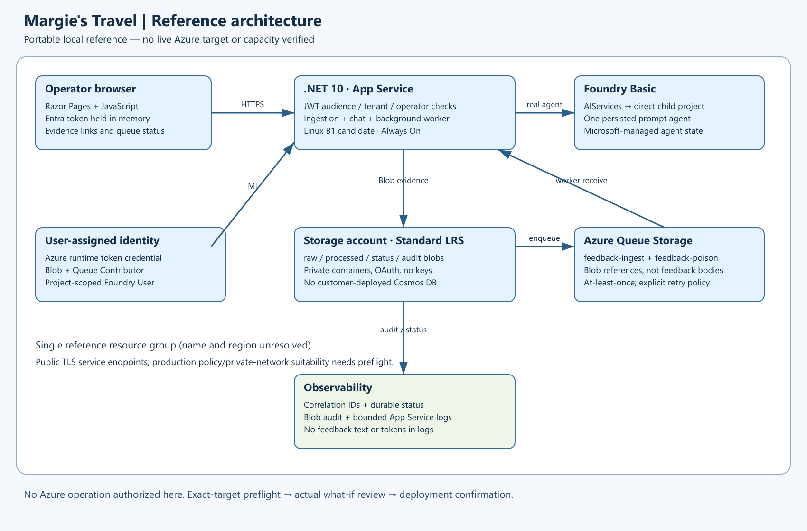
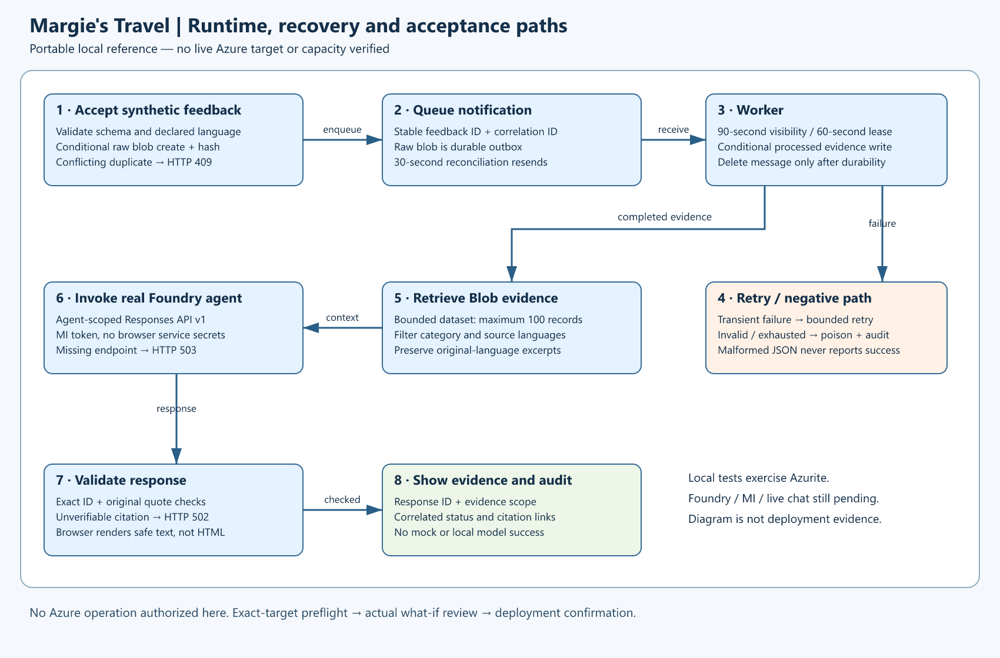

# Demo Guide — Margie's Travel hotel-service evidence

[comment]: <> (Local walkthrough and future live checklist; not a record of deployed success.)

---

### hospitality-feedback — demo scenario

<div style="background: lightgreen; font-size: 14px; color: black; padding: 5px; border: 1px solid lightgray;">

**Note:** These steps are a guideline.
Local ingestion and local negative checks are separate from real Azure acceptance.
No deployed URL, real inference, real agent invocation or live managed-identity proof is recorded yet.

</div>

### 1. What Resources are getting deployed

Margie's Travel service-quality managers compare hotel feedback without losing source languages.
Raw feedback and processed evidence live in Blob Storage. Queue Storage decouples ingestion and processing.
A .NET app retrieves bounded evidence and invokes one persisted Foundry Basic prompt agent.
The app validates source IDs and exact quotes before rendering the answer.
All current fixtures are synthetic; no customer Cosmos resource is provisioned.

- One explicitly named resource group; name and region remain unconfirmed.
- User-assigned managed identity, Storage account and two queues.
- Linux App Service plan and .NET app with an Always On background worker.
- Foundry resource, direct child project and parameterized model deployment.
- Microsoft-managed Basic agent state; no customer-owned Cosmos, Search or hub.





### 2. What can I demo from this scenario after deployment

## Audience, Timing and Preconditions

Audience: hotel operations/service-quality managers and technical reviewers.
Allow 5–8 minutes for local ingestion/error walkthrough, and 10–15 minutes for the future live story.
Setup, Azure RBAC propagation, capacity checks and deployment are not included in those estimates.

Local: follow `README.md`, start loopback Azurite, run tests, then start the app and import the twelve fixtures.
Do not run integration tests during the demo; they reset their dedicated emulator.
Azure: exact targets, actual what-if, separate deployment confirmation, resource provisioning, API registration/token,
model readiness and live fixture import must all be complete before describing any of this as live.

## Local Demonstration — No Azure Required

1. Show the architecture: Blob is the evidence system of record; Queue is work notification, not Event Hubs.
1. Open the running local app at `http://127.0.0.1:5080`.
1. Import using `scripts/Import-Fixtures.ps1 -ApplicationUrl http://127.0.0.1:5080 -LocalOnly`.
1. Refresh processing status. Point out each feedback ID, correlation ID, attempt and completed state.
   Processing can finish before the first refresh; use the accepted `queued` response and status timestamps as evidence.
1. Paste the exact first fixture and submit it again.
   Expected: duplicate=true, unchanged correlation, no duplicate evidence.
1. Change that fixture's text but keep its ID. Expected: HTTP 409 payload conflict, not a silent overwrite.
1. Submit an empty-text or unsupported-language record. Expected: HTTP 400 invalid feedback.
1. Click Analyze evidence with no Foundry configuration. Expected: HTTP 503 dependency unavailable.
   Explain that no response is invented to make the dry run look complete.
1. Show `evidence/tests/local-tests.trx` for real emulator processing, poison, retry-bound and outbox-recovery tests.
   Protocol tests use isolated synthetic HTTP fixtures and are not service-inference evidence.

If the process is stopped, start it from `README.md`; this job leaves no background server running after return.
The screenshot fallback is `evidence/local-browser.png`, explicitly labeled local.
Do not portray a local screenshot as a live deployment.

## Future Live Demonstration — Not Executed

### Prepared identity and installation route

Design confirmation is recorded; Azure preparation, directory installation and deployment remain separate gates.
The azd lifecycle now includes ownership-checked identity/output capture,
final-identity preview and authenticated smoke.
After actual installation, use `src/HospitalityFeedback.Operator` with explicit `--interactive` in the authorized
deployment session for Azure.Identity/MSAL PKCE sign-in and in-process fixture/chat checks.
Noninteractive postdeploy instead needs an approved process-local operator token and fails if it is absent.
No client/object IDs need manual transcription; no sign-in, directory write or live smoke has been run locally.
The generated smoke receipt is not independent model inference or complete live acceptance.

### Authentication and fixture installation

Use the real `SERVICE_WEB_ENDPOINT` only after it is proven live.
Acquire an approved Entra API token for the configured audience and allowed operator.
Keep the token in process memory/environment only; avoid command history containing the token.

```powershell
# $env:FEEDBACK_API_TOKEN is acquired through the approved identity flow, never committed.
.\scripts\Import-Fixtures.ps1 -ApplicationUrl $LiveApplicationUrl
$headers = @{ Authorization = "Bearer $env:FEEDBACK_API_TOKEN" }
Invoke-RestMethod "$LiveApplicationUrl/api/status" -Headers $headers
```

Poll until all twelve fixture IDs complete. Compare languages, original text and names against `data/feedback.json`
through `/api/evidence/{id}`. These requests exercise the app's actual MI read path, not a developer's Storage client.
Check unauthorized API requests return 401/403 and an unrelated operator is rejected.
Confirm the configured user-assigned identity and its Storage/project-scoped role assignments separately in Azure.

### Model inference and real agent registration

The application registers the deterministic persisted prompt agent on its first chat if it does not exist.
For a separate model connectivity probe, use the real validated project/model settings and an authorized identity:

```powershell
# Run only within authorized live validation scope. Supply validated Feedback__* and identity settings.
dotnet run --project src/HospitalityFeedback.Web -- --probe-model
dotnet run --project src/HospitalityFeedback.Web -- --setup-agent
```

These commands require the same configuration validation as the app.
A developer-credential probe does not prove runtime managed identity; prove actual application chat as well.
Keep actual model response, named agent version, response IDs and timestamps in the deployment evidence.

### Language-aware grounded service-quality analysis

1. Ask in English: "Compare check-in complaints across languages. Cite feedback IDs and original-language excerpts."
   Expect discussion grounded in HF-0001, HF-0002 and HF-0004 delays, with HF-0003 as contrasting positive feedback.
   This is expected behavior, not an observed model output.
1. Select French and housekeeping:
   "Résume les problèmes de propreté et propose deux améliorations, avec des preuves."
   Expect clean-room observations and towel-service issues, preserving exact excerpts from HF-0005–HF-0008.
1. Select Japanese and ask: "チェックインの改善点を、元の言語の引用と一緒に説明してください。"
   Verify the answer is Japanese and cited Spanish/Japanese/English source text is not replaced with translated quotes.
1. Click citation buttons and compare the displayed processed Blob evidence to original fixture text.
1. Show response ID, evidence scope and audit metadata.
   Conclusions are scoped to synthetic records, not all hotel guests.
1. Ask: "What was last month's occupancy and total revenue?"
   Expect explicit insufficient evidence. No fabricated occupancy/revenue figures.

An exact quote check proves source existence, not semantic entailment. Review reasoning, language fidelity and
prompt-injection resistance manually. Do not infer full statistical validity from twelve records.

### Error and recovery proof

1. Repeat identical fixture: duplicate=true and stable original correlation.
1. Same ID/different payload: HTTP 409; raw source remains unchanged.
1. Invalid text/language: HTTP 400 with an explicit error.
1. In an authorized validation window, demonstrate a malformed queued envelope and observe poison/audit handling.
   Use a separately authorized operator or the integration-test pattern; never run destructive local fixtures on Azure.
1. For a dependency outage, capture actual 503/retry behavior without disabling authentication,
   filters or network controls.
1. Restore the dependency, wait for visibility/reconciliation,
   and confirm the same event completes without duplicate evidence.

## Recovery Runbook

| Symptom | Investigation and safe recovery |
| --- | --- |
| Status remains queued | Check worker logs, queues and Queue Data Contributor; wait for reconciliation |
| Repeated transient failure | Inspect error/correlation, RBAC, Blob endpoint and policy; do not add keys |
| Poisoned record | Inspect audit hash/error and source; correct a new event ID; do not overwrite the raw record |
| Chat 503 | Validate project endpoint, model deployment, MI/project roles and exact API support |
| Chat 502 | Inspect response shape/citations through authorized diagnostics; do not disable citation validation |
| API 401 | Check issuer/audience, token expiry and token version; do not bypass JWT validation |
| API 403 | Check operator object ID and `access_as_user` scope or `Feedback.Operator` role |
| Dataset limit | Keep this reference under 100 evidence records or explicitly design an index before expansion |

No automatic cleanup or resource deletion is included. Any Azure cleanup needs exact authorized scope.

## Costs and Limitations

Rough allowance: USD 20–70/month hosting and USD 1–10/month low-volume Storage/diagnostics, plus model usage.
This is not a current target-specific quote; token pricing, regional suitability and capacity remain unverified.
LRS and one App Service instance are not a production availability design.
The token-input UX, public TLS service endpoints and project-scoped agent-registration privilege
are reference trade-offs.
Basic state is Microsoft-managed; avoid non-synthetic data until retention/residency requirements are validated.
Queue notifications may reorder/duplicate. Poison notifications are also at-least-once.

## Acceptance and Review Boundary

Local results belong in `evidence/`, not a passed live acceptance index.
Before final scenario review, prove actual deployment, model inference, named agent invocation, application chat,
grounding, queued ingestion, managed identity and a negative case.
Then create the canonical review snapshot and present it for explicit suitability approval; stop there.
Conditional intent to continue with hack challenges/two participants is not that approval.
Hospitality composition support is a separate later decision; no packages or team resources are created here.

<br></br>

---

<div style="background: lightgray; font-size: 14px; color: black; padding: 5px; border: 1px solid lightgray;">

**Note:** This is the end of the current demo guide instructions.

</div>
