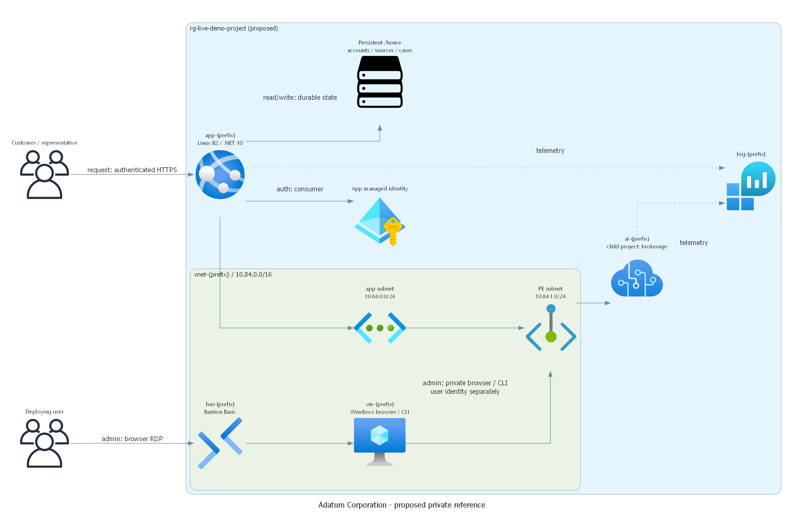
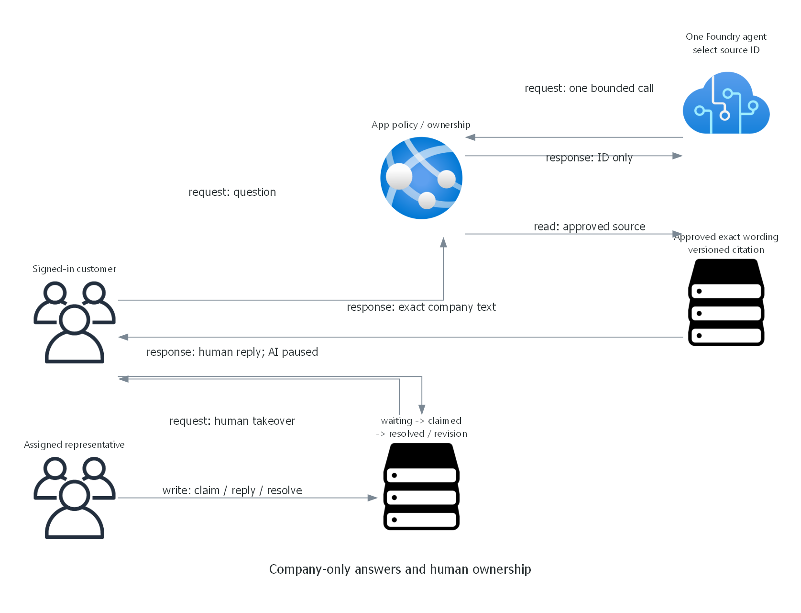

> Generated by az-01-conductor agent | 2026-10-27

## Requirements Validation

Financial Services, `["generic"]`, one brokerage support flow and the explicitly requested HITL overlay are retained.
The company and customer/representative identities come from the recorded repository catalogs.
Company documents are synthetic demo policies, not statements about a real brokerage.

### Agentic runtime contract

One Foundry prompt agent classifies the customer's question against ten approved structured knowledge entries.
The `select_company_answer` function returns only a source ID or `unsupported`.
The application executes the lookup and returns exact stored wording with a versioned citation.
It deliberately does not request the model to write a final customer answer.
This is a bounded selection tool, not vector retrieval; Search and embeddings are unnecessary.

HITL is application-hosted: a durable conversation changes from automated to waiting, claimed and resolved.
Only a server-assigned coach role can claim; only the assigned representative can reply/resolve.
Customer escalation is idempotent and disables AI answers; stale revisions fail with HTTP 409.
No trades, market data, account mutation, autonomous escalation or generated investment recommendations.

One inference call per question, 30-second timeout, 300 output-token cap and 2,000-character input cap.
The app does not expose model prose or hidden reasoning. HTTP errors, invalid tool calls and missing configuration
are failures, not successful fallback answers. Invocation receipts are retained separately from company citations.

### Basic versus Standard

Use the Basic prompt-agent environment with platform-managed agent metadata.
Requests are stateless (`store: false`); no persistent Foundry conversations, hosted agents or service-side retrieval.
The application owns the knowledge and human-case records.
Private inbound access uses an account private endpoint; no Foundry outbound customer data-service calls are needed.
Standard/BYO networking is the alternative if tenant policy requires customer-owned agent backing stores or injection.
That would add Storage, Search and Cosmos, require a revised cost/design review, and must not be silently substituted.
Private prompt-agent/model feature eligibility remains an authorized subscription check before provisioning.

### Application persistence and operations

The .NET 10 Razor Pages app stores local-account password hashes, approved knowledge and cases in a durable JSON file
under App Service `/home/data/brokerage`, not under the deployed application directory.
The App Service plan is deliberately single-instance with no autoscale.
Writes use an exclusive lock, revision checks and atomic replacement.
Session keys persist alongside state; App Service storage encryption and OS permissions protect files.
No database service exists, so there is no misleading local-data fallback for an Azure database.
Local state is appropriate only for this small synthetic demo: no production HA, distributed locking or regulated data.
Back up the persistent directory before changing knowledge or code; never copy live credentials into source packages.
Reinitialization refuses to overwrite an existing deployment.

Local sample accounts do not use Entra registration or consent.
Unique participant/coach credentials are emitted separately into deployment-private access files.
The public guide carries no passwords. App Service publishing uses Entra-authenticated tooling.
The public web endpoint is authenticated HTTPS; a WAF is a production recommendation, not implemented in this demo.

### Management and deployment access

| Operation | Host and identity | Path |
| --- | --- | --- |
| ARM provisioning and zip publication | This workstation; confirmed Azure user | ARM and public SCM HTTPS |
| Agent creation and private checks | Management VM; scenario VM managed identity | VNet private DNS and Foundry PE |
| Human Foundry browser admin | Management desktop; user's own Azure sign-in | Bastion RDP; private Foundry |
| Human CLI/data admin | Same VM; user's own Azure sign-in | Private TLS and scoped RBAC |
| Runtime invocation | App Service system identity | Delegated integration subnet to private Foundry |

Preferred setup: Windows Server 2022 desktop VM, Standard_D2s_v5, no public IP,
Standard SSD OS disk, Azure Bastion Basic and dedicated Bastion subnet.
Bastion is human entry, not connectivity for local hooks.
The postprovision hook explicitly sends a small initialization script through VM Run Command.
It installs Azure CLI only on the newly approved scenario VM, signs in with its managed identity,
and creates/reuses the exact prompt agent; no workstation/default-account changes.
The web app is published locally by azd; it does not need private data-plane access to publish a zip.
Human administration uses the operator's Azure credentials, not the VM identity or app credentials.
Browser sign-in, private CLI operations and outside-network denial remain live acceptance requirements.

### Deployment-user access matrix

Observed identity: petender@microsoft.com; tenant `16b3c013-d300-468d-ac64-7eda0820b6d3`.
The user's object ID is resolved from the signed-in access-token `oid` during authorized preparation,
not requested manually and not confused with workload identity.

| Scope | Control/data grant | Required verification |
| --- | --- | --- |
| Resource group/children | Scoped Owner or verified inherited equivalent | Resource update; role administration |
| Foundry/project/model | Foundry User data access plus Owner resource administration | Agent CRUD; inference; cleanup |
| Web app durable data | App Service administration and authenticated SCM | Backup; file CRUD; cleanup |
| VNet, PE and DNS | Scenario administration | Disposable metadata update; private DNS |
| VM, disk and Bastion | Scenario administration; private VM login | Desktop entry; Azure user browser/CLI |
| Log Analytics | Scenario administration and query permissions | Query diagnostics without customer message bodies |

Workload app: Foundry Agent Consumer on the project only.
VM installer: Foundry User on the project only. Project identity: Foundry User on the account.
No subscription-wide or tenant-wide grants, Graph app creation, consent or service keys.
On 2026-10-28, unconditional inherited subscription Owner and Foundry User were verified for the deploying human.
Reuse them through `deployerRoleMode=inherited`; do not create duplicate human grants.
The installation hook resolves inheritance afresh and otherwise provisions only scenario-scoped equivalents.
The live Foundry User ID is `53ca6127-db72-4b80-b1b0-d745d6d5456d`; Project Manager is not substituted.
Every user data-plane probe still awaits the deployed resources and documented private management path.
Missing user access blocks completion even if runtime identity works.

## Resource SKU Recommendations

| Resource | Proposed SKU/configuration | Provisional monthly USD budget |
| --- | --- | --- |
| Foundry account/project | AIServices S0; Basic prompt agent; private inbound | Tokens, budget 5-20 |
| Model | gpt-4.1-mini / 2025-04-14 / GlobalStandard; 10 units; parameterized | Included in token budget |
| Web hosting | Linux B2; .NET 10; one instance; managed identity | 25-65 |
| VNet/private endpoint/DNS | Separate app, PE, management and Bastion subnets | 10-20 |
| Management VM | Standard_D2s_v5 Windows, zone 1; 128 GiB Standard SSD | 130-190 |
| Bastion | Basic and Standard public IP; no VM public IP | 140-180 |
| Monitoring | Log Analytics PerGB2018 with low-volume diagnostics | 5-20 |
| Total | Planning range, not a quote or a spend limit | 315-495 |

The table preserves the initial provisional ranges. On 2026-10-28, live readiness rejected East US 2 and
recommended Sweden Central; its what-if passed with 34 creates and no modifications/deletions.
Current official retail rates give a USD 328.65 fixed monthly subtotal and a USD 340-380 low-traffic planning range.
See the deployment summary for itemized pricing, quota, model lifecycle and evidence limitations.
Regional/currency/offer pricing, taxes and usage can change that estimate.
Shutting down the VM does not remove disk, Bastion or hosting charges.
Foundry GlobalStandard processing is not a regional residency guarantee; use synthetic data only.
No management component is currently deployed, and no existing connected host is assumed.

## Architecture Decision Summary

| Decision | Choice and rationale |
| --- | --- |
| Answer policy | Exact approved wording, stronger than generative RAG grounding |
| Agent count | One prompt agent; human service ownership is app state, not another AI agent |
| HITL | Customer explicitly requests; real representative claims and replies |
| State | Single-instance persistent app files, intentionally limited demo tier |
| Data services | No Search/Cosmos/Storage service needed for ten exact structured entries |
| Private operations | Dedicated human desktop plus explicitly invoked VM automation |
| Region | East US 2 rejected; Sweden Central eligible at check time and proposed for deployment |
| Authorization | Readiness/what-if authorized; deployment and suitability approval still pending |

### Evidence, checked 2026-10-27

- [Function calling and REST agent/Responses contract][functions]
- [Foundry environment setup and Basic/Standard trade-offs][environment]
- [Private inbound endpoints and human access][private]
- [Region support][regions] and [model catalog][models]
- [Foundry RBAC and consumer versus author roles][rbac]
- Public MCR AVM tags queried; exact selected versions pinned in infrastructure.
- Web search failed with HTTP 504; official pages were fetched directly.

[functions]: https://learn.microsoft.com/azure/foundry/agents/how-to/tools/function-calling
[environment]: https://learn.microsoft.com/azure/foundry/agents/environment-setup
[private]: https://learn.microsoft.com/azure/foundry/how-to/configure-private-link
[regions]: https://learn.microsoft.com/azure/foundry/reference/region-support
[models]: https://learn.microsoft.com/azure/foundry/foundry-models/concepts/models-sold-directly-by-azure
[rbac]: https://learn.microsoft.com/azure/foundry/concepts/rbac-foundry
