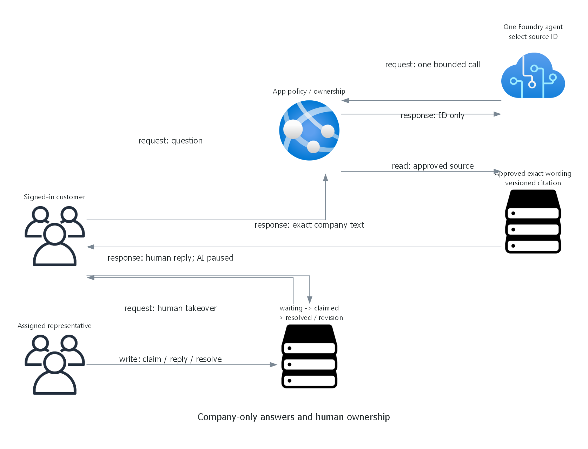

> Generated by az-01-conductor agent | 2026-10-27

## Overview

Implement one private Foundry prompt agent and an authenticated .NET brokerage service desk.
Local preparation and authorized subscription validation are complete; approved installation is now running.

## Resource Inventory

| Resource | Configuration | Implementation |
| --- | --- | --- |
| Resource group | `rg-live-demo-project`, proposed environment | Subscription root Bicep |
| Foundry account | AIServices S0, no keys/public ingress | AVM account 0.19.1 |
| Child project | `brokerage`, managed identity | Direct child ARM resource; no standalone AVM available |
| Model deployment | `company-selector`, reviewed name/version/SKU parameters | AVM account deployment |
| Web plan and app | Linux B2, one instance, managed identity | AVM serverfarm 0.7.0 / site 0.24.0 |
| VNet | `10.84.0.0/16`, four subnets | AVM virtual-network 0.10.2 |
| Private endpoint and DNS | Account endpoint, three DNS zones/links | AVM endpoint 0.12.1 / DNS 0.8.1 |
| Management VM | Standard_D2s_v5, zone 1, Windows Server 2022, private NIC | AVM VM 0.22.3 |
| Management NSG | RDP only from Bastion subnet; deny other inbound | AVM NSG 0.5.4 |
| Bastion and public IP | Basic; public entry is Bastion only, not VM RDP | AVM bastion-host 0.8.2 |
| Log Analytics | PerGB2018, 30 days | AVM workspace 0.16.1 |
| User/workload RBAC | Full user control/data access; scoped workload consumers/authors | ARM role assignments |

The VM's explicit outbound Internet access supports official Azure CLI installation and operator sign-in.
No inbound public VM address or unrestricted data-service ingress is introduced.
Compute checks must verify Dsv5 family and regional vCPU headroom, one VM, zone 1, and the 128 GiB disk.

## Module Structure

`infra/main.bicep` creates the group and calls `infra/reference.bicep`.
The reference composes pinned AVM modules. Raw resources are limited to the direct child project,
the top-level resource group and role assignments.
`infra/main.parameters.json` maps azd environment values, not committed targets or passwords.
The preprovision hook sets `AZURE_DEPLOYER_ROLE_MODE` after checking the signed-in user's unconditional
subscription Owner and Foundry User assignments. `inherited` reuses both; `assign` creates scoped equivalents.
The current review reuses verified inheritance and includes only the three workload role assignments.
`azure.yaml` wires the .NET app and installation hooks.

## Implementation Tasks

- Preup: resolve the existing human principal/consumer role and private VM access before azd resolves parameters.
- Preprovision: repeat the idempotent identity/private-parameter check for direct provisioning invocations.
- Provision: VNet, DNS, private services, app, operator VM/Bastion and separate workload/user grants.
- Postprovision: explicitly execute the private agent installer on the management VM.
- Publish: azd uses local .NET zip publication through authenticated SCM, not a local private Foundry request.
- First application start: initialize fresh local accounts/knowledge into durable storage, never overwrite state.
- Acceptance: prove user administration and runtime managed-identity paths separately.

## Dependency Graph

Group -> monitoring/NSG -> VNet -> DNS/hosting/VM/Bastion -> private Foundry -> project/RBAC -> agent.
The app's first real question requires the installed agent and propagated app-consumer role.
There is no dependency on a learner-built access path or a hack package.

## Runtime Flow Diagram

## Naming Conventions

Environment is proposed as `live-demo-project`; group is `rg-live-demo-project`.
One `uniqueString(resourceGroup().id)` suffix is shared across child names.
The diagram's `{prefix}` denotes the exact `reference.bicep` prefix expression,
not an invented deployed name. Final resolved names come from deployment outputs.

## Execution Handoff

Local Bicep build/lint, .NET build, 23 component tests and nine HTTPS browser checks passed.
PowerShell hooks parse; they have not been executed against Azure.
Sweden Central what-if passed with 34 creates and no modifications/deletions; East US 2 failed B2 quota.
See the deployment summary for exact proposed identity, scope, current pricing and deployment approval.
