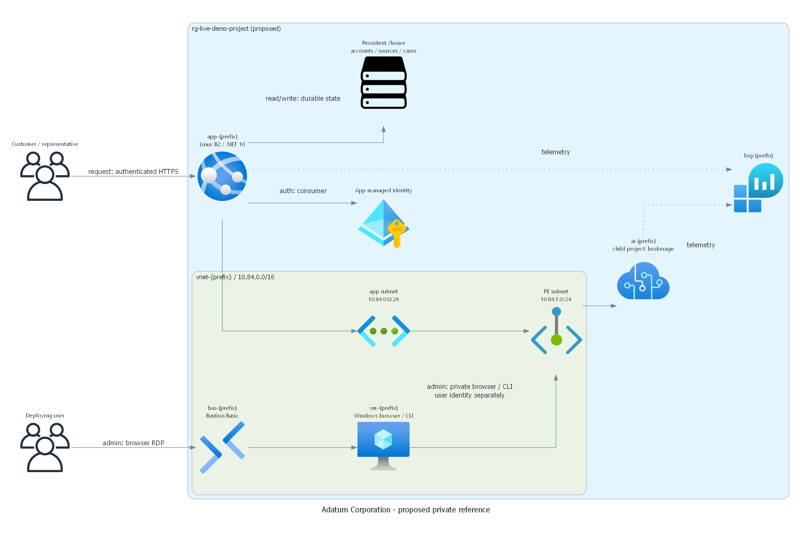
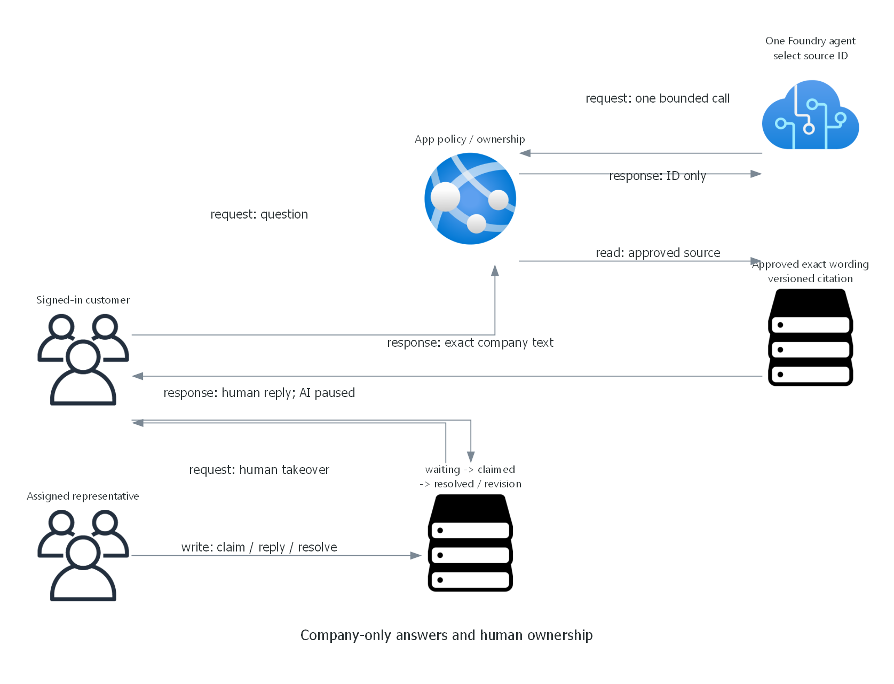

> Generated by az-01-conductor agent | 2026-10-27

## Installation

Adatum Corporation brokerage service desk: exact company answers with accountable human takeover.
This scenario workspace is linked from Hack Builder and physically stored in the adjacent azd-projects directory.
Reuse the existing shared prerequisites; do not reinstall tools or change Azure defaults.

Local prerequisites: .NET 10, Azure CLI Bicep, PowerShell and the repository Python environment.
Azure readiness and deployment require separate explicit authorization.

## Deploying the scenario in 4 steps:

1. Review [requirements](01-requirements.md), [architecture](02-architecture-assessment.md)
   and [proposed targets and authorization scope](06-deployment-summary.md).
1. Authorize scoped subscription checks and what-if; inspect actual model/SKU/quota/policy and current cost evidence.
1. Confirm the final targets and deployment after that review; initialize the scenario-local azd environment.
1. Run the authorized azd lifecycle, then prove real inference, app behavior, human takeover and user administration.

The user approved deployment on 2026-10-28; installation is running and live acceptance remains pending.
Do not execute writes based solely on these instructions or treat partial provisioning as a working reference.
Local accounts generate unique credentials into private files; public documentation contains no live passwords.

## What is the demo scenario about?

A prospective or existing brokerage customer asks a natural-language service question.
One Foundry agent selects an approved company entry; the app returns its exact wording and citation.
The customer can request a human, who claims the durable case and replies in a separate representative desk.
AI stops answering after takeover. No trading or personalized financial advice is implemented.

See the [prepared demonstration](demoguide/demoguide.md) and [application summary](07-webapp-summary.md).

## Feedback and Contributing

Record scenario revisions in this chat. Publication and event rollout are separate explicit choices.
No repository, hack package or participant deployment has been created.

## Project Summary

| Property | Status |
| --- | --- |
| Industry / business units | Financial Services / `["generic"]` |
| Requested workflow | Human-in-the-loop, overlay on one agent's bounded tool selection |
| Requirements, design, diagrams, IaC, app | Locally complete |
| Local validation | 23 component checks; nine HTTPS browser checks; build/lint passed |
| Reference progress | Five of seven implementation stages complete, approximately 71% |
| Azure readiness and what-if | Complete; East US 2 rejected, Sweden Central proposed with 34 creates |
| Deployment and live demonstration | Approved Sweden Central installation running; live acceptance pending |
| Suitability | Unreviewed; no approval fingerprint |
| Updated | 2026-10-28 |

Exact evidence and commands are in the [deployment summary](06-deployment-summary.md).
Local tests do not establish Azure readiness or successful Foundry invocation.
