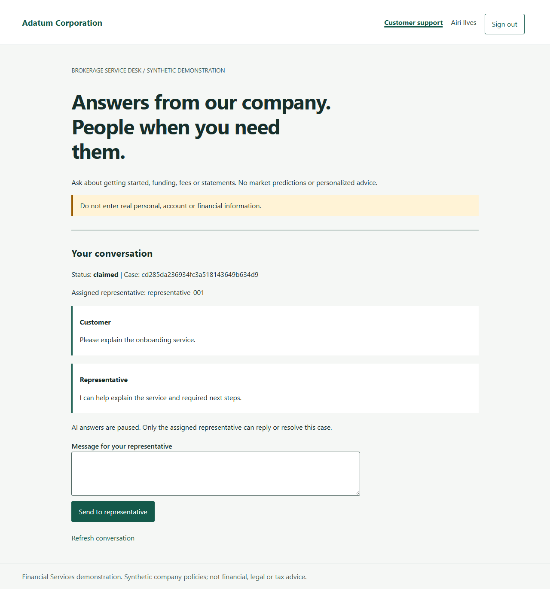
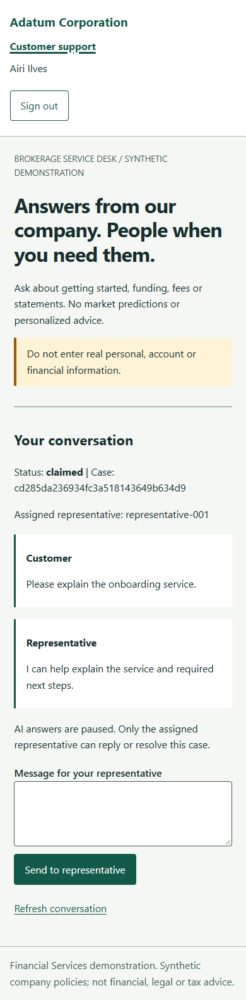

> Generated by az-01-conductor agent | 2026-10-27

## Demonstration status

> [!IMPORTANT]
> This is a prepared walkthrough, not a certified live demonstration.
> No application URL or successful Azure invocation exists yet.
> Screenshots below come from the local application only.

Audience: brokerage service owners and technical implementers.
Industry: Financial Services; `["generic"]`, without department targeting.
Story: Adatum Corporation helps prospective and existing customers understand its services
using approved company wording, then transfers responsibility to a real representative on request.
No customer data, trading, financial advice or public web answers.

## Prerequisites and access

For the future Azure walkthrough, first complete authorized readiness, what-if, deployment and all access-matrix checks.
Read `APPLICATION_URL` from actual azd outputs; do not substitute a guessed hostname.
Participant login uses the private participant access file only.
Coach login uses the separate private coach access file.
Passwords are never included in this public guide.

Use two isolated browser profiles so the customer and representative have separate sessions.
The human representative is an actual signed-in app user, not a model pretending to be a person.
For Azure administration, enter the private Windows desktop through Bastion using the private VM account,
then sign into Azure/Foundry with the deploying user's own account.
VM login, local app login and Azure login are three different authentication contexts.

## Ten-minute business walkthrough

| Time | Action | Evidence required |
| --- | --- | --- |
| 0-1 min | Explain company-only scope; sign in as customer | Local account role and synthetic-data notice |
| 1-3 min | Ask how to open an investment account | Exact source 1 wording, version and real Foundry invocation ID |
| 3-4 min | Ask for a prediction about an unrelated asset | Unsupported notice, no invented company answer |
| 4-5 min | Select Request a representative and send a service message | Durable waiting case; AI is paused |
| 5-7 min | In coach browser, claim the case and send a reply | Assigned owner and separately labeled human reply |
| 7-8 min | Refresh customer view and answer the representative | Real two-way communication, no new model call |
| 8-9 min | Attempt customer access to representative desk | Access denied; no privilege escalation |
| 9-10 min | Resolve as assigned representative and summarize | Durable resolved state and visible ownership |

The company answer must equal the stored approved entry, not simply sound grounded.
Inspect receipts and final policy outcomes, never hidden chain-of-thought.
The actual live inference, model-call budget and latency measurements are still pending.

## Operator acceptance and negative case

From the management VM, verify private DNS and an authenticated Foundry call under the deploying user.
Use disposable agent/version data to verify full create/read/update/delete and cleanup.
Verify the app's managed-identity path independently through the website.
From outside the network, confirm private Foundry access is denied.
The outside denial is not proof of working operator access, and a backend HTTP 403 is a failure.

## Local screenshot fallback

These are real Playwright captures from local HTTPS testing, not deployed-resource evidence.
If showing them while Azure is unavailable, state that distinction before beginning.

Azure resource group, Foundry, network and deployed UI captures are pending deployment.
Do not relabel these images as Azure screenshots.

## Failure and recovery

| Failure | Operator response |
| --- | --- |
| Foundry 403 / missing configuration | Use correlation ID; check consumer RBAC and private DNS; no mock answer |
| Conflicting human claim/reply | Refresh current revision; only the assigned representative retries |
| App state unavailable | Stop writes; inspect persistent path/ACL and restore a verified private backup |

Do not reinitialize to repair an existing account store: initialization refuses to overwrite data.
Do not relax private ingress, use shared keys or switch identities to turn a failed check into success.
After material changes, revalidate before a new suitability review.

## Cost and exit

Provisional full-time estimate: USD 315-495/month, not a quote.
Stop/deallocate VM compute when unused, but account for Bastion, disk and hosting charges.
Deletion requires a separate explicit cleanup request and confirmation of the scenario resource group.
After live proof, present the full scenario for suitability approval; do not start hack authoring automatically.
