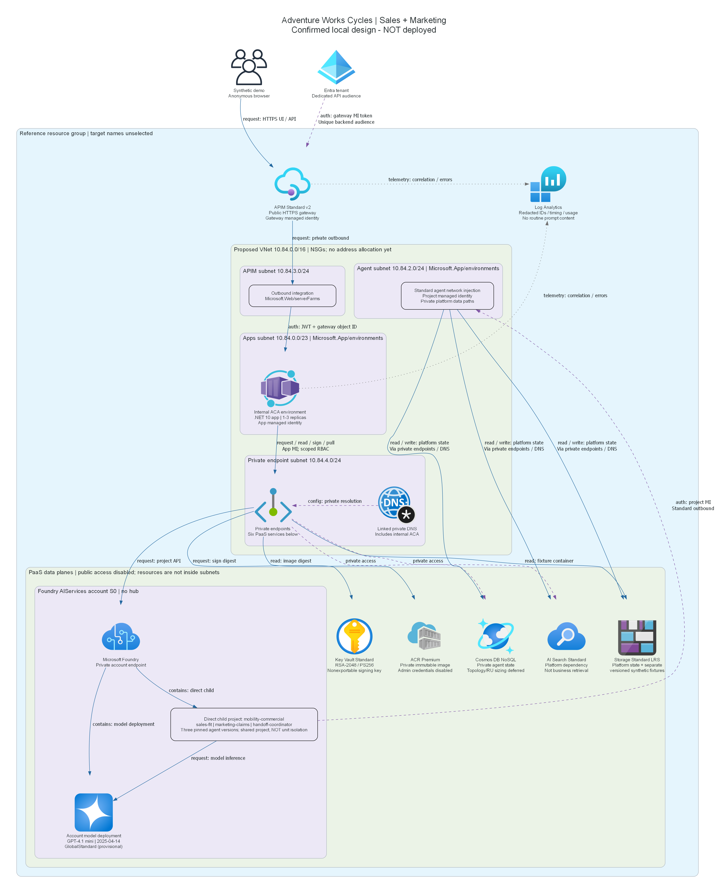
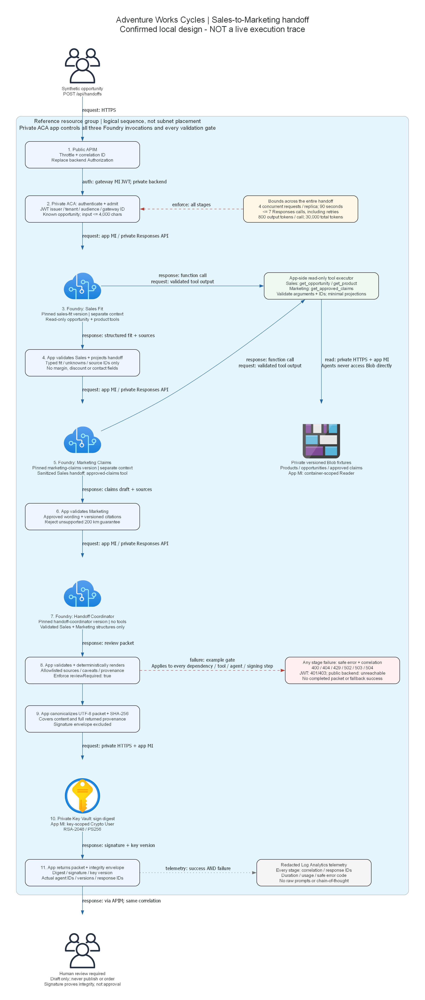

# Implementation plan: Manufacturing Sales-to-Marketing

## Overview

The portal confirmed this design on 2026-10-23. This operation implements infrastructure only.
Application code, agent definitions, fixture installation and runtime tests belong to later bounded operations.
No Azure query, environment initialization, what-if or deployment is authorized or executed.
Region/model defaults come from `00-region-availability.json` and remain provisional.

Use a resource-group-scoped foundation, followed by private installation and a workload deployment.
The resource group must be `rg-{environment}`; the proposed distinct environment is `manu-multi-agent-ref`.
No azd environment has been created. Names derive once from `uniqueString(resourceGroup().id)`.
The platform-created ACA infrastructure group is separate and is not a participant environment.

## Resource Inventory

| Resource | SKU/configuration | Implementation | Dependency |
| --- | --- | --- | --- |
| Resource-group tags | Four mandatory tags | ARM tags extension | Existing authorized group |
| VNet / four subnets / NSGs | Confirmed `10.84.0.0/16` proposal | AVM | Overlap review before deployment |
| Private DNS / endpoints | Seven endpoints; eight service zones | AVM | VNet and services |
| Gateway / app identities | Two user-assigned identities | AVM | Resource group |
| Logs | PerGB2018, 30 days, 1 GB/day cap | AVM | Resource group |
| Foundry | AIServices S0 / direct project / exact model | AVM account, ARM children | Agent subnet, dependencies |
| Standard platform storage | LRS, keyless, private | AVM | Private endpoint subnet |
| Business fixture storage | Separate LRS account, versioned container | AVM | Private endpoint subnet |
| Cosmos | Provisioned, 5000 RU/s ceiling | AVM | Private endpoint subnet |
| Search | Standard, one partition/replica | AVM | Private endpoint subnet |
| Key Vault | Standard; RSA-2048 signing key | AVM | Private endpoint subnet |
| Registry | Premium, no admin/public access | AVM | Private endpoint subnet |
| ACA environment | Internal; Consumption profile | AVM | Apps subnet, logs |
| ACA application | 0.5 vCPU / 1 GiB, 1-3 replicas | AVM; workload phase | Installed image/agents/fixtures |
| APIM | StandardV2, one unit, outbound integration | AVM; workload phase | Private ACA/DNS, gateway identity |
| Project connections / capability host | Legacy private setup API | ARM children | Project RBAC and private DNS |
| Scoped RBAC | Project, fixture container, key, registry | ARM role assignments | Identities and resources |

The separate fixture account is a least-privilege refinement, not a new business service:
the documented Standard provisioning path needs account-wide Blob Contributor on its platform account.
Sharing that account with business fixtures would let project MI write the supposedly read-only fixture corpus.
The project receives no role on the business account; the app receives no platform Storage/Cosmos/Search role.
Both accounts share the same private Blob DNS zone but have distinct private endpoints.

## Module Structure

```text
infra\
  main.bicep
  main.bicepparam
  main.parameters.json
  modules\
    network.bicep
    dependencies.bicep
    foundry.bicep
    access.bicep
    capability.bicep
    private-links.bicep
    workload.bicep
    gateway-policy.xml
```

| AVM resource module (`br/public:avm/res/` prefix) | Pinned release |
| --- | --- |
| `network/virtual-network` | 0.10.2 |
| `network/network-security-group` | 0.5.4 |
| `network/private-dns-zone` | 0.8.1 |
| `network/private-endpoint` | 0.12.1 |
| `managed-identity/user-assigned-identity` | 0.6.0 |
| `operational-insights/workspace` | 0.16.1 |
| `storage/storage-account` | 0.33.1 |
| `document-db/database-account` | 0.21.1 |
| `search/search-service` | 0.13.0 |
| `key-vault/vault` | 0.14.2 |
| `container-registry/registry` | 0.13.1 |
| `cognitive-services/account` | 0.19.1 |
| `app/managed-environment` | 0.16.0 |
| `app/container-app` | 0.23.0 |
| `api-management/service` | 0.15.0 |

Published MCR tags and release-tagged source interfaces were checked on 2026-10-23.
Public source snapshots under `.infra-evidence\avm` are research evidence, not vendored deployment modules.
Bicep restores the exact published versions. AVM's own nested modules remain its pinned dependencies.

## Implementation Tasks

### Task 1: main.bicep

Apply tags; derive one suffix; compose networking, identities, logs, dependencies, project, private endpoints,
provisioning RBAC, capability host, runtime state access and internal ACA environment.
The `foundation` default creates no placeholder application or public route.
The `workload` phase requires an immutable private image digest, three agent versions, fixture manifest hash,
verified Foundry Consumer role ID and the dedicated backend API application ID.
No hard-coded identity, subscription or copied deployment state is accepted.

### Task 2: private Standard provisioning

Follow the currently linked official private Standard sample's capability-host path,
using project identity for provisioning; do not combine it with 2026-07-15 capability settings.
The account's `networkInjections` auto-creates its account capability host.
Never create a second account capability host: the official sample documents a 409 conflict.
Create the direct child project, three AAD connections, prerequisite RBAC, then the project capability host.
Assign Cosmos data access at `enterprise_memory` and conditioned Blob owner access afterward.
The public schema omits `capabilityHostKind`; retain the narrow documented BCP037 suppression.
Likewise `internalId` is an actual sample-used service output absent from the older schema.
These two exceptions are not evidence of deployment success.

Do not precreate guessed Cosmos containers. The chosen official capability-host sample delegates their
creation to the service. Reserve 5000 RU/s as a ceiling, not a measured provisioned topology.
After authorized deployment, inspect actual New-runtime containers and consumption before cost finalization.
Deployment preparation must verify this backward-compatible path with the later pinned New SDK.
No Classic SDK, workflow service or silent provisioning-model fallback is allowed.

### Task 3: application and gateway integration contract

The workload module supplies the app with project/model endpoints, pinned agent names/versions,
private fixture endpoint and manifest hash, signing key URI, app MI client ID, Entra issuer/audience,
gateway object ID and the confirmed request/token/deadline limits.
The later app must validate these exact settings at startup and enforce JWT authorization on every route.
Liveness/readiness probes use TCP; no unauthenticated HTTP health exception is needed.

APIM exposes explicit UI/static/read-only-data/handoff/verification operations, not an unrestricted wildcard proxy.
It overwrites Authorization using gateway MI, assigns a fresh correlation ID and applies bounded throttles.
No APIM body/header tracing or business-content diagnostics are enabled.
The app must not ship tools, agent mutation or configuration endpoints through these routes.
The Azure YAML has infrastructure only until the application operation supplies the real service project.
Do not add an azd deploy hook referencing a nonexistent installer or silently build a remote image.

### Task 4: deployment preparation contract

Only after exact-scope consent: verify CLI/azd identities, providers, effective policies, role definitions,
network overlap, model availability/capacity, every regional SKU and the private installer path.
Resolve the dedicated secretless Entra API registration through a separately authorized mutation procedure.
No Graph registration, VPN, hosted runner, public firewall opening or account-default change occurs here.
After reviewing actual what-if and itemized cost, request separate deployment consent for identical targets.

## Dependency Graph

The existing architecture image is also the infrastructure dependency view; no duplicate diagram pass is needed.



Network -> private services/project/connections -> private DNS/endpoints -> provisioning RBAC -> capability host
-> runtime state RBAC -> private installation -> ACA workload -> APIM routes.
The internal ACA environment and its DNS can be provisioned alongside the project foundation.
Explicit dependencies are used only for security/provisioning ordering not expressed by resource IDs.

## Runtime Flow Diagram



Source: [retained runtime diagram source](./04-runtime-diagram.py).
The fixture Blob icon is a logical corpus, hosted in the isolated business account described above.
These diagrams remain design evidence, not actual traces.

## Naming Conventions

| Resource | Pattern |
| --- | --- |
| Resource group | `rg-{environment}` |
| Short resource stem | `mm-{first 8 environment characters}-{first 6 unique suffix characters}` |
| Key Vault | `kv-{stem}`, maximum 24 characters |
| Platform / business Storage | `stmm{p or b}{first 13 unique suffix characters}` |
| Foundry project | `mobility-commercial` |
| Fixture container | `synthetic-fixtures` |
| Signing key | `handoff-receipt` |
| Agents | `sales-fit`, `marketing-claims`, `handoff-coordinator` |
| Container repository | `mobility-commercial` |

All resources supporting tags receive Environment, ManagedBy, Project and SecurityControl.
Child RBAC, connections, capability hosts and DNS records do not accept arbitrary resource tags.

## Execution Handoff

The Bicep operation records real compilation/lint and structural checks in `.infra-evidence`.
The backend selects the application operation next; this worker does not implement it.
Application work must supply the real .NET project, agents, fixtures, installer and service wiring,
then build/test their actual contracts. Foundation completion is not deployed-scenario completion.
No hack plan, participant starter, coach package, suitability approval or team deployment is created.

Public references inspected on 2026-10-23:

- [Private Standard networking][private]
- [Official private Bicep sample][sample]
- [Foundry caller/runtime roles][roles]
- [APIM outbound VNet integration][apim]
- [Current AVM sources][avm]

[private]: https://learn.microsoft.com/azure/foundry/agents/how-to/virtual-networks
[sample]: https://github.com/microsoft-foundry/foundry-samples
[roles]: https://learn.microsoft.com/azure/foundry/concepts/rbac-foundry
[apim]: https://learn.microsoft.com/azure/api-management/integrate-vnet-outbound
[avm]: https://github.com/Azure/bicep-registry-modules/tree/main/avm/res
