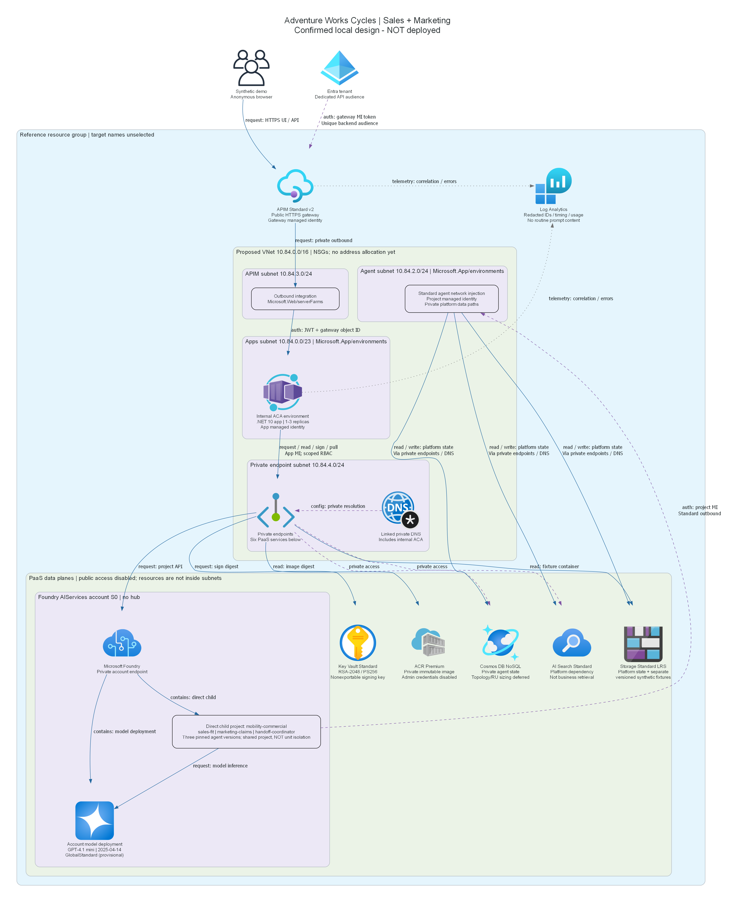

# Infrastructure reference: Manufacturing Sales-to-Marketing

## IaC Templates Location

[Infrastructure source](./infra/) implements the locally confirmed design.
It is not deployed or live-validated. No Azure targets, runtime results or suitability approval are inherited.
The portal/backend owns phase progression and cloud consent.

## File Structure

```text
infra\
  main.bicep
  main.bicepparam
  main.parameters.json
  modules\
    network.bicep
    dependencies.bicep
    foundry.bicep
    access.bicep
    capability.bicep
    private-links.bicep
    workload.bicep
    gateway-policy.xml
  tests\
    test_infrastructure.py
azure.yaml
.infra-evidence\
```

`main.parameters.json` is the azd substitution contract.
`main.bicepparam` is an equivalent explicit CLI/operator contract.
The zero GUID in `.infra-evidence\local-only.parameters.json` is a compile-test sentinel,
not an identity or deployable parameter set. Never deploy the evidence template or test parameters.

## Validation Status

Local compilation and lint were run against published AVM artifacts with Azure CLI Bicep 0.48.1.
Final command results, template/source hashes and structural test counts are in
`.infra-evidence\validation.json`; failed intermediate compiler logs are superseded by the final run.
The infrastructure tests inspect the actual compiled ARM, including the conditional workload module.
They cannot prove service-side provisioning, JWT validation, model inference or private connectivity.

| Check | Evidence |
| --- | --- |
| Full template build | `.infra-evidence\build.log`, compiled `main.arm.json` |
| Full template lint | `.infra-evidence\lint.log` |
| Parameter compilation | `.infra-evidence\parameters-build.log` |
| Infrastructure contract tests | `.infra-evidence\tests.log` |
| Azure what-if | Not authorized; not run |
| Deployment and runtime acceptance | Not authorized; not run |

## Resources Created

**None in Azure.** These are authored resource definitions only.
See [inventory, pinned releases and dependency graph](./04-implementation-plan.md).

| Local module | Defined resources |
| --- | --- |
| `network` | VNet, four dedicated subnets and four NSGs |
| `dependencies` | Separate platform/business Blob, Cosmos, Search, registry, vault/key |
| `foundry` | AIServices account/model, direct project, AAD connections, installer/project roles |
| `access` | Project provisioning roles on platform services only |
| `private-links` | Eight service DNS zones, seven private endpoints and zone groups |
| `capability` | Project capability host, conditioned Blob owner and Cosmos runtime roles |
| `main` | Resource-group tags, two UAMIs, logs, internal ACA environment and internal DNS |
| `workload` | Digest-pinned ACA app, invocation-only project role, Standard v2 APIM and explicit routes |



The two Storage accounts represent the platform-state and business-fixture boundaries shown logically in the diagram.
The application has no platform Storage, Search or Cosmos role. The project cannot write business fixtures.
Existing diagrams are retained; no third diagram or substitute runtime evidence was generated.

## Deployment Instructions

Do not execute these cloud commands from a local-only job.
Use the portal to authorize exact account/subscription/tenant/group/environment/region preparation first.
Reuse its retained identity proposal rather than asking for known IDs again.
Private installer connectivity, current policy, model capacity and all service SKUs remain unchecked.

After consent, validate that `AZURE_RESOURCE_GROUP` is exactly `rg-{AZURE_ENV_NAME}`.
The Bicep tag expression also rejects a different group name.
The proposed distinct environment is `manu-multi-agent-ref`; it has not been initialized.
Do not change shared Azure CLI defaults. Use the guarded `azd provision` lifecycle described below,
not default `azd up` or `azd deploy`, which would independently rebuild and deploy the service image.

Preparation command shape, shown only and **not run**:

```powershell
az deployment group what-if `
  --subscription $authorizedSubscriptionId `
  --resource-group "rg-$authorizedEnvironment" `
  --name "manu-multi-agent-foundation-preview" `
  --parameters .\infra\main.bicepparam
```

For the parameter file above, populate process-local `AZURE_ENV_NAME`, `AZURE_LOCATION` and
`AZURE_PRINCIPAL_ID` from the same authorized scope, not shared defaults; set `DEPLOYMENT_PHASE=foundation`.
The resource group must already exist; its creation is a mutation needing deployment consent.
If absent, prepare a subscription-scoped wrapper/what-if in the authorized preparation operation,
then review that complete target before permission to create it. Never create the group just to run what-if.

Review actual what-if and a dated, itemized estimate before separate deployment permission.
Then run the complete reference installation once, through a verified private-network-capable operator context.
The one consolidated deployment review must include every operation below, not successive stage approvals:

1. Foundation provisions private services, model/project, Standard state and internal ACA.
1. The lifecycle builds the real image locally, pushes privately and records its immutable digest.
1. It uploads versioned fixture blobs/manifest, installs three actual prompt agents and records their versions.
1. Preprovision creates/validates the dedicated backend API registration; postprovision captures the key version.
1. Workload provisioning supplies all required installation values and creates the app/APIM routes.
1. Authorized live validation proves every agent, signed grounding, JWT negatives, private DNS and error/recovery cases.

No placeholder/public image, temporary public firewall access, remote build fallback or source installation is allowed.
Foundation/workload parameter sets are distinct what-if inputs; consent must cover the actual staged mutations.
Use explicit `--environment $authorizedEnvironment` and explicit subscription for later azd commands.
No environment initialization or cloud operation has been executed by this local resumption.

### Guarded complete-reference lifecycle

`azure.yaml` now wires `preprovision` and `postprovision` to `scripts\deployment_lifecycle.py`.
After actual what-if/cost review and explicit exact-target deployment consent, run:

```powershell
azd provision --environment $authorizedEnvironment --no-prompt
```

This is the complete installation entry point. It retains the real source service definition for discovery,
but rejects default `azd up`/`deploy`/`publish` before an independent mutable image rollout can occur.
The root hooks use explicit PowerShell and fail closed; no continue-on-error or nested azd provisioning is used.
Postprovision performs the dependent workload ARM deployment with the installed immutable values.
This installation is not live acceptance; real inference, JWT, grounding, signature and network negatives follow.

The deployment worker supplies `ABCBUILDER_WORKFLOW_HELPER` pointing to the existing repository
`scripts\portal_workflow.py`, current project/writer variables, and the exact `AZURE_ACCOUNT`,
`AZURE_SUBSCRIPTION_ID`, `AZURE_TENANT_ID`, `AZURE_RESOURCE_GROUP`, `AZURE_ENV_NAME`, `AZURE_LOCATION`,
`AZURE_PRINCIPAL_ID` and `APIM_PUBLISHER_EMAIL`. These are authorized preparation outputs/settings,
not guessed defaults. The current explicit user identity must match the installer principal.

The canonical consolidated scope must additionally identify `privateExecutionHost` by its actual hostname
and `directoryWrites: "scenario-owned-secretless-backend-api"`.
Carry these planned changes through preparation and deployment review; preparation never grants writes.
The worker cannot create authorization through flags, environment variables or a copied state file.
The guard reads canonical state and checks the current writer, local validation, exact targets,
actual what-if/cost references, directory scope and execution host before any Azure query or write.
It then verifies matching Azure CLI/azd accounts and the actual installer object ID without changing shared defaults.
The existing backend identity helper then captures actual client/object IDs automatically.
It requests no secret, Graph permission grants, tenant-wide consent or elevated directory role.

The postprovision hook checks private DNS, TCP and certificate-validated TLS from that actual host,
including ACR's regional data endpoint, before image publishing and installation.
Registry push, fixture/manifest upload, actual agent-version installation and key retrieval then exercise
authenticated data-plane operations. Their results and real nonsecret outputs go under `.installation`.
No cloud check has passed merely because this wiring exists.
If the connected host or its approved artifact/result channel is unavailable, stop before deployment;
present one priced management-path repair rather than adding a VM/VPN or relaxing private-only access.

On a retry, verified existing workload parameters remain selected instead of resetting a running app to foundation.
Target or backend-identity conflicts fail explicitly. Existing fixture and agent installers reuse matching content.
Generated versions, digest and key version are passed to workload provisioning and saved to the named azd environment.
`.installation\deployment.json` records provisioning separately from pending live acceptance.

Hook behavior and schema were checked against the official
[azd hook reference][azd-hooks] and [azure.yaml schema][azd-schema] on 2026-10-24.
Offline lifecycle tests exercise ordering, capture, restricted-scope denial and retry behavior;
they are not cloud execution evidence.

### Required workload values

| Environment variable | Meaning |
| --- | --- |
| `DEPLOYMENT_PHASE` | `foundation` initially; `workload` after verified installation |
| `APIM_PUBLISHER_EMAIL` | Actual authorized operator email, not a synthetic catalog domain |
| `BACKEND_CLIENT_ID` | Dedicated Entra API app ID; single tenant, token version 2, `api://{id}` URI |
| `FOUNDRY_CONSUMER_ROLE_ID` | Verified Foundry Agent Consumer GUID, never Foundry User |
| `APP_IMAGE_SHA256` | 64-character digest for this registry's `mobility-commercial` image |
| `SALES_AGENT_VERSION` | Installed `sales-fit` version |
| `MARKETING_AGENT_VERSION` | Installed `marketing-claims` version |
| `COORDINATOR_AGENT_VERSION` | Installed `handoff-coordinator` version |
| `FIXTURE_MANIFEST_SHA256` | 64-character digest of the installed, versioned fixture manifest |
| `SIGNING_KEY_VERSION` | Installer-resolved immutable 32-character key version, not the versionless foundation URI |

The later app must use the exact settings in `workload.bicep`.
Gateway token requests target `api://{BACKEND_CLIENT_ID}`.
The registration must set `requestedAccessTokenVersion=2`; backend validation expects the GUID audience,
the selected tenant's v2 issuer, valid lifetime/signature and `oid` equal to gateway MI object ID.
No shared secret, trusted header or persona-tab authentication is acceptable.
The registration and any app-role assignment need explicit mutation scope during later deployment review.

Gateway routes are `/`, `/app.css`, `/app.js`, `/api/opportunities`, `/api/products`, `/api/claims`,
`POST /api/handoffs` and `POST /api/receipts/verify`.
The application operation must implement these exact routes and update the gateway if genuinely required,
without exposing arbitrary tool/configuration paths.
The application operation added the real web project to `azure.yaml`; guarded immutable-image provisioning is now wired.
It also wired `SIGNING_KEY_VERSION` through both parameter files and the workload settings.
The foundation output stays versionless for discovery; runtime sign/verify uses the exact installed key version.
Current integration compilation is recorded separately in `.application-evidence`, preserving the original IaC receipt.

## Key Implementation Notes

- AVM versions were discovered from public MCR tags and release-tagged official sources on 2026-10-23.
  Current interfaces take `dailyQuotaGb` as a string, use `appLogsConfiguration`, and lowercase key rotation action.
  These release interfaces take precedence over older example snippets.
- ARM exceptions are limited to resource-group tags, direct Foundry project/connections/capability host
  and cross-resource RBAC extensions: no released account/project child AVM was found
  (release-tagged `account/project` and `account/project/connection` returned 404).
  Parent service/network/identity resources all use published AVM.
- The account's network injection creates its account capability host. Only the project host is authored.
  The explicit `2025-04-01-preview` path follows the linked private Standard sample;
  it is not silently combined with newer capability settings.
- The sample requires `capabilityHostKind` despite its omission from published types,
  and reads the service-assigned project `internalId`. Only those specific diagnostics are suppressed.
- The capability host creates runtime containers. A 5000 RU/s account ceiling is a planning envelope,
  not proof of five deployed containers or actual usage. Live topology remains an acceptance requirement.
- Public access and local/shared-key auth are disabled on data backends.
  APIM remains anonymous/public for synthetic demonstration data only.
  Standard v2 uses `External` plus the dedicated delegated subnet for outbound integration;
  this is not classic inbound VNet injection.
- APIM emits/replaces correlation headers and authenticates backend calls with its distinct identity.
  TCP probes do not create an anonymous HTTP bypass. Later backend code must require JWT on all app routes.
- The nonexportable RSA-2048 key permits sign/verify; app Crypto User is scoped to that key.
  Key Vault audit diagnostics and bounded ACA console/system logs target the 30-day workspace.
  Application logging must be redacted; never enable raw Foundry or APIM payload capture.
- NSGs preserve platform default VNet/egress behavior plus the APIM Key Vault rule.
  This is private data-plane isolation, not deny-all egress, firewall inspection or zero internet.
  Entra, ARM and platform telemetry remain explicit egress exceptions from the confirmed design.
- GlobalStandard can process inference outside the account region. Private endpoints do not change that boundary.
- No deployment identifiers, credentials, user endpoints or approvals enter curated catalog metadata.
  Public source URLs and local-only evidence are not capacity or runtime proof.

[azd-hooks]: https://learn.microsoft.com/azure/developer/azure-developer-cli/azd-extensibility
[azd-schema]: https://raw.githubusercontent.com/Azure/azure-dev/main/schemas/v1.0/azure.yaml.json
