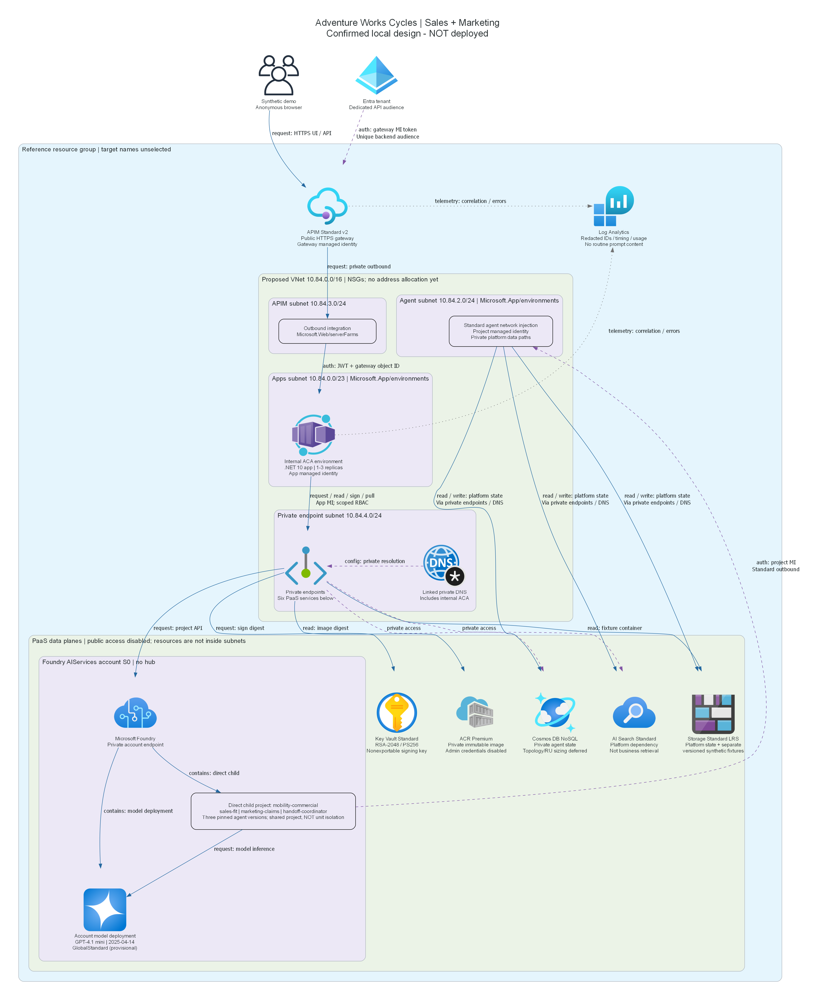
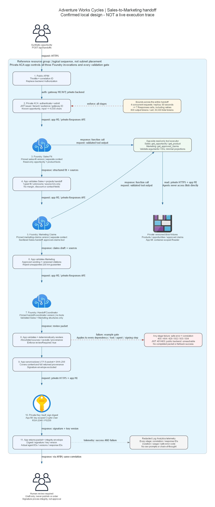

# Manufacturing Sales-to-Marketing multi-agent reference

> Generated by az-01-conductor agent | Updated 2026-10-24

Adventure Works Cycles' synthetic mobility opportunities flow through Sales Fit, Marketing Claims and
Handoff Coordinator Foundry agents to a cited, signed, human-review campaign packet.
This is an ABC Builder reference design workspace, not a published catalog template or completed hack.

## Installation

The workspace is available at `generated-scenarios\manu-multi-agent` through the repository workspace junction.
Requirements, public evidence and architecture are authored.
The recovered canonical portal records current design confirmation on 2026-10-24 for local revalidation.
Architecture and runtime diagrams are rendered; private Bicep and azd infrastructure are now authored.
See the [implementation plan](./04-implementation-plan.md)
and [infrastructure reference](./05-implementation-reference.md).
The .NET 10 application, new versioned fixture corpus, pinned runtime agent definitions and installation automation
are now authored. See the [application summary](./07-webapp-summary.md)
for routes, local evidence and installer contracts.
Local image/configuration/authentication checks are complete; live runtime acceptance remains separate work.
Dependency installation, if needed, follows actual manifests or missing-tool validation errors.

## Deploying the scenario in 4 steps:

1. Implement and validate the locally confirmed reference design; no additional routine design approval is needed.
1. Separately authorize preparation for exact Azure targets before account queries or what-if.
1. Review actual what-if and itemized cost, then explicitly authorize deployment of the same targets.
1. Deploy and prove live behavior; review suitability separately before any hack authoring.

No Azure operations are authorized now. Design confirmation is neither cloud consent nor suitability approval.

## What is the demo scenario about?

Manufacturing & Mobility, specifically `sales` and `marketing`, not Generic.
Sales qualifies product fit; Marketing uses a sanitized handoff and approved claims to draft positioning;
the coordinator assembles a review packet and flags unsupported guarantees.
The five selected services remain Foundry, Container Apps, Key Vault, managed identities and API Management.
The proposed private Standard setup additionally requires Storage, Cosmos DB, Search, networking, ACR and logs.

## Project Summary

| Property | Value |
| --- | --- |
| Created / Last Updated | 2026-10-22 / 2026-10-24 |
| Industry | Manufacturing & Mobility |
| Business Units | `sales`, `marketing` |
| WAF priority | Operational Excellence |
| Provisional region | `eastus2`; no selected Azure target |
| Provisional model | `gpt-4.1-mini` version `2025-04-14`, `GlobalStandard` |
| Design confirmation | Reconfirmed in the portal on 2026-10-24; local revalidation and wiring only |
| Phase A overall | Incomplete; not deployed, live-validated or approved |

| Stage | State | Evidence |
| --- | --- | --- |
| Requirements | Complete | [Story, scope and acceptance](./01-requirements.md) |
| Architecture | Confirmed for local implementation | [Assessment](./02-architecture-assessment.md) |
| Diagrams | Rendered design, not runtime proof | PNGs and reproducible Python sources below |
| Bicep | Authored; local infrastructure checks recorded | `infra`, `azure.yaml`, `.infra-evidence\validation.json` |
| Application | Implemented; offline checks | [Summary](./07-webapp-summary.md), `.application-evidence` |
| Local validation | Passed offline | `local-validation.json`; image, configuration and protected-route checks |
| Deployment / live proof / review | Unauthorized / pending | No runtime receipt or suitability snapshot |

Progress follows portal events, not filenames or CLI exit status.
Current public support and limitations are in [region/model evidence](./00-region-availability.json).

## Architecture

Public APIM -> private ACA -> three distinct Foundry agents, read-only private fixture tools and Key Vault signing.
Private Standard uses BYO Storage, Cosmos and Search. All app backend hops use managed identity.
Anonymous access is for synthetic data only and does not implement staff access control.

### Architecture diagram



Source: [architecture Python source](./03-architect-diagram.py).
The resource-group boundary contains the proposed four-subnet VNet, APIM, internal ACA, private PaaS resources
and redacted logging. Entra and the anonymous browser are outside that boundary.
The Foundry account contains the direct child project and model deployment; agent versions share that project.
Subnet addresses and resource labels are design proposals, not allocated Azure targets or generated IaC names.

The private-endpoint icon aggregates endpoints for six PaaS services; it is not one endpoint serving all services.
App MI arrows cover project invocation, fixture-container reads, key-scoped signing and image pulls only.
They do not grant the app Cosmos or Search access; those are Standard runtime dependencies accessed by project MI.
Project Storage writes are platform state, not fixture writes.
DNS is shown once for readability; linked zones also cover service-specific domains and internal ACA wildcard/apex.
Entra metadata, ARM, platform telemetry and package/base-image downloads remain documented egress exceptions.
The future installer still requires private access for image push, fixture upload and agent/key installation.

### Runtime diagram



Source: [runtime Python source](./04-runtime-diagram.py).
Numbered steps describe the intended sequence, not an executed trace.
The app invokes three distinct pinned Foundry agent versions with separate contexts, executes function tools
itself and validates each handoff before the next agent. No tool can publish a campaign or place an order.
The diagram's group is a resource-group/logical workflow view, not a claim that PaaS services sit in ACA's subnet.
Standard platform persistence and image delivery appear in the architecture diagram, not on the business sequence.

Solid blue edges show labeled requests, responses and reads; purple dashed architecture edges show identity/config.
Red dashed runtime edges show bounds/failure controls; grey dotted edges show redacted telemetry.
The fail-closed annotation applies to every tool, agent, validation and signing operation,
not only the illustrated gate.
The runtime tool loop uses bidirectional arrows for returned function calls and subsequent app-submitted tool outputs;
agents never access Blob directly. Calls and retries share the seven-Responses-request and 90-second limits.
The final signature covers canonical packet content and provenance, not its own envelope.
It proves integrity, not business approval or deployed-scenario suitability.

Regenerate locally from the repository root using the existing Python environment:

```powershell
python generated-scenarios\manu-multi-agent\03-architect-diagram.py
python generated-scenarios\manu-multi-agent\04-runtime-diagram.py
```

Both sources resolve their output beside themselves, use top-to-bottom layout and never open a browser or call Azure.
Top-to-bottom layout keeps the four network boundaries and ordered validation gates legible.
The dated requirements/architecture documents retain their pre-confirmation checkpoint wording;
the portal decision and this update record the later confirmation without changing the reviewed design.
Infrastructure now implements these logical resource paths; physical names derive from the environment and group suffix.
Private Standard platform state and read-only business fixtures use separate Storage accounts so project provisioning
roles cannot modify the business corpus. Each has its own Blob endpoint, sharing the linked private Blob DNS zone.
This refines the logical Blob boundaries without changing the confirmed business workflow.
The application now implements this workflow and route/settings contract, including a pinned signing-key version.
Offline tests and browser fixtures do not replace the diagram's later live multi-agent/runtime evidence.

### Local validation boundary

The native `BUILDPLATFORM` SDK build restores/publishes successfully and preserves the nonroot `linux/amd64`
runtime. The production image rejects missing configuration explicitly.
The repository container helper's generic anonymous health/homepage check therefore does not pass;
it is retained as an expected negative test, not represented as application liveness success.
No anonymous route, runtime test-double switch or relaxed authentication was introduced.

With explicit syntax-only test settings, the image passes `--check-configuration` with Docker networking disabled.
A separate application-specific check uses the repository helper's Docker operations and in-container loopback:
all six shell/asset/read routes return HTTP 401, `authentication_required`, a correlation ID and no business data.
That check also disables networking, mounts and host-published ports and uses a read-only nonroot container.
Its test IDs/endpoints are not installed identities, deployment outputs or proof of a working Foundry connection.
Owned containers were cleaned up. Read-only startup logs show ephemeral ASP.NET Data Protection keys;
cross-replica cookie/antiforgery persistence was not validated, and no interactive sign-in is implemented.

Reproduce this assigned operation from the repository root:

```powershell
$scenario = 'generated-scenarios\manu-multi-agent'
$evidence = "$scenario\.resume-evidence\d759fcc15c504c529009a19ae5ba0e13"
python "$scenario\scripts\validate_application.py" --evidence-directory "$evidence\application"
python "$scenario\.local-validation-evidence\validate_local.py" `
    --evidence-directory "$evidence\container" --application-evidence "$evidence\application"
```

The historical receipt retained 35 application tests, 12 infrastructure contracts and eight offline browser cases
through source-hash verification, with the recorded Dockerfile SDK-platform repair.
Current resumption reruns the application and infrastructure tests and adds offline lifecycle contracts;
source-hash checks then bind those current results to the rebuilt image and protected-route checks.
Exact historical commands and limitations are in `.local-validation-evidence`.
Current resumption results are retained under `.resume-evidence\d759fcc15c504c529009a19ae5ba0e13`;
dated original evidence remains available and is not imported as current validation.
Real configuration, directory permissions, private-network access and model/agent invocation remain unverified
until separately authorized cloud work. No deployment, suitability approval or hack composition is claimed.

## Feedback and Contributing

Use the portal for subsequent decisions and progress. Do not edit canonical workflow state manually.
This target adapts `finance-security-hack` architecture read-only and preserves its reviewed manifest digest.
No source deployment state or approval transfers. Publication and hack composition are separate later user choices.

### Execution record

| UTC date | Step | Result |
| --- | --- | --- |
| 2026-10-22 | Read canonical revision 1 and all prior answers | No resolved decisions; design not confirmed |
| 2026-10-22 | Inspect source and verify manifest digest | Reviewed digest matched; source untouched |
| 2026-10-22 | Create workspace using repository helper | External folder and expected junction created |
| 2026-10-22 | Inspect identity catalogs and public Microsoft guidance | New provenance and provisional evidence saved |
| 2026-10-22 | Author requirements and architecture | Local documents only; design decision required |
| 2026-10-23 | Read canonical revision 10 and history | Design confirmed; local tools authorized; no cloud consent |
| 2026-10-23 | Render architecture and runtime PNGs | Both images generated from retained Python sources |
| 2026-10-23 | Fix import and runtime layout | Used installed Search icon; kept ordered gates legible |
| 2026-10-23 | Inspect diagrams and decode PNGs | Design views only; no deployment or live inference claimed |
| 2026-10-23 | Implement AVM-first private infrastructure | Foundation/workload separation; no Azure operation |
| 2026-10-23 | Compile infrastructure and parameter contracts | Actual local results in `.infra-evidence` |
| 2026-10-23 | Implement .NET 10 handoff and installers | Target-only source, data and agent definitions |
| 2026-10-23 | Exercise application and responsive UI offline | Application evidence; no Azure invocation |
| 2026-10-23 | Resume recovered local validation | Native SDK image and explicit configuration checks passed |
| 2026-10-23 | Check protected routes without networking | Six correlated HTTP 401 responses; owned containers cleaned |
| 2026-10-24 | Read recovered canonical state and all decisions/history | Current design confirmed; local consent only |
| 2026-10-24 | Check current tools and approved NuGet metadata | All local prerequisites passed; no Azure queries |
| 2026-10-24 | Wire guarded complete-reference azd installation | Local code; no installation or live success claimed |
| 2026-10-24 | Revalidate app and infrastructure | 35 .NET and 21 infrastructure/lifecycle tests passed |
| 2026-10-24 | Revalidate UI and isolated production container | Eight browser cases and seven container checks passed |
| 2026-10-24 | Stop at exact-target preparation boundary | Use the portal Azure context card; no cloud grant exists |

Research limitations are explicit in the evidence file: an unused guessed A2A URL returned 404,
the AVM shortcut was not a usable index, and dynamic pricing tables did not yield reliable regional unit prices.
Official AVM source interfaces and supported prompt-agent/function APIs were used instead.
No retries changed account, region, model, security or authorization.
