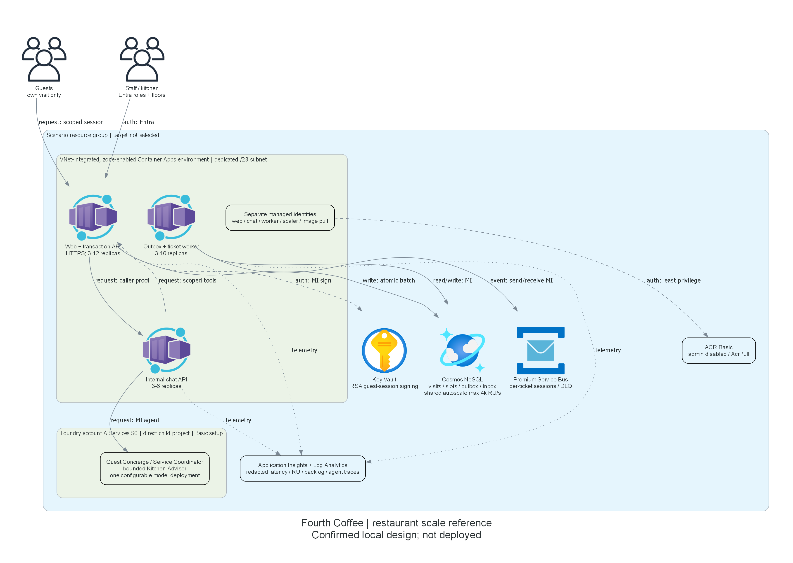
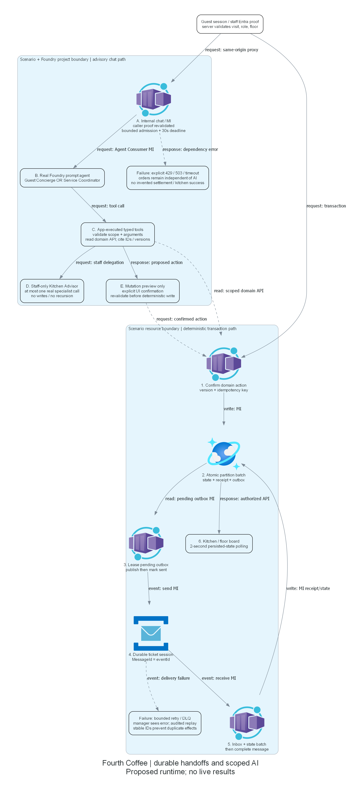

# Architecture assessment: Fourth Coffee restaurant scale reference

## Requirements Validation

### Current same-reference design review: 2026-10-24

This section governs the current resume. The dated design confirmations, targets, installation grants and
deployment observations below are preserved history, not current portal authorization or stage completion.
The portal records local execution consent and explicit local design confirmation at 2026-10-24T20:45:26Z.
The accepted answer is "Confirm design for local repair"; there are still no cloud authorizations.
Requirements recovery passed 25 local checks. Current local repair evidence is below;
live application/runtime/performance acceptance has not run this attempt.
Do not replace the workspace, recreate retained resources, infer suitability approval or start composition.

Keep the complete restaurant architecture and all six required services.
Keep VNet/subnet, ACR Basic, workspace-based Application Insights/Log Analytics and Entra dependencies visible.
Retain Basic Foundry managed state, the direct child project, authenticated public data endpoints,
zone-enabled VNet-integrated Container Apps and internal chat; add neither Search nor Storage.
Reuse the 2026-10-23/24 Foundry evidence for unchanged local design.
Retain the historical Central US target rather than silently switching back to the older East US 2 proposal.
Neither region is certified currently deployable by this local review.
Saved target resolution/confirmation belongs to the portal Azure context card after design confirmation.

### Staff authentication reconciliation

The sources disagree materially, not just in terminology:

- Requirements and this architecture require Entra-validated staff business roles and floor assignments.
- `Program.cs` registers the custom `StaffAuthenticationHandler`, not Entra bearer validation.
- `StaffAuthentication.cs` verifies installation-scoped HMAC proofs and local password hashes.
- `azure.yaml` runs `setup_staff.py --verify`; `infra\runtime.bicep` consumes `staffAuthenticationJson`.
- `scripts\setup_identity.py` is now a retired entry point. It exports none of the installer functions
  imported by the historical `operator_access.py`; that old verifier cannot currently be reused unchanged.

**Confirmed local resolution:** preserve the explicit Entra requirement.
Repair the existing authentication/configuration/installation surfaces in place.
Do not silently relabel synthetic password proofs as Entra authentication or enable a deployed fallback.
Retain synthetic helpers and historical assets; restrict any synthetic staff mode to explicitly isolated local tests.
No credentials, private staff configuration or `.azure` environment values were read during this review.

Use a single-tenant staff API/client pair and assignment-required access.
Prefer verified, scenario-owned registrations already represented by the retained installation receipt.
Verify ownership markers, tenant, app IDs and configuration before reuse; do not adopt objects by name alone
or create replacements merely because the current helper was retired.
Expose only the scenario API's delegated `access_as_user` scope and business/floor app roles.
Validate signature, issuer, audience, expiry, tenant, delegated scope and business/floor authorization server-side,
including again at the internal chat boundary. ID tokens are not API access tokens.
Guest RSA sessions, managed-identity service access and deterministic transaction APIs remain independent.

Capture verified client/object IDs, roles, redirects and endpoints automatically as installation outputs.
No missing generated ID is a business input or an independent local-build blocker.
Existing application code can retain the `Caller` business-scope contract while repairing its trusted identity source.
Tests must cover wrong tenant/audience, expired tokens, missing role/floor, cross-floor/visit access,
synthetic proofs rejected in deployed mode, and staff-to-chat propagation.
No real staff sign-in, current installed permission, directory capability or live verification is claimed yet.

Local repair run `30bc1eeb` now uses single-tenant JWT bearer validation at both web/chat boundaries.
It checks RSA signature, issuer, audience, expiry, tenant, v2 delegated scope, authorized client and app roles.
Unsigned/custom floor inputs do not grant access. Synthetic staff code is retained only for explicit isolated
Testing hosts and rejects configured cloud identity/data-service hosts.
The browser uses pinned Microsoft MSAL Browser 4.30.0 with memory-only token caching and a same-origin callback.
Only a validated API access token can become the secure, HttpOnly, host-only staff cookie.
The cookie expires within 30 minutes or earlier token expiry. Both boundaries revalidate the original proof.
The deployed runtime no longer consumes synthetic staff hashes or signing material.

The restored identity helper preserves the original ownership marker and role identifiers.
It verifies the retained pair, roles, v2 scope, assignment policy, operator assignments and operator-only consent.
The only prepared directory repair is appending the actual HTTPS SPA callback to the verified owned client.
It never creates replacement identities, grants broad access or retries the denied consent POST.
The azd postprovision hook orders identity verification, local image publication, initialization and runtime rollout.
It requires a current canonical deployment grant bound to `scripts\reference-installation-plan.json`;
the file and its digest alone grant nothing. Plain azd deploy/up image replacement is intentionally blocked.
This installation path is authored, not executed or certified.

Current actual evidence: targeted authentication/API/domain checks passed 50/50, and the later full run passed
51/52, including the added staff-to-chat proof-propagation check.
The browser check failed because clearing an unauthenticated staff session empties the board placeholder.
The Python identity/infrastructure suite was denied by the CLI before execution, with no structured missing scope.
This is an unresolved workflow error, not proof of a user setup problem or a need for more consent.
Local validation remains incomplete; see `06-deployment-summary.md` and the portal blocker.

The historical Graph consent POST failed with `Authorization_RequestDenied` at `2026-10-24T17:42:00Z`.
Do not retry that denied write, use another credential route, widen Graph rights or grant tenant-wide consent.
Preserve the recorded operator-only `Principal` / `access_as_user` remediation request.
Any later read-only verification requires recorded exact-target preparation permission and a repaired verifier.
An actual remaining denial requires its precise technical remediation, not a guessed sign-in or ID questionnaire.

Identity guidance fetched on 2026-10-24:
[API access-token validation][resume-access-tokens] and [application-role claims][resume-app-roles].
These sources support the proposed security contract, not tenant permission or installed-state assertions.
The [authorization-code flow guidance][repair-auth-flow] was fetched during this repair on 2026-10-24.
It recommends a supported authentication library and SPA callbacks for PKCE; no raw OAuth implementation was added.

### Agentic runtime contract and management access

Use pattern 01 tool loops with the required bounded pattern 08 staff-to-Kitchen Advisor overlay and
pattern 17 human confirmations. A shared guest/staff agent is simpler but fails the requested audience/tool
separation and independent Advisor trace. All coordination is application-mediated, not native A2A or Copilot fanout.
Retain one Advisor invocation, four function calls maximum, a 30-second turn deadline, a queue of ten turns
and aggregate admission of twelve turns/minute. Exhaustion must be an explicit 429/timeout, not invented success.
Typed scoped tool results carry record IDs/versions; previews bind caller, expected version, digest and expiry.
Real positive/negative coordination traces and committed receipts are required later.

The authorized local execution host will use public ARM, registry and service HTTPS endpoints with explicit
scenario credentials/managed identities. No private endpoint, connected runner, management VM or Bastion is added.
VNet integration/internal chat do not imply local access to the chat endpoint; test it through the authenticated
web proxy and service-side evidence. Never expose chat publicly just to enable a test.
Image publication, ingestion, Foundry initialization and runtime tests need separately authorized data-plane access.

### One remaining end-to-end deployment review

After design confirmation, repair and validate existing assets locally before requesting cloud preparation.
Then use one coherent exact-target review covering retained infrastructure ownership and incremental changes,
the identity repair and operator-only consent dependency, image publication, fixture/agent initialization,
runtime rollout and live business/agent/browser/load/fault acceptance.
Use existing azd lifecycle wiring for technical dependency ordering; the current single staff predeploy check
is insufficient for that complete installation and must be repaired, not presented as a finished pipeline.
Do not create separate foundation/image/initialization/app approval stages.

Historical candidate scope is account `petender@microsoft.com`, subscription
`efd64343-6ef4-4926-951f-d3229f38bd76`, tenant `16b3c013-d300-468d-ac64-7eda0820b6d3`,
resource group `rg-resto-scale-agent`, environment `resto-scale-agent`, region `centralus`.
These are retained targets for reconciliation, not an authorization imported from artifacts.
Resource RBAC, ownership, zones, exact model capacity, policy, directory dependencies and actual incremental
what-if remain authorized preparation checks. Do not use old create-only previews against potentially retained assets.
Dependent identity-expanded checks remain explicitly pending until approved installation produces verified outputs.

Reuse the dated Central US price evidence at `evidence\centralus-189819a8\cost-review.json`:
$745-$1,150/month shared and $900-$1,650/month typical full reference at nine warm replicas and 200 turns/day.
The typical figure includes the $50.40 model example; do not add it twice.
Premium 1 MU alone is $677.08/month. Sustained maximum app compute alone is $1,103.76/month;
conservative sustained rollout overlap is $2,207.52/month before broker, Cosmos and other costs.
Ancillary $30-$120 is a planning allowance, not individually refreshed pricing.
Identity registration itself adds no quoted Azure meter here; required Entra licensing is not verified or priced.
Storage, requests, telemetry, egress, taxes and any licensing can add costs.
These dated estimates are neither a cap, approved budget nor current invoice.
Retained resources may still accrue charges; this review authorizes no deletion or cleanup.

The local design checkpoint is accepted; the current boundary is an **unresolved local-validation workflow error**.
No current what-if, cloud preparation, directory mutation, deployment or suitability success is claimed.
Fresh authorized what-if/cost review must precede the separate end-to-end deployment authorization.

[repair-auth-flow]: https://learn.microsoft.com/en-us/entra/identity-platform/v2-oauth2-auth-code-flow

| Scope | Design response | Acceptance evidence to produce |
| --- | --- | --- |
| Hospitality & Travel; `["generic"]` | End-to-end venue flow, no department targeting | Persona/journey fixtures |
| Five floors, 250 seats | Floor-aware views, capacity-controlled table/slot allocation | Booking contention tests |
| Customer/staff agents | Concierge, Coordinator, bounded Kitchen Advisor | Real agent/tool traces |
| Full guest journey | Deterministic APIs and durable event handoffs | Domain/API/browser tests |
| Reliability | Outbox, idempotency, session ordering, zone-aware deployment | Fault recovery and invariant report |
| Performance Efficiency | Separate transaction/chat pools, RU and token budgets | Normal/burst/soak reports |
| Required services | Foundry, Cosmos, Container Apps, Key Vault, MI, Service Bus | IaC/runtime checks |

Historical assessment date: 2026-10-23 UTC. That attempt recorded design confirmation for local implementation.
Authoritative provisional evidence: `00-region-availability.json`.
The original design used public evidence only. Separately authorized read-only preparation on 2026-10-23
is recorded in `06-deployment-summary.md`: actual what-if/validation, quota, costs and remaining limitations.
That original assessment preceded the later historical shared deployment; see the current recovery section above.

### Recommended architecture

Guest and staff browsers connect to a .NET 10 web/transaction Container App.
The customer pages cover reserve, check-in, menu/order, bill and survey.
The protected staff pages cover arrivals, floor board, kitchen board and reconciliation.
This app also serves a same-origin chat proxy to an internal-ingress chat Container App.
The proxy forwards the authenticated caller context; the chat service revalidates tokens, roles and visit/floor scope.
The chat app alone invokes real Foundry agents using managed identity.
Agent tool requests execute in application code and call authorized domain APIs; agents never get database keys.
The transaction app never waits for Foundry to accept an order or update a kitchen ticket.

Cosmos commits aggregate state, idempotency receipt and outbox record atomically.
A worker Container App polls indexed pending outbox records, publishes durable Service Bus messages and processes
session-aware ticket work. The same worker executable hosts separately bounded dispatcher and consumer loops;
failure of either leaves durable state available for retry.
Service Bus sessions are per ticket, not per floor, allowing concurrent work across all five floors.
The kitchen board reads persisted ticket state through the API with two-second polling and version-aware updates.
No WebSocket session affinity or extra real-time hosted service is required.

Architecture and runtime PNGs were generated after design confirmation, before Bicep/app construction.
They describe the confirmed design, not a deployed implementation.



Source: `03-architect-diagram.py`.



Source: `04-runtime-diagram.py`. Both sources are retained for reproducibility.
Top-to-bottom layout follows the repository Python diagram standard.

### Foundry runtime and multi-agent scope

Use one `Microsoft.CognitiveServices/accounts` resource (`AIServices`, S0), one direct child
`Microsoft.CognitiveServices/accounts/projects`, one model deployment and three versioned prompt agents.
No hub or Machine Learning workspace is part of this greenfield design.
Use the new Foundry project API and project endpoint emitted by the deployment, never a constructed classic endpoint.
The current official C# quickstart uses `AIProjectClient`, declarative agent definitions, conversations and Responses.
Pin package versions at implementation after checking metadata; no unverified SDK version is prescribed here.

| Agent | Audience | Allowed capability | Invocation boundary |
| --- | --- | --- | --- |
| Guest Concierge | Guest | Menu/policy, own reservation/visit and action previews | No staff tools or other visits |
| Service Coordinator | Staff | Backlog, bill summary, action previews, Advisor tool | Claims constrain every tool |
| Kitchen Advisor | Via Coordinator | Explain ticket ages/states and bottlenecks | No payment or write tools |

App-mediated delegation is a typed Coordinator function tool that invokes the real Kitchen Advisor prompt agent.
It does not depend on preview hosted-agent workflows or native Agent2Agent transport.
Maximum one specialist invocation per turn, no recursive delegation, at most four function calls per turn,
bounded tool output and conversation history. All hops share one correlation ID and a 30-second overall deadline.
Do not confuse these business agents with Copilot authoring agents; no implementation delegation occurs.

Every tool validates arguments and caller scope independently of model output.
Mutating proposals produce a short-lived preview bound to caller, aggregate, expected version and payload digest.
Only an explicit UI confirmation performs the deterministic write after revalidation.
The agent can report success only when supplied a committed domain receipt.
Menu/policy answers include tool record IDs/versions; this small structured corpus needs no Search/vector store.
Missing evidence returns an explicit limitation, not an invented menu item, ticket state or settlement.

### Basic versus Standard and networking

Choose **Basic agent setup**, with Microsoft-managed agent conversation/state storage.
The requested customer Cosmos DB stores business transactions; it is not represented as BYO Foundry thread storage.
Basic supports the selected function tools and avoids unnecessary Azure AI Search and Blob Storage dependencies.
Standard setup adds customer-managed Cosmos, Storage and Search for full state ownership.
Standard with BYO VNet is appropriate for secured agent outbound networking and strict data-control requirements.
No such requirement was supplied; selecting Basic is proposed for confirmation, not an invisible security downgrade.

Inbound Foundry private endpoints can be used with Basic, but are not proposed for this synthetic reference.
The proposed app/data endpoints use TLS and Entra authentication; no public anonymous database or broker access.
Container Apps environment VNet integration is required for zone redundancy, not proof of private data egress.
Private-only outbound, full customer-owned agent state, payment production compliance and internet WAF protection
are explicitly not satisfied. A production rollout needs its own security and residency review.
GlobalStandard can process inference outside the project region. Only synthetic data is permitted here.

### Data ownership and correctness

Use a Cosmos NoSQL database with shared autoscale throughput and a small number of containers.
The transactional container partition key is `/aggregateKey`; a visit's items, ledger, audit, receipts and
outbox records share `visit:<id>`. Order transitions use ETag-checked transactional batches and monotonically
increasing aggregate versions. Never claim Cosmos transactions span partitions.

Reservation allocation is authoritative in `slot:<service-date>:<meal-slot>` with bounded seat/table documents.
A conditional batch reserves capacity and creates the reservation receipt/outbox in that partition.
Visit creation is idempotently projected; until then, the UI shows "confirmed, visit preparing".
A projection delay cannot sell a seat twice.
Cancellation releases allocation through a compensating, version-checked action.
Check-in verifies the allocation before activating the visit. Five floor labels are not database partition keys.
Use a separate small menu/policy container and a rebuildable reporting projection container.

Order totals use server menu prices, integer minor units, captured price/version and explicit currency.
Settlement requires all required bill items reconciled, a stable bill version and unique ledger identity.
Duplicate keys with different bodies return conflict; identical retries return the original receipt.
The synthetic settlement adapter never accepts card data and never contacts a bank.

Outbox event IDs are stable; dispatcher uses conditional leases and sends in aggregate-version order.
Record "sent" only after broker acknowledgement. A crash between send and marker can resend; this is expected.
Use broker `MessageId=eventId`, `SessionId=ticketId`, and a ten-minute duplicate-detection window.
Consumer creates an inbox receipt and business update in one partition transaction before completing the broker message.
Inbox records outlive broker deduplication. Version gaps are deferred/retried, never applied out of order.
This is at-least-once delivery with idempotent effects, not an exactly-once transport guarantee.
Poison messages dead-letter after bounded attempts.
Managers see failure details and can replay through an audited action.
An undelivered ticket remains visibly "pending kitchen dispatch"; accepted HTTP writes never pretend kitchen acceptance.

### Identity and authorization paths

| Identity | Required scope | Explicitly excluded |
| --- | --- | --- |
| Web/transaction MI | Cosmos business read/write; Key Vault sign on one key | Foundry authoring, subscription access |
| Chat MI | Foundry Agent Consumer at project; public token verification key | Cosmos direct writes, Key Vault signing |
| Worker MI | Cosmos business/inbox/outbox; Service Bus sender and receiver on queue | Foundry and guest token signing |
| Scaler MI | Service Bus receiver metadata access for queue scale rule | Cosmos and Foundry |
| Image-pull identities | AcrPull on scenario registry | Registry push/admin |
| Future setup principal | Deploy resources and agent versions | No persisted user secrets in runtime |

Foundry role names were recently renamed; confirm IDs and exact permission scope at implementation.
A deployment initializer, not the runtime chatbot, creates agent versions.
Guest sessions use Key Vault RSA signing, short expiry, scoped audiences and cached public-key verification.
Do not call Key Vault on every API read. Rotation retains prior public keys until issued sessions expire.
The internal chat proxy preserves user proof; an internal network address alone grants no privileges.
Entra staff app roles and floor assignments are verified server-side. Never derive authorization from a chat prompt.
Read-only local test doubles are visibly test-only and cannot enable simulated AI success in deployed mode.

## Resource SKU Recommendations

All values are initial design parameters, not claims of allocated quota or measured sufficient capacity.

| Service | Proposed SKU/configuration | Initial scale |
| --- | --- | --- |
| Foundry account/project | AIServices S0; direct child project; Basic setup | One project, three prompt agents |
| Model | gpt-5.4-mini 2026-03-17, GlobalStandard | Planning allocation 100k TPM; verify RPM/eligibility later |
| Container Apps environment | Workload profiles, Consumption, zone redundant | Dedicated infrastructure subnet /23 |
| Web/transaction app | 0.5 vCPU, 1 GiB; HTTP concurrency trigger 30 | 3-12 replicas |
| Chat app | 0.5 vCPU, 1 GiB; internal ingress | 3-6 replicas |
| Worker app | 0.5 vCPU, 1 GiB per replica; no ingress | 3 minimum, 10 maximum; queue trigger 20 messages |
| Cosmos NoSQL | Standard, single region, zones, session consistency | Database autoscale max 4,000 RU/s |
| Cosmos recovery | Continuous backup; shortest supported retention | Restore exercise requires permission |
| Service Bus | Premium, initial 1 MU; zone resilience where supported | Session queue, dedup, DLQ, max delivery 5 |
| Key Vault | Standard, RBAC, RSA key, soft delete/purge protection | Sign sessions; public-key cache |
| Managed identities | User-assigned, separate runtime/scaler scopes | No stored cloud credentials |
| Container Registry | Basic, admin disabled | Store the three application image variants |
| Observability | Workspace-based Application Insights + Log Analytics | Redaction, sampling, 30-day logs |
| Network | VNet + dedicated environment subnet | Zone-enabled ACA; no private endpoints claimed |

### Indispensable supporting dependencies

ACR provides authenticated image delivery for the azd Container Apps deployment.
VNet/subnet enables the required zone-redundant app environment.
Log Analytics/Application Insights provide request, dependency, queue-delay, RU and recovery evidence;
plain homepage availability cannot prove the requested scale/reliability objectives.
Microsoft Entra supports managed identity and real staff authentication; it is not a new business service.
App registration/configuration is a later authorized identity setup operation, not permitted in this local job.
No Azure Load Testing, Redis, API Management, AI Search, Storage, payment provider or Teams bot service is added.
Any requested-service substitution or material expansion must return for a decision.

### Capacity and load reasoning

1,250 covers/day is a workload volume estimate; burstiness, not that daily average, drives scaling.
At 50 req/s and 0.8-second writes, a rough Little's Law bound is 40 in-flight operations.
At 150 req/s the analogous bound is 120; initial warm replicas reduce scaling lag but do not prove latency.
Use singleton SDK clients, async I/O, bounded concurrency, cancellation and no unbounded background queues.
Queue age and active sessions matter more than raw message count; scale consumers across tickets.
Shared outbox scans must use indexed status/type filters and bounded pages; measure their RU cost under soak.
If cross-partition scans dominate, revisit partitioning from measured evidence before increasing service complexity.
No preemptive Redis dependency is justified.

The 4,000 RU/s ceiling is a test starting point. Capture per-operation RU, hot partitions, 429s and retry delays.
Tune indexes and query shapes before increasing RU. Capacity changes remain explicit test parameters.
Metrics must distinguish business rejections, authorization failures, transient faults and throttling.

AI has a separate envelope: 12 admitted turns/minute, averaging two model calls per turn,
2,000 input and 600 output/reasoning tokens per call = 62,400 tokens/minute before headroom.
100k TPM is therefore a planning request, not a quota entitlement or guarantee.
Hard per-turn call/output/history limits and per-replica admission slices keep aggregate use bounded at max replicas.
Use a bounded queue of ten turns and immediate retryable 429 when full; never queue an unbounded number of chats.
Measure token reservation semantics and RPM before cloud load. Specialist-heavy paths may need a lower turn rate.
Scaling Container Apps cannot fix model quota. Transaction throughput and AI throughput must be reported separately.

### Reliability and observability

Maintain at least three replicas for each app in the zone-enabled environment.
Zone distribution is platform-managed and must be verified, not assumed from replica count alone.
Broker Premium provides predictable isolation and zone resilience; 250 seats alone do not require Premium capacity.
Standard supports sessions/dedup and costs less; downgrading is a deliberate reliability/cost design revision.
Service Bus Basic cannot satisfy the session/dedup design.
Cosmos autoscale plus zones protects against zone faults; backup is not automatic regional failover.
Foundry Basic and GlobalStandard are dependencies outside the deterministic transaction availability path.
No single-region solution guarantees regional-outage continuity.

Use exponential backoff with jitter and bounded retries for retryable calls; no blanket success-shaped fallbacks.
Show explicit unavailable/degraded indicators. Circuit-break chat dependencies without disabling order APIs.
Readiness checks reflect transaction dependencies.
Separate chat health avoids restarting healthy transaction replicas.
Track p50/p95/p99 latency, unexpected errors, active replicas, saturation, RU/throttles, outbox age,
queue age/depth, duplicate drops, DLQ count, model tokens/429s, tool denials and correlation propagation.
Alert on oldest kitchen handoff >5 seconds, any DLQ item, growing outbox and sustained unexpected API errors.

### Cost planning, not a quote

Rough USD allowances for 730 hours/month, no discounts, low synthetic data volume and bounded telemetry:

| Component | Monthly planning allowance |
| --- | --- |
| Service Bus Premium 1 MU | $650-$850 |
| Nine warm ACA replicas plus variable burst time | $250-$550 |
| Cosmos autoscale 4,000 RU/s ceiling, variable utilization and storage | $50-$400 |
| Registry, vault, telemetry and incidental data transfer | $30-$120 |
| Total infrastructure allowance, excluding model | $980-$1,920 |

These are engineering planning ranges, not fetched regional price quotes, approved budgets or guaranteed caps.
A short demo still accrues the broker and warm-replica hourly baseline while provisioned; teardown needs authorization.
Model cost is additional: at 200 turns/day and the above call sizes, 30 days produce about 24M input and
7.2M output/reasoning tokens. Multiply by current per-million-token rates during deployment preparation.
Sustaining the maximum 12 turns/minute all day is a different, much larger cost scenario.
The actual regional price sheet, usage assumptions and total estimate must accompany the later what-if review.

## Architecture Decision Summary

| Decision | Choice | Rationale |
| --- | --- | --- |
| Business scope | Generic restaurant guest-to-kitchen-to-settlement flow | Honors intake without department targeting |
| Agent design | Two audience agents plus a bounded specialist | Staff multi-agent reasoning without fanout |
| Transaction authority | Deterministic APIs and Cosmos receipts | AI failures cannot lose orders or invent payment |
| Foundry setup | Basic; direct child project | Function grounding needs no BYO Search/Storage |
| Model/region | East US 2; gpt-5.4-mini 2026-03-17; GlobalStandard | Current GA and Functions support |
| Messaging | Outbox, Premium sessions, idempotent inbox | Recoverable kitchen handoffs |
| Scale isolation | Separate web, chat, worker | AI/backlog cannot starve transaction HTTP |
| Network | TLS/Entra public services; internal chat | Synthetic reference; production hardening deferred |
| Payment | Persisted synthetic settlement; no bank/card | No misleading money-movement claims |
| Dependencies | ACR, VNet, Monitor/Log Analytics, Entra | Images, zones, identity, evidence |
| Rejected | Agent per seat/floor/order; preview fanout | Excess cost, latency and coordination failures |

The current Agent Service tool table marks Functions unavailable for gpt-5-mini; it was not selected.
The newer gpt-5.4-mini is explicitly listed with Functions support and a GA lifecycle through 2027-09-21.
The chosen model is configurable from the evidence file, not an authoring-agent model preference override.
Recheck lifecycle before deployment and seek a decision before any required model/service substitution.

## Implementation Handoff

### Gate and parameters

| Parameter | Value |
| --- | --- |
| Workspace | `generated-scenarios\resto-scale-agent` |
| Region | `eastus2`; live preparation metadata is recorded, with explicit unresolved checks |
| Model | `gpt-5.4-mini`, `2026-03-17`, `GlobalStandard` |
| Account/subscription/tenant/resource group/azd environment | Exact portal scope recorded in deployment summary |
| Design confirmation | Recorded in portal; local implementation only, not deployment or suitability approval |
| Deployments and runtime results | None |

After explicit design confirmation, generate architecture/runtime PNGs with the diagram skill, AVM-first Bicep,
azd wiring, .NET 10 web/chat/worker app, synthetic data, import and agent setup automation, xUnit/Playwright tests,
and local k6 workload definitions. No production payment connector is implied.
Check AVM compatibility before pinning modules. Public Foundry AVM account tags currently include 0.19.1;
this proves publication, not support for every current project property.
The current project resource schema lists stable 2026-09-01. Select mutually supported account/project API versions
from actual module/schema inspection during implementation, documenting a direct-resource exception if needed.
Do not generate Bicep before this design gate is resolved.

Prepare exact-target what-if commands as documentation only after implementation:

```powershell
# Later, only after separately recorded exact-target preparation permission:
az deployment group what-if --subscription <confirmed-subscription> `
  --resource-group <confirmed-resource-group> --template-file infra\main.bicep `
  --parameters infra\main.parameters.json
```

The original preview above was preparatory. The actual parameterized group attempt and successful
subscription-scope what-if for the absent group are retained in `06-deployment-summary.md`.
Before any cloud query, get scoped deployment-preparation authorization.
After actual quota/policy/what-if/cost review, obtain a separate deployment authorization for identical targets.
Then prove real inference, agents, customer/staff chat, tool grounding, browser journeys and a negative case.
Only afterward create the review snapshot and request suitability approval.
Never approve or compose automatically.

### Evidence and unresolved risks

All public source URLs, observation date, model/feature/SKU assumptions and deferred live checks are indexed in
`00-region-availability.json`. Public region tables do not prove subscription capacity.
The product availability page is dynamic and did not expose an exact supporting SKU matrix in the fetched text.
Supporting regional SKUs/zones, identity roles, policies, current model access and quota therefore remain explicit
deployment-preparation checks, not local-build blockers.
Payment scope, public networking, Basic managed state and planning costs are part of this design decision.
Hospitality authoring support is a later composition decision, only after approval of the deployed reference.

[resume-access-tokens]: https://learn.microsoft.com/en-us/entra/identity-platform/access-tokens
[resume-app-roles]: https://learn.microsoft.com/en-us/entra/identity-platform/howto-add-app-roles-in-apps
