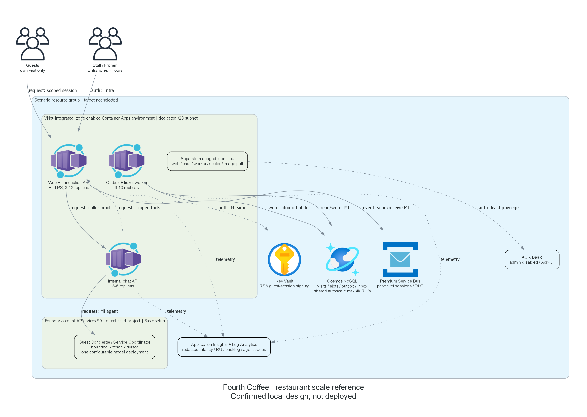
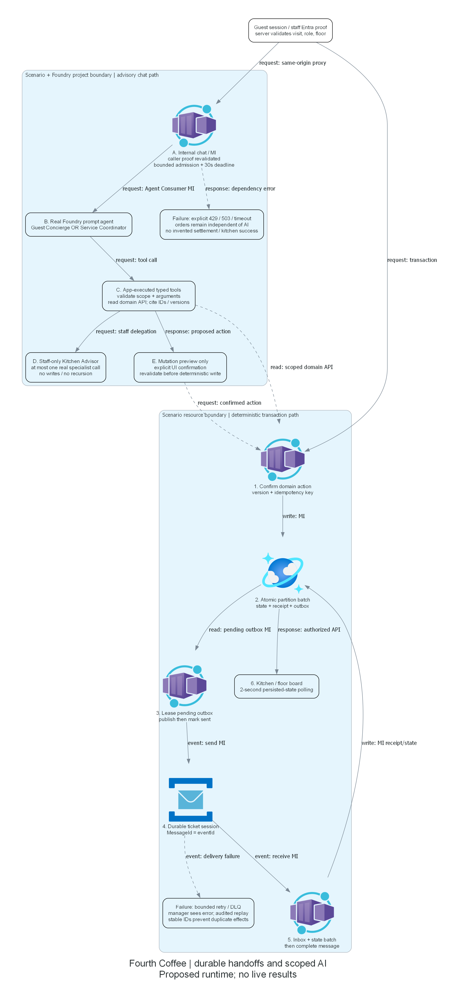

# Implementation plan: Fourth Coffee restaurant scale reference

## Overview

Implement the portal-confirmed Generic Hospitality & Travel design without cloud operations.
The recorded Docker setup check passed on 2026-10-23 UTC under unchanged worker restrictions.
This is local construction, not deployment readiness, live acceptance or suitability approval.

Resume checkpoint, 2026-10-23 UTC: the recorded k6/cache/SDK setup checks actually passed.
The prior blocker was cleared through the revision-checked portal protocol, preserving existing design and consent.
Proxy-only package restore succeeded. The web/chat/worker implementation compiles and seventeen local
domain/API/real Chromium checks pass. The local Linux x64 image builds using a native SDK build stage
and portable framework-dependent IL; its runtime target remains Linux x64.
The first emulated SDK restore crashed with QEMU signal 11. Both build logs are retained.

Setup retry `cc61b383`, 2026-10-23 UTC: the exact recorded helper actually passed with the unchanged local image.
It verified nonroot Linux amd64, HTTP 200 health/homepage with Fourth Coffee, and successful owned-container cleanup.
Canonical revision 120 cleared the existing blocker; that receipt is not application or Azure acceptance.

Local integration now includes the runtime Bicep entry point, pinned agent versions, strict deployment-output
scope checks, explicit initializer subscription/tenant, managed-identity-only runtime credentials and telemetry RBAC.
The web replicas share antiforgery keys in the existing encrypted Cosmos account instead of per-host profile files.
Guest login refreshes the identity-bound CSRF token. Cancellation uses an idempotent cross-partition compensation;
the versioned synthetic legacy importer retains external IDs and resumable private receipts.
Staff boards select a service slot, floor and status; the manager workspace exposes reconciliation/replay evidence.
The updated twenty-five domain/API/Chromium checks and eight parameter/validation-tool checks pass locally.
The final updated image builds and passes the same owned nonroot Linux amd64 liveness/homepage/cleanup check.
Real broker races, replay, Foundry coordination,
full business journeys and the load envelopes remain deployment acceptance, not measured local successes.
Do not describe this reference as deployed or suitability-approved.

Use the provisional model/region in `00-region-availability.json`; account, quota, policy, identity
registration and pricing remain authorized deployment-preparation work.
Do not select a cloud target or initialize an azd environment in this worker without scoped consent.
The future environment must be distinct and the resource group must be `rg-{environment}`.

## Resource Inventory

| Resource | SKU/configuration | AVM pin | Status |
| --- | --- | --- | --- |
| Runtime/scaler identities | User-assigned; separate scopes | managed-identity/user-assigned-identity 0.6.0 | Planned |
| Virtual network | Dedicated /23 delegated ACA subnet | network/virtual-network 0.10.2 | Planned |
| Log Analytics | PerGB2018, 30 days | operational-insights/workspace 0.16.1 | Planned |
| Application Insights | Workspace-based | insights/component 0.8.0 | Planned |
| Registry | Basic; no admin | container-registry/registry 0.13.1 | Planned |
| Cosmos DB | Zones, Session, shared autoscale 4000 RU/s | document-db/database-account 0.21.1 | Planned |
| Service Bus | Premium 1 MU, sessions/dedup | service-bus/namespace 0.17.1 | Planned |
| Key Vault | Standard; RSA signing key; purge protection | key-vault/vault 0.14.2 | Planned |
| Foundry | AIServices S0; direct project; Basic | cognitive-services/account 0.19.1 | Planned |
| ACA environment | Consumption, zones, VNet | app/managed-environment 0.16.0 | Planned |
| Three apps | web, chat, worker; minimum three replicas | app/container-app 0.23.0 | Planned |

Public AVM source interfaces downloaded by the preceding worker are retained in `evidence`.
The account AVM does not expose child projects. Use the current stable direct-child project schema
`Microsoft.CognitiveServices/accounts/projects@2026-09-01`, not a hub or ML workspace.
That is a documented extension of the account module, not replacement of an available account AVM.
Use AVM-supported nested resources for queues, keys, databases, containers and data role assignments.
Role assignments on the direct project require extension resources because the account AVM cannot scope
assignments to that child.

## Module Structure

```text
infra\
  main.bicep
  main.parameters.json
  modules\
    apps.bicep
    project.bicep
  runtime.bicep
azure.yaml
scripts\
  prepare_runtime.py
src\
  Restaurant.Web\
tests\
validation\
```

The resource-group-scoped main entry point derives one unique suffix from the group ID.
Shared services deploy before the app module; outputs carry real resource names, IDs and endpoints.
The app module deploys three independently scaled variants of the same .NET executable.
It must never bootstrap a placeholder image as a working application.

## Implementation Tasks

### Task 1: shared infrastructure

Create identities, tagged resources, zone-enabled environment and diagnostics.
Disable local service authentication. Configure Cosmos transaction, catalog and reporting containers.
Assign web/worker Cosmos data access, worker/scaler queue access, web key signing and chat project consumption.
The deployment initializer gets separately scoped data-plane and agent-authoring access.
Runtime identities must not create agent definitions.

### Task 2: application wiring

Expose image parameters instead of deploying public sample images.
Wire endpoint, identity client ID, staff Entra configuration and internal service addresses.
Use real health probes, queue scaling and explicit missing-configuration errors.
Reserve cloud bootstrap, agent installation and synthetic fixture ingestion for authorized deployment.

### Task 3: application and tests

Implement deterministic reservations, check-in, server-priced orders, kitchen transitions, synthetic settlement
and surveys with Cosmos conditional batches, durable outbox and idempotent inbox.
Implement scoped guest signing, staff authorization, preview confirmation and real Foundry function calling.
Provide distinct guest/staff journeys, initializer/import tooling, xUnit, browser and load tests.
Test doubles are test-only and must not produce deployed AI success.

### Task 4: local validation

Run actual Bicep restore/build/lint, policy scanning, NuGet restore/build/tests and local image build.
Verify Playwright and k6 prerequisites before their affected operations, without installing shared tools.
Persist exact results, including failures; do not equate local results with live acceptance.

## Dependency Graph

Identity/network/telemetry -> data services and Foundry -> environment -> web/chat/worker.
The retained architecture PNG shows these same infrastructure dependencies and scope boundaries.



Source: `03-architect-diagram.py`.

## Runtime Flow Diagram



Source: `04-runtime-diagram.py`. Recheck agreement after implementation.

## Naming Conventions

| Resource | Pattern |
| --- | --- |
| Resource group | `rg-{environment}` |
| Runtime apps | `ca-resto-{role}-{suffix}` |
| Foundry/project | `ai-resto-{suffix}` / `restaurant` |
| Cosmos | `cosmos-resto-{suffix}` |
| Vault | `kv-resto-{suffix}` |
| Broker | `sb-resto-{suffix}` |
| Registry | `acrresto{suffix}` |

Tags are Environment, ManagedBy=Bicep, Project=resto-scale-agent and SecurityControl=Ignore.
Also tag each app with its azd-service-name. Deployment identifiers do not belong in catalog metadata.

## Execution Handoff

Continue local implementation automatically under retained consent.
Use explicit subscription arguments in all future Azure commands; never change shared CLI defaults.
Prepare what-if command documentation only. Preparation permission must precede cloud queries;
deployment permission follows actual what-if/cost evidence for identical user-selected targets.
Do not create a suitability snapshot, package plan or hack materials from an undeployed local reference.
The ordered two-pass deployment procedure is in `05-implementation-reference.md`.
`azd up` alone does not initialize agents or complete this reference.

Public schema inspected on 2026-10-23 UTC:
[Foundry direct child project schema][project-schema].

[project-schema]: https://learn.microsoft.com/en-us/azure/templates/microsoft.cognitiveservices/accounts/projects
