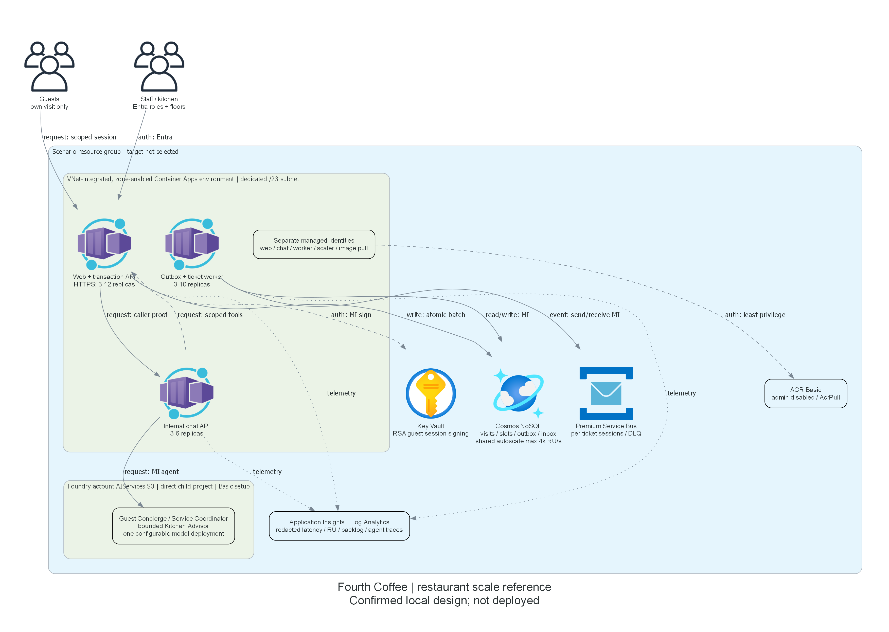

# Implementation reference: Fourth Coffee restaurant agents

## IaC Templates Location

`infra\main.bicep` creates shared resources. `infra\runtime.bicep` deploys the three real application roles
only after image publication, synthetic fixture initialization and agent-version installation.
There is no placeholder image or mock Foundry success.
The current azd postprovision hook uses `scripts\install_reference.py` for the complete ordered runtime install.
It requires current canonical exact-target deployment consent bound to the reference installation-plan digest.
The only prepared directory write appends the actual SPA callback to the verified owned client.
The historical consent POST remains prohibited; missing consent stops before image publication.
Plain azd deploy/up image replacement is blocked by predeploy, preserving immutable runtime image deployment.
This repaired hook is not yet executed or validated; no local file confers cloud authorization.

## File Structure

```text
infra\
  main.bicep
  main.parameters.json
  runtime.bicep
  modules\
    apps.bicep
    project.bicep
scripts\
  prepare_runtime.py
  setup_identity.py
src\Restaurant.Web\
tests\Restaurant.Tests\
validation\
  audit_arm.py
  test_runtime_parameters.py
  load.js
  business_journey.py
```

## Validation Status

Current local repair run `30bc1eeb` supersedes the historical checkpoints below.
Targeted .NET checks passed 50/50; the full suite passed 51/52 and failed the staff board empty-state assertion.
Runtime Bicep build and runtime/shared lint exited 0.
The Python validation invocation was denied without structured permission metadata and was not retried.
Identity automation and installation-hook behavior remain unverified.
See `06-deployment-summary.md` and `evidence\local-entra-repair-30bc1eeb\`.

Local Bicep compilation/lint and runtime-parameter checks have passed during integration.
Twenty-five local domain/API/Chromium checks and eight parameter/tooling checks passed.
The final changed image built and passed nonroot Linux amd64 health, homepage-marker and owned-cleanup checks.
The bounded liveness probe retained startup retry/HTTP failure logs before its final successful responses;
this is shell-liveness evidence, not a zero-error or performance result.
Evidence is retained under `evidence`; earlier failing runs remain distinct from corrected runs.
Separately authorized read-only what-if/ARM validation and live model capacity metadata are now retained in
`06-deployment-summary.md`, including thirteen unresolved identity-dependent grants and nested validation limits.
Deployed identity access, real agents, broker races and load thresholds remain unverified.

The first Checkov scan of the compiled ARM v2 wrapper examined zero resources: it is not security evidence.
`validation\audit_arm.py` produces audit-only list views and extracts embedded AVM templates.
The expanded scan reports 393 resource definitions, eight passing checks and fourteen findings, not a clean scan.
Those definitions include conditional/zero-count AVM branches and unresolved parameter expressions;
they are not a count of resources that will deploy.

Public-endpoint findings CKV_AZURE_189/109/101/134/139 reflect the explicitly confirmed synthetic-reference boundary.
Standard software-key and Basic registry choices explain CKV_AZURE_112/233/166; no HSM, registry quarantine or
registry zone redundancy is claimed. Runtime images must still be pinned and their provenance reviewed.
CKV_AZURE_110/42/238 must be compared with explicit purge protection, soft delete and system identity inputs in
`main.bicep`; unresolved AVM expressions are not evidence those controls are absent or effective.
CKV_AZURE_114/41 concern optional AVM secret branches; this design creates no application secrets.
The signing key now has a 180-day expiry and 90-day automatic rotation.
The final expanded scan still flags CKV_AZURE_40 on the parameterized AVM key definition; its effective attributes
and rotation behavior require target what-if/data-plane review. The fourteen findings remain retained.
The runtime scan returned zero applicable checks/resources despite extracting seven templates;
that scanner has not certified Container Apps configuration. Bicep compilation and explicit configuration review
are separate, narrower evidence.
No finding is silently suppressed. Target-specific Azure Policy remains an authorized preparation check.

## Resources Created

No Azure resources have been created by this worker. The templates define the confirmed reference:
four user-assigned identities, ACR, VNet/subnet, telemetry, Cosmos, Service Bus, Key Vault,
Foundry account/project/model,
Container Apps environment and three separately scaled apps. All receive the confirmed scenario/environment tags.



## Deployment Instructions

The commands and native-client narrative below are retained historical instructions, not the current repair entry point.
For the repaired reference, complete local validation and exact-target preparation, then review the entire scope once.
The future canonical deployment scope must include `installationPlanDigest` for the bytes of
`scripts\reference-installation-plan.json`, together with actual what-if, cost and explicit directory scope.
Only an approved portal worker may then run the existing exact-environment `azd provision` path.
Its postprovision hook consumes actual shared outputs, verifies/repairs the retained Entra pair,
publishes a digest-pinned image, initializes synthetic fixtures/agents, previews and installs the three runtime apps.
An actual missing operator-only consent remains external remediation, not a denied-write retry.
Run real browser sign-in/business/agent/load/recovery acceptance before preparing a suitability snapshot.
No current grant exists and none of these cloud commands ran in local repair.

The current local identity consistency command is:

```powershell
python scripts\setup_identity.py --verify-local
```

This checks non-secret receipt structure only. For a later authorized exact-target live verification,
use the same helper's `--scope`, `--receipt`, `--application-url` and `--verify-only` options.
The application origin comes from verified infrastructure outputs; it is not a user-entered generated ID.
`scripts\prepare_runtime.py` now consumes `--identity-receipt`, not `--staff-auth-file`.

These are preparation instructions, **not authorization**. Obtain exact account, subscription, tenant, distinct
environment, `rg-{environment}` and region through the portal. Preparation consent precedes all Azure queries.
Review actual what-if and regional cost, then obtain separate deployment consent for identical targets.
Do not use shared account defaults or another scenario's environment.

After authorized target/policy/quota/identity checks, export explicit main parameters to a private local file.
Do not commit deployment targets, staff tokens, initializer receipts or synthetic guest access codes.
The following preview is only for the separately authorized preparation scope:

```powershell
az deployment group what-if --subscription $subscriptionId --resource-group "rg-$environment" `
  --name reference --template-file infra\main.bicep --parameters "@$approvedMainParameters"
```

After deployment consent, create only the approved group if absent and deploy the shared reference:

```powershell
az group create --subscription $subscriptionId --name "rg-$environment" --location $region
az deployment group create --subscription $subscriptionId --resource-group "rg-$environment" `
  --name reference --template-file infra\main.bicep --parameters "@$approvedMainParameters"
az deployment group show --subscription $subscriptionId --resource-group "rg-$environment" `
  --name reference --query properties.outputs --output json > evidence\infrastructure-outputs.json
```

Before invoking azd, create/select a distinct environment and verify its subscription, tenant and resource group
match the canonical scope. `azure.yaml` retains the three stable azd service names for later image updates.
Do not run plain `azd up` as a substitute for this initializer/two-pass sequence.

Prepare dedicated staff identities using `scripts\setup_identity.py`, not manually supplied generated client IDs.
The exact directory changes/permissions and remaining staff assignments are in
`evidence\centralus-189819a8\installation-plan.json`. No Graph operation ran during read-only preparation.
After separately recorded directory-installation authorization, installation captures actual IDs automatically:

```powershell
python scripts\setup_identity.py --scope evidence\identity-install-scope.json `
  --receipt evidence\identity-installation.json --authorize-directory-install
```

The scope file is produced from the retained exact consent scope, not a new target questionnaire.
The installer creates/reconciles only marker-owned single-tenant API/native-client registrations and principals;
unowned or ambiguous objects stop the operation. No runtime secret, admin consent or staff assignment is invented.
The assignment-required policy remains enabled. Authorized staff need a business role and signed Floor.1-Floor.5
app roles (or existing verified floor claims); Manager retains the established five-floor scope.
The native client uses localhost redirect/token acquisition; the existing staff UI keeps tokens in page memory.
Tenant permission/consent and actual sign-in remain separate checks, not inferred from registration creation.

Build the actual source locally for Linux amd64, verify it with the repository container helper, authenticate only
to the scenario registry under the approved subscription, and push the owned image. Retain its `sha256` digest.
Retrieve the real project endpoint from the deployed direct child project's properties; never construct a guessed
classic endpoint. Consume the generated staff API audience and configure authorized assignments before staff use.
Non-manager roles require verified `floors` claims; managers receive all five floors in application authorization.
The separate Entra client must obtain a v2 access token for the configured API audience.
No simulated staff identities are accepted outside test fixtures.

Run initialization from the scenario's published .NET application, with process-local environment configuration:

```powershell
$env:INITIALIZER_SUBSCRIPTION_ID = $subscriptionId
$env:INITIALIZER_TENANT_ID = $tenantId
$env:COSMOS_ENDPOINT = $outputs.COSMOS_ENDPOINT.value
$env:FOUNDRY_PROJECT_ENDPOINT = $discoveredProjectEndpoint
$env:FOUNDRY_MODEL_DEPLOYMENT = $outputs.FOUNDRY_MODEL_DEPLOYMENT.value
$env:AGENT_VERSIONS_OUTPUT = "$workspace\evidence\agent-versions.json"
dotnet "$publishedApplication\Restaurant.Web.dll" --initialize
```

The setup identity needs the explicit data/agent-authoring roles in the shared deployment.
Runtime identities cannot install agents. Initialization checks catalog versions without overwriting business state;
agent installation creates immutable versions under the same three stable names.
Retain the returned versions; repeated installation may create newer versions and requires a new runtime rollout.

Generate runtime parameters locally from the actual outputs, initializer receipt and reviewed image digest:

```powershell
python scripts\prepare_runtime.py --outputs evidence\infrastructure-outputs.json `
  --versions evidence\agent-versions.json --environment $environment --location $region `
  --subscription $subscriptionId --tenant $tenantId --identity-receipt evidence\identity-installation.json `
  --endpoint $discoveredProjectEndpoint --image $imageDigest --out evidence\runtime.parameters.json
```

Preview runtime changes within preparation consent, review cost/targets again if materially changed, and deploy
only within the recorded deployment authorization:

```powershell
az deployment group what-if --subscription $subscriptionId --resource-group "rg-$environment" `
  --name runtime --template-file infra\runtime.bicep --parameters "@evidence\runtime.parameters.json"
az deployment group create --subscription $subscriptionId --resource-group "rg-$environment" `
  --name runtime --template-file infra\runtime.bicep --parameters "@evidence\runtime.parameters.json"
```

Future image/version changes require their own authorized rollout; azd image updates must preserve role-specific
configuration and must not replace agent-version settings with defaults.
Retain actual deployment outputs and run deployed model, agent, application, negative, grounding and tool checks.
No suitability snapshot or hack composition is allowed from local-only results.

The actual 2026-10-23 preparation found the target group absent. A subscription-scope preview-only wrapper
avoided creating it: 33 creates, zero modifies/deletes and thirteen unsupported role assignments.
See `06-deployment-summary.md` for exact scope, commands, regional costs and the separate deployment decision.

## Key Implementation Notes

One suffix comes from the isolated resource group for existing resource names.
Foundry uses a stable v2 GUID-derived DNS label bound to scenario, full environment and subscription.
Its account and custom domain share that name; project references use actual module outputs.
The prior globally retained custom domain was not adopted, purged or mutated.
The absent conflicting Key Vault now uses a separate stable v2 GUID-derived 24-character label,
with unchanged signing, retention, RBAC and rotation controls.
All Cosmos ARM data grants use the fully qualified account resource ID plus `/dbs/restaurant`;
relative CLI-style scope shorthand is not valid in this AVM/ARM payload.
The chat identity still has no direct database grant. Existing account and other resource names are unchanged.
Three compiled-template regression tests cover the scopes, naming and preservation of other security inputs.
The latest target group is absent, despite historical foundation installation receipts.
See `06-deployment-summary.md` for actual full recreation previews and the proposed consolidated installation grant.
Runtime parameter generation rejects foreign target outputs,
foreign identities, mutable/foreign registry images and a different Foundry project.
All worker Azure CLI calls must pass the authorized subscription explicitly; no shared CLI defaults are changed.
Initializer credentials are scoped to subscription and tenant; runtime credentials are managed-identity-only.

Basic ACR explicitly sets `networkRuleSetDefaultAction: 'Allow'` while leaving IP rules unspecified.
AVM 0.13.1 otherwise combines its default Deny with public access Enabled and emits a Premium-only network rule.
This preserves the confirmed authenticated public endpoint, disabled admin/anonymous access and Basic SKU;
it does not open anonymous pulls or introduce private networking.
The corrected independent registry preview and provider validation passed, excluding new-identity grants.
Historical East US 2 Cosmos access failure is retained; current Central US AZ access is true.
Preparation remains incomplete because quota and installation-dependent checks are not falsely marked passed.
See `06-deployment-summary.md` for current repaired previews, distinct from historical region findings.

Cosmos-backed antiforgery keys keep web replicas consistent and avoid profile access.
Cosmos encryption at rest and RBAC protect that key ring; it is not additionally Key Vault-wrapped.
The guest-session key remains in Key Vault, with public-key caching and retained prior versions.
Cancellation is a saga: the slot release receipt commits first, then the visit inbox/projection; retries cannot
release capacity twice. Broker acknowledgement alone never proves an order was prepared or served.
The internal chat FQDN includes the required `.internal.` segment and retains HTTPS between apps.
Reservation function tools return capacity previews only; explicit UI confirmation checks the slot version again.
Staff delay tools require an explicit service slot/floor and recheck verified caller scope on every hop.

For a synthetic legacy import, supply schema version 1, `synthetic:true`, a bounded source and records with
`legacyReferenceId`, `slot`, `floor`, `seats`, `guestId:"guest-001"`.
Set `LEGACY_IMPORT_PATH` and a private `LEGACY_IMPORT_OUTPUT`, then invoke the published app with `--import-legacy`
under the same scoped setup identity. Partial receipts persist after each record and retries preserve retained codes.
A crash after reservation commit but before the local code receipt can still lose that newly issued code;
do not claim complete code recovery or log/store plaintext codes in Cosmos.
Changed imported payloads require an explicit migration instead of silently moving capacity.

`validation\load.js` defines normal 50 req/s for 30 minutes, burst 150 req/s for five minutes with ten writes/s,
and soak 25 req/s for two hours. It checks read/write p95, unexpected errors and dropped iterations.
This is a menu/reservation microbenchmark, not proof of the complete authenticated 250-guest/30-staff workload.
`business_journey.py` separately exercises four/five turns of 250 covers and idempotent confirmations.
Actual full-mix load, chat admission/latency, broker fault/recovery, RU/replica/memory metrics and identity security
remain explicit live acceptance work. Local compilation and authored tools do not certify those outcomes.

Current implementation evidence inspected on 2026-10-23 UTC:
[Azure CLI credential subscription/tenant options][cli-options],
[Foundry direct child project schema][project-schema] and
[authenticated telemetry ingestion][telemetry-auth].
[Container Apps inter-service FQDN patterns][app-routing] were checked during final wiring.

[cli-options]: https://learn.microsoft.com/dotnet/api/azure.identity.azureclicredentialoptions
[project-schema]: https://learn.microsoft.com/azure/templates/microsoft.cognitiveservices/2026-09-01/accounts/projects
[telemetry-auth]: https://learn.microsoft.com/azure/azure-monitor/app/azure-ad-authentication
[app-routing]: https://learn.microsoft.com/azure/container-apps/connect-apps
