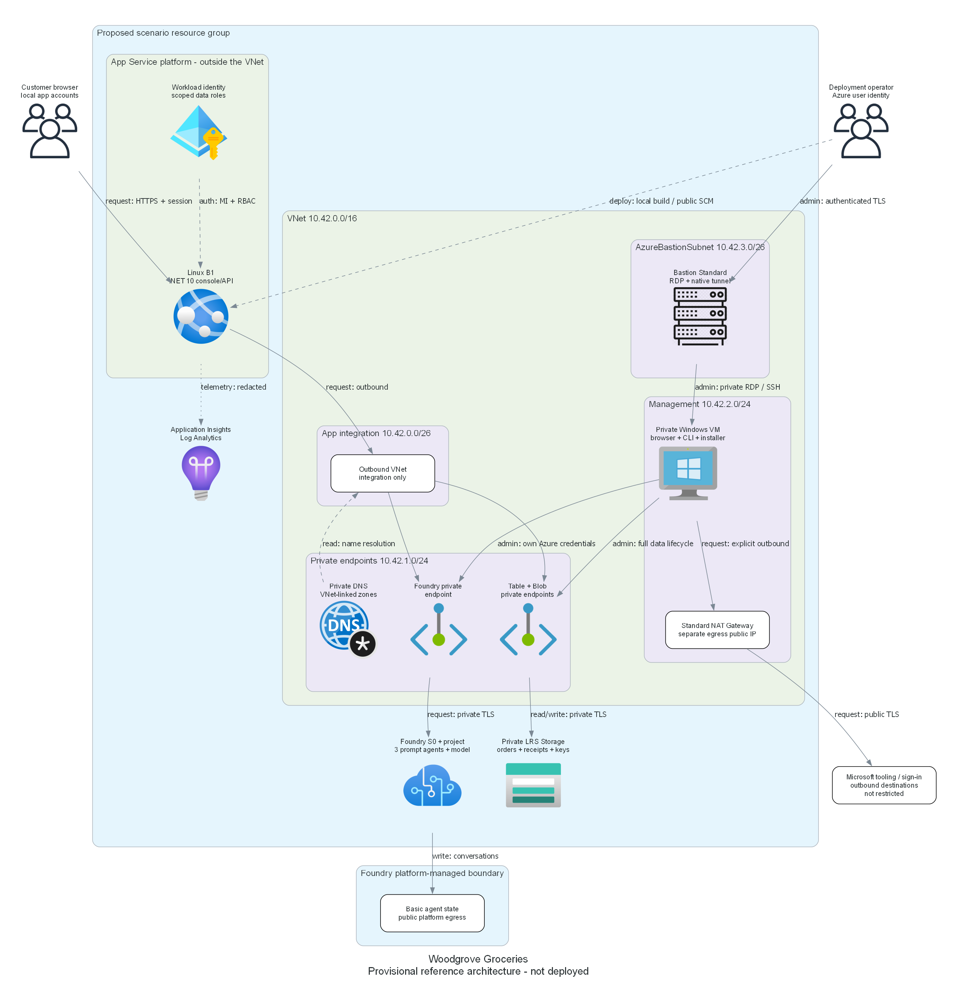
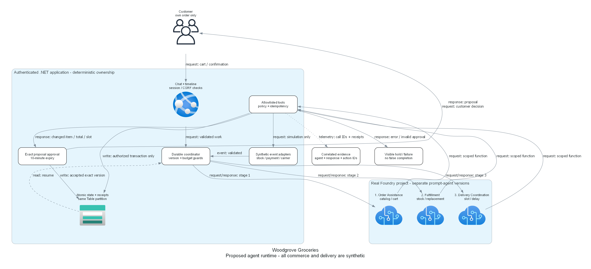

# Retail-agentic architecture assessment

> Generated by az-01-conductor agent | 2026-10-27

## Requirements Validation

**Status: local reference implemented; authorized readiness found SKU blockers. Not deployed.**

Read-only checks on 2026-10-28 rejected Standard_B2ms in both candidate regions.
East US 2 also reports B1 worker quota zero. No region is selected.
Sweden Central with Standard_D2s_v5 is an explicitly unapproved revision, not a silent replacement.
See [dated target, policy, quota and incomplete what-if evidence](./00-region-availability.json).

Woodgrove Groceries demonstrates a grocery order becoming a simulated home delivery.
The industry is `Retail & Consumer Goods`; `businessUnits` remains `["generic"]`.
No department-specific workflows or native mobile app are added.

| Requirement | Design response | Required evidence |
| --- | --- | --- |
| Real agents, synthetic commerce | Three Foundry prompt agents; app-executed tools | Response IDs and tool receipts |
| Browser/chat/timeline | Minimal .NET 10 web app with local account authentication | Browser and API acceptance |
| Human approval for changes | Server-side exact-version proposal and policy | Reject/expire/stale/altered tests |
| Routine autonomous fulfillment | Durable stage coordinator and synthetic event runner | Successful three-stage trace |
| Explicit failures | Typed errors, persisted holds and visible retry state | Timeout/malformed-handoff tests |
| Customer isolation | Server-derived identity; ownership checks on all operations | Cross-customer/wrong-role denial |

### Agentic runtime contract

Use `sequential-pipeline` with a `human-in-the-loop` overlay.
The application hosts coordination; this is not a claim that Foundry supplies a native durable multi-agent workflow.
Three distinct, separately versioned prompt agents use one configurable model deployment.

| Role | Tools it may request | Handoff and limits |
| --- | --- | --- |
| Order Assistance | Read catalog/own order; draft cart | Confirmed cart and immutable order/customer IDs |
| Fulfillment | Read stock; propose replacement; request reservation | Versioned reservation or customer hold |
| Delivery Coordination | Read slots/events; propose slot/dispatch | Accepted commitment and valid event chain |

Agents cannot select the authenticated customer, grant a role, approve their own proposal,
write database entities directly, calculate authoritative totals or manufacture a delivery receipt.
Tool execution happens inside the app; the model has no direct credential or network access to the fixture adapters.
Committed effects require deterministic server policy even when the agent requests them.

### Current implementation support

Official documentation reviewed on 2026-10-27 demonstrates C# `AIProjectClient`,
`AgentAdministrationClient.CreateAgentVersion`, `DeclarativeAgentDefinition`,
`GetProjectResponsesClientForAgent` and `FunctionCallResponseItem`.
Use `Azure.AI.Projects` and `Azure.AI.Extensions.OpenAI` with Azure Identity.
Compatible package versions are now pinned and validated by restore/build and 28 local tests.
These checks do not prove deployed agents; see [the implementation evidence](./05-implementation-reference.md).
Use the direct project endpoint, not a classic hub/Assistants implementation.

The endpoint shape is `https://<account>.ai.azure.com/api/projects/<project>`.
Actual endpoints, model deployment and agent versions are deployment outputs, not requested user inputs.
No Azure Agent Service run has occurred during this assessment.

### Typed state and recovery

Persist `Order`, `Inventory`, `Proposal`, `ActionReceipt`, `TimelineEvent`, `WorkItem` and `Lease`
entities in one Azure Table partition, `store-001`, for the single synthetic warehouse.
Use separate tables for account/password hashes and protected session-key blobs.
Do not expose partition-wide data to customers.

Handoffs include `schemaVersion`, `orderId`, `customerId`, `orderVersion`, `stage`,
`causationEventId`, `correlationId`, `agentVersion` and remaining call/time/token budgets.
The server validates the packet and supplies customer identity; never trust a model-supplied identity.

Order states: Draft -> Confirmed -> Reserved -> Picking -> ReadyForDispatch -> Dispatched -> Delivered.
Exceptional states: AwaitingCustomer, Held, Failed and Cancelled. Store the intended resume stage on a hold.
A server-created synthetic event, not elapsed time or agent prose alone, advances physical-delivery states.
The demo operator may inject a delayed or duplicate event through role-protected fixture controls.

Within the same table and partition, use entity group transactions with ETag preconditions to atomically
commit inventory changes, order version, action receipt, work item and timeline event.
Limit each transaction to fewer than 100 operations and 4 MiB; 20 cart lines leave headroom.
On an ambiguous write result, first read the action receipt using its unique action key.
Do not repeat a charge/reservation just because an HTTP response was lost.

The single-instance B1 app includes a bounded background worker:
claim work with conditional ETag updates, a 30-second renewable lease and persisted work rows.
Recover expired leases after restart. Delivery/payment are deterministic local adapters with idempotent receipts.
No live external side effect is hidden behind the simulation.
This is deliberately not a cross-warehouse or high-scale transaction design.

### Approval and action enforcement

1. Server computes proposed replacement, total and slot from fixtures; emits a proposal and fingerprint.
1. Customer decision endpoint checks session, CSRF, ownership, expiry, order version and proposal fingerprint.
1. The accepted version and its resulting action are persisted atomically with the action receipt.
1. A changed product, quantity, price, slot or inventory version invalidates the approval.
1. Rejection, expiry, ambiguity or missing evidence holds the order without the affected mutation.

Do not hold an open model request while waiting for a human. Resume from persisted state with fresh validated context.
Routine actions matching the originally confirmed order need no second business confirmation.
Simulated payment records must say `simulation`, never claim a real authorization or settlement.

### Runtime budgets and telemetry

- Maximum 6 model requests, 8 function executions and 60 active seconds per stage.
- Maximum 18 requests, 24 tool executions and 180 active seconds per order attempt.
- Maximum 12,000 input and 2,000 output tokens per stage, including prior requests.
  Enforce remaining output limits before each call and reject oversized context before submission.
- Maximum 3 concurrently active agent stages across the app; queue further work durably.
- At most 2 transient read retries within the same deadline; no independent retry-budget reset.
- Proposal lifetime 10 minutes; human wait does not extend an in-flight model request.
- Exhaustion produces a visible hold/error, not another agent loop or success-shaped fallback.

Record correlation/order IDs, stage, prompt-agent version, real response/tool-call IDs, duration,
token counts, policy decision, receipt ID and redacted error category.
Logs exclude passwords, bearer tokens, exact synthetic addresses and raw chat bodies by default.
Persist the durable business timeline separately from best-effort telemetry.

### Reference networking and Basic versus Standard

Recommended reference: **Basic agent setup with private inbound access and platform-managed agent storage**.
Foundry and customer-owned business Storage have public network access disabled.
Foundry's platform-managed egress is not isolated; only allowlisted client-executed function tools are configured.
This is supported by the current networking comparison's `10-private-network-basic` pattern.

Standard setup would put agent conversation/files/vector state into customer-owned Storage, Cosmos DB and Search.
That adds resources, grants and cost without an identified business need here.
If customer-owned agent-state residency or isolated agent egress becomes required, revisit this choice
before provisioning; inbound Private Link alone must not be presented as end-to-end isolation.

The browser app itself uses public HTTPS and local sample accounts.
This is an explicit design recommendation for review, not a relaxation of the private data-service baseline.
No WAF is proposed for this small synthetic reference; it is not an enterprise production perimeter.
App Service VNet integration supplies outbound access to private endpoints, not private app ingress.

Provisional VNet `10.42.0.0/16`, subject to address-conflict review:

| Subnet | Prefix | Purpose |
| --- | --- | --- |
| `snet-app` | `10.42.0.0/26` | `Microsoft.Web/serverFarms` delegated app outbound integration |
| `snet-endpoints` | `10.42.1.0/24` | Foundry, Table and Blob private endpoints |
| `snet-management` | `10.42.2.0/24` | Windows operator/automation VM; no public IP |
| `AzureBastionSubnet` | `10.42.3.0/26` | Bastion Standard and its public IP |

Use service-documented private DNS zones for Foundry and Storage Table/Blob.
Confirm exact Foundry endpoint group IDs and zone set against current resource schemas during IaC preparation.
Do not guess them from the project endpoint. No DNS or routing has yet been probed.

### Management and deployment access

| Operation | Host and identity | Path | Acceptance |
| --- | --- | --- | --- |
| Initial infrastructure | Authorized user; local CLI | ARM control plane | Actual what-if and reviewed target |
| Artifact transfer | Operator; authenticated VM session | Bastion Standard SSH tunnel | Verify checksums |
| App build/publish | Approved user; local azd | Public authenticated SCM | Portable .NET publish and deploy |
| Private initialization | VM MI; encoded SSH | Private Table/Blob/Foundry | Install fixtures/accounts/agents |
| Human Foundry browser | User's Azure login; VM browser | Bastion RDP; private DNS | Manage project/agents/model |
| Human data admin | User's Azure login; VM CLI/SDK | Private Table/Blob | Safe CRUD and cleanup |
| Unattended test | Scoped MI; explicit VM task | Same private paths | MI probe; timestamped results |

Bastion is not local VPN connectivity. Local azd hooks cannot directly access private data endpoints.
The postprovision hook builds a portable runtime locally and transfers its checksummed archive through Bastion.
Only private data/agent initialization executes on the VM. Local azd publishes the web application to public SCM.
No hook claims that the local workstation reaches the private endpoints.

Bootstrap the VM's OpenSSH and installed tools with an approved ARM Run Command script.
Permit VM SSH only from the Bastion subnet; tunnel over authenticated Bastion Standard, then use an ephemeral key.
Verify/pin the VM host key from the authenticated bootstrap output; never disable host-key validation.
Keep generated VM credentials and transfer keys in gitignored `.private` files with restrictive access.
Run Commands carry setup, not an unauthenticated public download or embedded Azure token.
Artifacts and test results return through the tunnel with checksums.
Successful initialization revokes its exact SSH public key and removes the local private/public key pair.
An interrupted installation retains owner-only recovery material for retry and is not complete.

The management subnet disables default outbound access and uses a Standard NAT Gateway with its own
Standard public IP for official tooling downloads and Azure sign-in. This is outbound connectivity, not VM ingress.
The VM still has no public IP. Current NSGs restrict inbound traffic, not outbound destinations.
Neither NAT nor Basic Foundry egress is a destination-restricting firewall.

Browser administration uses VM sign-in and then the human's own Azure browser/CLI sign-in.
The VM managed identity is for bounded automation, not a replacement for human administrator acceptance.
The app's generated customer/operator passwords are separate again.
No Entra app registration, tenant-wide consent or directory write is needed for sample-app login.

An equivalent existing VPN-connected operator environment could replace the VM/Bastion only after
its browser, DNS, publishing and data administration paths are verified.
A lower-cost public/allowlisted design requires explicit review; do not silently enable data-service public access.

### Deployment-user access matrix

The actual deploying user's tenant/object ID is unresolved; no Azure account discovery was authorized or performed.
Resolve it from the confirmed CLI identity before deployment rather than asking the user to manufacture IDs.
Verify inherited effective grants before creating duplicate assignments.

| Scope | Control-plane administration | Data administration | User-credential probe |
| --- | --- | --- | --- |
| Resource group | Contributor; scoped grant authority | No implied data access | List/update; inspect roles |
| Foundry/project/model | Scoped management; Project Manager as applicable | Agent/model CRUD and invoke | VM probe |
| Table Storage | Storage administration | Storage Table Data Contributor | Disposable entity CRUD |
| Blob Storage | Storage administration | Storage Blob Data Contributor | Probe blob CRUD |
| App Service | Scoped app administration | Publish/config/log access | Publish; inspect config and diagnostics |
| VM/Bastion/network | Scoped administration/connect | Separate VM and Azure sign-in | Browser RDP and tunnel tests |
| Monitor | Workspace/component administration | Log Analytics query access | Read correlated acceptance traces |

Confirm current role definitions and exact scopes at deployment preparation; a role name alone is not evidence.
For Foundry, combine scoped management and data roles if one does not cover full operations.
Do not grant subscription-wide roles as a shortcut.
App and initialization MIs get project-scoped Foundry User (formerly Azure AI User),
Storage Table Data Contributor and Storage Blob Data Contributor.
The human gets resource-scoped Foundry Owner and the separate Storage data roles.
Initialization MI receives only additional agent-administration rights needed by the approved installer.
No workload identity gets the deployment user's broad administrative roles.
Missing grants, grant authority or private human access blocks reference completion.

Authorized target inspection found inherited subscription Owner and Foundry User.
For the selected agent operations, their combined control/data access can be reused rather than adding
redundant RG Contributor and Foundry Owner grants. Bicep now has explicit, default-false reuse switches.
Human Storage Table/Blob data roles and separate workload grants are still required.
Actual full human resource/data administration must be proved after installation using the user's own credentials.

### Recommended architecture

Diagrams are design artifacts, not proof of resources or running agents.

## Resource SKU Recommendations

| Resource | Proposed SKU/configuration | Reason and limit |
| --- | --- | --- |
| Foundry account/project | AIServices S0; direct child project | Current resource model; Basic state |
| Model deployment | `gpt-4.1-mini`, `2025-04-14`, GlobalStandard | Quota available; Legacy, retires 2027-04-14 |
| App Service | Linux B1, one instance, .NET 10, Always On | Small app and durable background worker; no production HA |
| Business Storage | Standard LRS GPv2; private Table/Blob | Atomic warehouse state and protected keys |
| Operator VM | Original Standard_B2ms, 2 vCPU/8 GiB | Subscription-restricted; D2s_v5 proposal pending |
| Bastion | Standard; native-client tunnel and browser RDP | Access/file transfer; no VM public IP |
| Management egress | Standard NAT plus separate Standard public IP | Explicit outbound tooling/sign-in access |
| Monitoring | Application Insights and Log Analytics pay-per-GB | Correlation; modest retention and ingestion cap |
| Network | One VNet, NSGs, three private endpoints and private DNS | Separate app, data and management paths |

All names use the existing project/environment/suffix conventions.
GlobalStandard permits global inference processing.
Neither East US 2 nor Sweden Central implies regional-only inference.
See [public evidence and pending eligibility](./00-region-availability.json).

### Cost envelope, not a quote

Revised planning estimate: **USD 350-550/month** of continuously allocated infrastructure, plus model consumption.
This is an unquoted rough-order estimate, not live pricing or an approved budget.
Explicit management NAT/public-IP egress adds approximately USD 35-50/month to the earlier USD 300-500 envelope.
Exact regional prices and data-processing charges remain to be checked before deployment review.
For a 24-hour event, roughly USD 12-19 of continuous infrastructure is a planning extrapolation,
before consumption, storage/egress, taxes or minimum billing effects.

The dominant costs are Bastion Standard, the Windows VM and its disk, followed by App Service and private endpoints.
Storage and telemetry are small only with bounded fixtures, retention and logging.
Budget model calls separately using measured tokens and current regional model pricing before consent.
A token/call budget limits workload behavior; Azure budgets are alerts, not a guaranteed spend stop.

The unapproved Sweden Central proposal retains private networking and replaces only the operator VM size.
The Azure Retail Prices API returned Windows D2s_v5 USD 0.194/hour versus B2ms USD 0.0944/hour.
At 730 hours/month, the compute-only increment is USD 72.71.
The revised rough infrastructure envelope is USD 425-625/month plus consumption, not an approved budget.
Other component pricing and the Legacy model's retirement horizon remain part of the final deployment review.
No resource was allocated to obtain this pricing or SKU evidence.

Stopping the VM removes compute charges, not disk, public IP, NAT, Bastion or private-endpoint charges.
After a demonstration, explicit teardown of the approved resource group is the reliable cost cleanup path.
An existing equivalent private management environment is the first cost-reduction candidate.
Standard agent storage, Search, Cosmos, Service Bus, API Management and native mobile hosting are intentionally omitted.

## Architecture Decision Summary

| Decision | Choice | Rationale/status |
| --- | --- | --- |
| Pattern | Three sequential prompt agents plus customer decisions | Matches the confirmed multi-agent demonstration |
| Coordinator | App-hosted deterministic durable stage machine | Models advise/request tools; never own authorization |
| Agent setup | Basic state; private inbound; platform egress | No extra Search/Cosmos; egress disclosed |
| Business persistence | Private Table/Blob Storage | One warehouse makes same-partition transactions sufficient |
| Public surface | Authenticated HTTPS app only | Data endpoints remain private; app exposure requires review |
| Human access | Private Windows VM plus Bastion Standard | Browser/CLI administration and file-transfer path included |
| Identity | Local sample accounts; MI to Azure | Avoids directory consent dependencies and service keys |
| Region | East US 2 provisional; Sweden Central candidate | Public service/model evidence only; no target selected |
| Model | Configurable deployment; provisional GPT-4.1 mini | No reusable-customization model pinning |
| Next boundary | Proposed SKU/cost revision and remaining readiness | No provisioning/runtime/suitability approval |

## Implementation Handoff

1. Retain the user's actual selection: "Use the proposed private-data design", for local implementation only.
1. Use the implemented AVM-first Bicep, azd wiring, .NET app, catalog-backed fixtures and local tests.
   The explicit NAT addition and revised estimate must be included in the eventual consolidated deployment review.
1. Reuse actual read-only permission and target observations; review the explicit SKU/cost revision.
1. Complete remaining readiness and what-if expansion, then present one consolidated deployment/identity/cost review.
1. Deploy only on actual consent, then prove agent invocation, business cases and deployment-user administration.
1. Present the working reference for separate suitability approval; do not author hack materials beforehand.

### Official design sources

All public sources below were reviewed on 2026-10-27; they are not subscription-specific evidence.

- [Foundry function calling and current C# prompt-agent API][function-calling]
- [Foundry networking options and Basic versus Standard][networking]
- [Agent Service regions and tool support][agent-regions]
- [Model/version and deployment-region availability][models]
- [App Service outbound VNet integration][app-network]
- [Table entity group transactions][table-transactions]
- [Bastion connectivity][bastion]

[function-calling]: https://learn.microsoft.com/azure/foundry/agents/how-to/tools/function-calling
[networking]: https://learn.microsoft.com/azure/foundry/agents/concepts/networking-options
[agent-regions]: https://learn.microsoft.com/azure/foundry/agents/concepts/limits-quotas-regions
[models]:
  https://learn.microsoft.com/azure/foundry/foundry-models/concepts/models-sold-directly-by-azure-region-availability
[app-network]: https://learn.microsoft.com/azure/app-service/overview-vnet-integration
[table-transactions]: https://learn.microsoft.com/rest/api/storageservices/performing-entity-group-transactions
[bastion]: https://learn.microsoft.com/azure/bastion/bastion-overview
