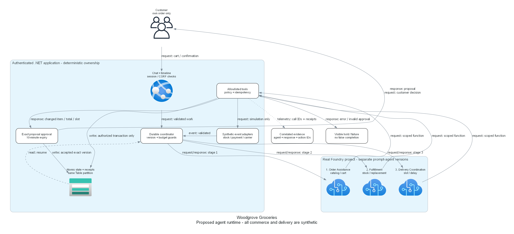

# Step 4: Implementation Plan - retail-agentic

> Generated by az-01-conductor agent | 2026-10-28

## Overview

The user selected: "Use the proposed private-data design".
This confirms the local implementation direction only, not Azure reads, provisioning or spending.
The later explicit grant covers read-only Azure readiness/what-if and official Bastion extension installation.
Provisioning, role grants, Entra changes and spending remain unauthorized.
The three real Foundry prompt agents run behind an application-owned deterministic grocery workflow.
All commerce, payments and delivery events remain explicitly synthetic.

## Resource Inventory

| Resource | Configuration | Dependencies | Local implementation |
| --- | --- | --- | --- |
| Resource group | `rg-{environment}`; mandatory tags | Reviewed Azure target | Implemented |
| Foundry resource/project | S0; direct child; private inbound | Private DNS/endpoints | Implemented |
| Model | GlobalStandard; quota available; Legacy lifecycle | Retirement review required | Implemented |
| Business Storage | LRS; private Table/Blob; keyless | DNS and scoped data RBAC | Implemented |
| Linux web plan/app | B1; public HTTPS; VNet integration | Workload MI; model/data | Implemented |
| Private network | Four dedicated subnets | Conflict/readiness pending | Implemented |
| Windows management VM | Original B2ms restricted; D2s_v5 proposed | SKU/cost revision not approved | Implemented |
| Bastion | Standard; browser RDP and native tunnel | Dedicated subnet/public IP | Implemented |
| Management egress | Standard NAT and separate public IP | Explicit outbound access | Implemented |
| Telemetry | Application Insights and Log Analytics | SDK wired; live export unproven | Implemented |
| Role assignments | Human/app/VM scopes; explicit inherited reuse | Live access probes pending | Implemented |

## Module Structure

Public registry versions were read from MCR on 2026-10-28; source schemas were inspected before authoring.
Only published versions are used, not remembered minimum versions.

| AVM resource module | Version | Purpose |
| --- | --- | --- |
| `cognitive-services/account` | 0.19.1 | Foundry resource and model |
| `storage/storage-account` | 0.33.1 | Business tables and session-key Blob |
| `network/virtual-network` | 0.10.2 | VNet and dedicated subnets |
| `network/network-security-group` | 0.5.4 | Private VM ingress policy |
| `network/private-dns-zone` | 0.8.1 | Private endpoint name resolution |
| `network/public-ip-address` | 0.13.0 | Separate Bastion entry and NAT egress IPs |
| `network/nat-gateway` | 2.1.1 | Management subnet's explicit egress |
| `network/private-endpoint` | 0.12.1 | Foundry account endpoint and DNS links |
| `network/bastion-host` | 0.8.2 | Human entry and artifact transfer |
| `compute/virtual-machine` | 0.22.3 | Private browser/CLI/build host |
| `web/serverfarm` | 0.7.0 | Linux B1 plan |
| `web/site` | 0.24.0 | Public HTTPS app and outbound VNet integration |
| `operational-insights/workspace` | 0.16.1 | Log destination |
| `insights/component` | 0.8.0 | Application telemetry |

Direct child resources are used only where no standalone matching AVM applies; each exception is documented
beside the implementation. Published module schemas and local Bicep compilation determine exact parameter shapes.

## Implementation Tasks

### Task 1: infrastructure

Create a subscription-scoped entry point and resource-group-scoped composition.
Require explicit target region/environment, deploying-user ID and secure management VM credentials.
Model choice remains configurable. No deployer, endpoint, quota result or deployment output is invented.
Wire application endpoint/settings, private DNS, role assignments and management-host outputs.

### Task 2: business application

Use .NET 10 Razor Pages, cookie authentication, framework password hashing, CSRF protection,
durable lockout and durable Data Protection keys.
Use Azure Table transactions with exact ETags, atomic receipts and conditional inventory updates.
Do not substitute local JSON or in-memory persistence for the configured Azure backend.
Read JSON fixtures only during explicit installation.

Execute real version-pinned Foundry agents with managed identity, bounded responses and scoped function tools.
Enforce ownership, budget, state, stock, diet/allergen metadata and exact proposal approval on the server.
Persist customer waits outside model requests. Never accept prose as action completion.

### Task 3: installation and private execution

Prepare secure bootstrap, artifact transfer/checksums, private-host execution and returned evidence.
Use the deployment user's Azure login for required human administration acceptance.
The postprovision hook uses VM managed identity for private initialization, not the human's credentials.
Build and publish locally through public SCM; do not imply Bastion makes the workstation VNet-connected.
Generate unique app passwords into distinct private, gitignored access files; never print them in logs.
Installation must not depend on the app being anonymously reachable.

### Task 4: validation

Run local Bicep build/lint, .NET build and focused positive/negative/concurrency/policy tests.
Keep local fake test doubles explicitly test-only; never register a mock runtime agent.
Authorized target discovery, quota/SKU/policy reads and limited ARM what-if have now run.
What-if returned 25 creates but skipped five dependent modules; it is not a passed gate.
See [the exact readiness evidence](./00-region-availability.json); deployment and runtime remain pending.

## Dependency Graph

1. Reviewed design -> network, identity and business-state contracts.
1. Network/DNS -> private endpoints and management host.
1. Foundry/model + Storage + RBAC -> agent initialization and fixture/account installation on the private host.
1. Application build + initialized agents/data -> app publishing.
1. Deployed app -> real managed-identity business tests and deploying-user administration tests.
1. Proven reference -> separate suitability review; no hack content before approval.

## Runtime Flow Diagram

Source: [Architecture and runtime diagram generator](./03-architect-diagram.py).
The diagram includes implemented topology and explicit management NAT, but remains undeployed design evidence.

## Naming Conventions

| Resource | Pattern |
| --- | --- |
| Resource group | `rg-{environment}` |
| Global names | Service prefix plus `woodgrove` and a shared unique resource-group suffix |
| App/domain namespace | `Woodgrove`; display name `Woodgrove Groceries` |
| Business partition | `store-001` |
| Customer IDs | `customer-001`, `customer-002` |
| Operator ID | `operator-001` |

## Execution Handoff

Continue implementation in this same scenario conversation.
No new agent, manual continuation prompt, cloud consent or suitability approval is implied.
The deployment review must include exact target, authorized readiness, what-if, costs and unresolved dependencies.
