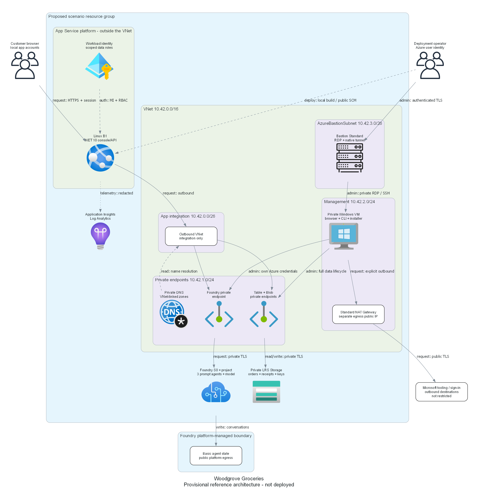
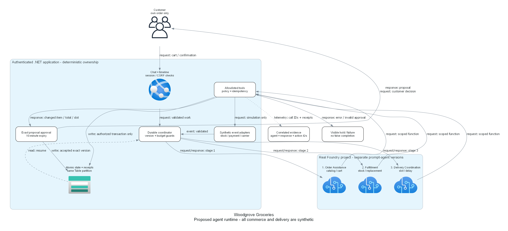

# Retail-agentic: Woodgrove Groceries

> Generated by az-01-conductor agent | Updated 2026-10-28

Real Foundry agents coordinate a fully synthetic grocery journey from customer order to home delivery.
The browser console emphasizes chat, deterministic action receipts, customer decisions and an inspectable timeline.
No native mobile app or live payment/carrier integration is included.

## Installation

The local reference implementation is built and locally validated; it is not deployed or runtime-proven.
It is maintained through ABC Builder, whose deployment catalog is [available here](https://aka.ms/trainer-demo-deploy).
No public standalone repository or publication is claimed.

The repository workspace junction points to `C:\azd-projects\retail-agentic`.
The original intake, refined brief and confirmation remain in ABC Builder's local scenario state.
Do not copy credentials, deployment state or approval records into future exported content.

## Deploying the scenario in 4 steps:

1. Review the architecture, network boundaries and cost envelope.
1. Use the generated IaC, application, fixture data, tests and private installation automation.
1. Confirm target, authorized readiness, what-if, scoped roles and deployment consent.
1. Deploy the root reference and prove real agents, business outcomes and full deploying-user access.

Do not run `azd up`: read-only readiness/what-if and the official Bastion CLI extension were authorized,
but provisioning, grants and spending were not.
The installer rejects the incomplete target evidence before invoking any CLI; `selectedRegion` remains null.

## What is the demo scenario about?

Woodgrove Groceries uses Order Assistance, Fulfillment and Delivery Coordination prompt agents.
An application-hosted coordinator owns workflow state and enforces exact customer approval for changed
items, increased totals or delivery slots. Commerce, stock, payments and carrier events are synthetic.
The models and Foundry agent invocation must be real when deployed.

Industry: `Retail & Consumer Goods`. Business units: `["generic"]`.

Both PNGs are reproducible from [the diagram source](./03-architect-diagram.py).
Diagram rendering, PNG integrity, document headings/line lengths, local links, exact catalog identity
provenance and null unresolved Azure targets were checked locally.
The .NET SDK integration compiles, local tests pass, and Bicep compiles/lints.
These checks do not establish target availability, a working private-host installation or real runtime acceptance.

## Feedback and Contributing

Discuss architecture revisions in the existing scenario conversation.
Working-scenario suitability, hack authoring, event rollout and publication are later separate choices.

## Project Summary

| Property | Value |
| --- | --- |
| Created/updated | 2026-10-27 / 2026-10-28 |
| Reference phase | Local implementation validated; authorized Azure readiness found SKU blockers |
| Region | Original candidates rejected for B2ms; Sweden Central/D2s_v5 proposal awaits review |
| Requirements | [Requirements and acceptance journeys](./01-requirements.md) |
| Architecture | [Resources, roles, data paths, costs and decisions](./02-architecture-assessment.md) |
| Evidence | [Dated subscription, quota, SKU and limited what-if results](./00-region-availability.json) |
| Diagrams | Architecture and runtime design, not runtime proof |
| App/IaC/tests | Implemented; 28 local tests pass; warning-free build; Bicep build/lint pass |
| Implementation | [Files, exact local commands and pending gates](./05-implementation-reference.md) |
| Application | [Business behavior, roles, pages and visual checks](./07-webapp-summary.md) |
| Deployment | Not performed or authorized |
| Hack suitability | Not requested or approved |

## Progress and resumption

- Completed business scoping: four actual user answers and a fingerprint-current confirmed brief.
- 2026-10-27: portal automatic continuation failed before dispatch; failure receipt retained, not rewritten as success.
- 2026-10-27: user explicitly requested continuation in this original scenario conversation after reboot.
- Completed local requirements, public technical research and proposed architecture.
- User selected "Use the proposed private-data design" for local implementation only.
- Implemented AVM-first infrastructure, explicit management NAT, azd wiring and private installation scripts.
- Implemented real current Foundry SDK integration, three versioned agents and a deterministic durable coordinator.
- Implemented exact customer decisions, synthetic payment/reservation/refund, expiry, delay and failure fixtures.
- Passed 28 local tests, warning-free solution build, locked restore and portable publish with fixtures.
- Passed Bicep build/lint, PowerShell syntax/guard, YAML syntax, workflow tests and skill validation.
- Checked rendered local UI fixtures at 1440, 390 and 320 pixels, keyboard entry and measured text contrast.
- An initial HTTP-test key-ring warm-up attempted an unreachable managed-identity endpoint and was stopped.
  Corrected test-only key storage and telemetry isolation; subsequent tests finish without that dependency.
- User explicitly chose "Authorize read-only Azure readiness and install the official Bastion CLI extension".
- Verified matching CLI/azd identity, enabled target subscription and registered required providers.
- Installed official Bastion extension 1.4.3 under that permission; native tunnel help succeeds.
- Standard_B2ms is subscription-restricted in both candidate regions; East US 2 B1 quota is zero.
- Sweden Central Standard_D2s_v5 has no reported SKU restrictions and sufficient family/total/VM-count quota.
- The original model has adequate quota/capacity but is Legacy; inference deprecation is 2027-04-14.
- Linux .NET 10 is Active; the Windows Gen2 image and Sweden Central Foundry/Storage SKUs are listed.
- Inspected inherited Owner/Foundry User and eleven policy rules; no grants or directory changes were made.
- Parameterized VM size and explicit inherited-role reuse; original defaults remain unchanged.
- Provider-level ARM what-if returned 25 creates, no evaluated modifications/deletes and twelve expansion warnings.
  Five dependent modules were short-circuited; this is incomplete evidence, not a passed what-if gate.
  The ephemeral secure parameter file was deleted successfully; raw results remain private and gitignored.
- No provisioning, Entra operation, real agent execution, suitability approval or hack composition occurred.
- Current genuine boundary: the proposed region/VM/cost revision, remaining readiness and complete deployment review.
- Revised unquoted infrastructure estimate is USD 350-550/month plus consumption; NAT adds roughly USD 35-50/month.
  These estimates and the explicit egress/security trade-offs must be reviewed before spending.
- The unapproved Sweden Central D2s_v5 proposal adds about USD 73/month of VM compute at 730 hours.
  Its revised rough infrastructure envelope is USD 425-625/month plus consumption; it is not a quote or budget.

The reviewed metadata is curated business/design scope only, not a completed or reusable deployed reference.
