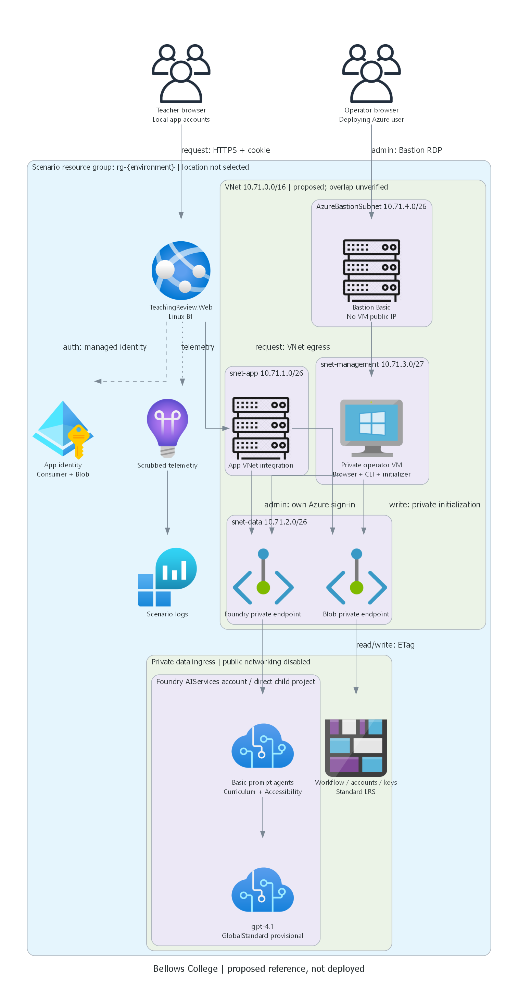

## Requirements Validation

> Generated by az-01-conductor agent | 2026-10-29 UTC

Status: design accepted; authorized read-only subscription checks found regional blockers/unknowns.
The user accepted the proposed design and authorized the stated read-only Azure preparation.
This did not authorize Azure/Entra writes, installation, deployment, suitability approval or composition.
No what-if, deployment readiness or runtime success is claimed.

| Scope | Design response | Acceptance evidence required |
| --- | --- | --- |
| Education / `["generic"]` | Bellows College secondary-school material review | Synthetic lesson/worksheet workflow |
| Two AI review roles | Curriculum and accessibility/clarity saved agents | Real response/version IDs |
| Human-in-the-Loop | Peer feedback, revision and lead approval enforced in code | Role/stale-version denial |
| Standalone app | .NET 10 Razor Pages, local accounts, Blob state | Workflow and sign-in tests |
| No publication | Internal release only, no LMS/external publication | No publication connector |

### Agentic runtime contract

Primary flow: Sequential / Pipeline with the selected Human-in-the-Loop overlay.
The application coordinates **two real saved Foundry prompt agents**, not two labels around one canned reply.
The application is the deterministic coordinator, not an additional LLM manager.
This is the minimum multi-agent interpretation of the user-confirmed distinct review responsibilities.
A single combined reviewer would be simpler but would lose separately attributed findings.

| Contract | Proposed design |
| --- | --- |
| SDK support | Azure.AI.Projects, Azure.AI.Projects.Agents, Azure.AI.Extensions.OpenAI; current Learn quickstart |
| Current API | Foundry project endpoint, saved agent versions, Responses API; not classic hub/thread APIs |
| Orchestration | App-hosted sequence; no hosted-agent container, Copilot harness or autonomous group chat |
| Curriculum agent | Compare material with fictitious rubric clauses; flag missing/unsupported evidence |
| Accessibility agent | Assess clarity, structure and alternative presentations; no formal compliance certification |
| Output | Findings, evidence references, reviewer kind, exact material version and real agent/response receipt |
| Human ownership | Author -> agents -> assigned peer -> author revision -> fresh reviews/peer -> lead decision |
| State | Blob document per material, immutable historical entries, ETag compare-and-swap updates |
| Version gate | Each revision clears current eligibility; feedback/reviews/approval must match the current version |
| Failure | Partial/failed reviews are visible and cannot advance; human chooses bounded retry or edits material |
| Budget | Two agent calls/attempt, two explicit retries maximum, 120 seconds total, 800 output tokens/call |
| Context | Material <=12,000 characters, rubric <=4,000; no chat history shared between materials |
| Observability | Material/version, attempt/correlation ID, agent/version/response IDs, elapsed time and error code |
| Acceptance | Both agents succeed; human feedback/decision recorded; stale and unauthorized actions denied |

Review cycles are bounded by explicit human submissions, not an AI self-improvement loop.
Grounding is the exact supplied material/rubric, with evidence references; Search is not needed for this scope.
Material text is untrusted data and cannot change reviewer instructions or grant tools/approval rights.
If response parsing or grounding validation fails, record a failed review rather than a passing default.

### Basic versus Standard

Recommend **Basic Foundry setup with private inbound access** for this synthetic, text-only scenario.
Current Learn states inbound private endpoints and disabled public access are available for all setups.
Basic uses platform-managed agent state; the application's authoritative teacher workflow remains in its own Blob store.
This is **not** a claim of fully private outbound agent networking or customer-owned conversation storage.
No agent connects to an external tool or customer-owned data service.

Standard adds customer-owned Storage, Cosmos DB and Search. Standard with BYO VNet adds secured agent outbound.
Those are appropriate if full customer-owned agent-state control or outbound isolation becomes a requirement.
They add services, quota, RBAC, network and cost dependencies without improving the confirmed bounded review outcome.
Do not silently expand to Standard or claim Basic meets Standard's stronger isolation guarantees.
The design review must acknowledge the Basic platform-state boundary and GlobalStandard global processing.

### Recommended architecture

- Public teacher browser -> authenticated App Service HTTPS application.
- App Service B1 Linux -> regional VNet integration -> private Foundry and Blob endpoints.
- Foundry AIServices account -> direct child project -> one model deployment -> two saved prompt agents.
- Storage: business state, salted local-account hashes and persistent data-protection keys in separate containers.
- Private operator Windows VM -> private services and Foundry portal using the deploying user's Azure identity.
- Azure Bastion -> operator VM over private RDP; VM has no public IP or Internet-exposed RDP/SSH.
- Application Insights and Log Analytics receive scrubbed operational events, not passwords/material bodies.

No actual resource names or deployed URLs exist yet. Naming is environment-derived with one shared unique suffix.
Diagrams label planned logical resources and are not an as-built topology.

### Management and deployment access

This is the full setup/operator design, not a participant starter or hack plan.
Use a new scenario VNet provisionally `10.71.0.0/16`, subject to overlap checks:
`snet-app` `10.71.1.0/26`, `snet-data` `10.71.2.0/26`,
`snet-management` `10.71.3.0/27`, `AzureBastionSubnet` `10.71.4.0/26`.
Delegate the application subnet to `Microsoft.Web/serverFarms`; keep private endpoints outside it.
Link service-specific private DNS zones to the VNet. Restrict management RDP source to Bastion.
Permit required HTTPS package, Azure identity/control-plane and Foundry portal dependencies;
no unsupported assertion of air-gapping or exfiltration prevention.

| Operation | Host and identity | Path | Ordering and acceptance |
| --- | --- | --- | --- |
| Provision | Local VS Code; deploying user | ARM | Authorized what-if first |
| Publish | Local azd; deploying user | Authenticated SCM | Package -> SCM; no public blob/SAS |
| Transfer | Local hook -> VM Run Command | ARM | Bounded payload; return nonsecret receipts |
| Initialize | VM; scoped managed identity | Private DNS -> Foundry/Blob | Reconcile agents/data; return IDs |
| Human entry | Deploying user -> Bastion -> VM | Browser RDP | Separate OS login; no VM public IP |
| Human browser | VM browser; deploying Azure user | Private project | Open project, inspect/invoke/edit agent |
| Human CLI/SDK | VM CLI; deploying Azure user | Private Foundry/Blob | Safe CRUD and cleanup |
| Runtime app | App managed identity | VNet -> private endpoints | Real agent call and Blob write |

VM OS sign-in and Azure browser/CLI sign-in are separate.
Never use the VM's managed identity as evidence of the human user's Azure administration access.
Run Command is the unattended bridge only, not a substitute for Bastion/browser administration.
Initialization tooling must be installed before private data operations, with approved outbound package access.
The hook must transfer the actual built initialization payload, await completion and surface failures.
An existing VPN/management environment may replace the new VM/Bastion only after its equivalent access is verified.

Alternatives:

- Fully public data endpoints are cheaper but violate the proposed data-service private baseline;
  no public exception is selected or implemented.
- Existing connected management host could remove most management costs, but none has been verified.
- Standard BYO VNet is stronger outbound isolation and higher cost; not required by the confirmed synthetic scope.

### Deployment-user access matrix

Principal: `214d672b-df87-4f3b-94fd-7863032546c1`, resolved from current CLI token claims locally;
tenant `16b3c013-d300-468d-ac64-7eda0820b6d3`. No token was retained and no Graph request was made.
CLI and azd identity match the confirmed target. Subscription effective permissions include unrestricted
ARM actions and Cognitive Services data actions; this is not a private data-plane acceptance result.
All control/data roles below are scenario-scoped proposed grants; reuse verified inherited access where sufficient.
Missing role-assignment rights, denied private access or incomplete administration blocks reference completion.

| Resource/scope | Control-plane administration | Data read/write/manage | User-credential verification |
| --- | --- | --- | --- |
| Scenario RG | Contributor + RBAC Administrator | Service roles below | Scoped config and effective-permission check |
| Foundry/project/model | RG grants + required Foundry account role | Foundry User/Owner | Disposable agent lifecycle |
| Blob storage | RG Contributor | Storage Blob Data Owner | Container/blob CRUD and ACL administration |
| App/plan | RG Contributor | Config, logs and deployment administration | Config/publish/scrubbed logs |
| VM/NIC/disk/NSG/VNet/DNS/PE | RG Contributor | Separate OS and Azure-user sign-in | Bastion, DNS/TLS and data CRUD |
| Bastion/public IP | RG Contributor | Scoped connect/read rights | Browser entry; private RDP |
| Logs/Insights | RG Contributor | Log Analytics Contributor | Test correlation query; retention management |

Workload roles are separate: app identity gets Foundry Agent Consumer scoped to the project
and Blob Data Contributor scoped to business/account containers, not human administration roles.
The initializer identity gets only required agent lifecycle and fixture-write access on this scenario.
No tenant-wide roles, Graph registration writes, delegated consent or sample-app Entra login are planned.
Role display names have recently changed; verify IDs/semantics from live definitions within authority
rather than guessing IDs from old agent names.

The RG-level administration combination is Contributor plus Role Based Access Control Administrator.
For Foundry, verify current Foundry Account Owner and Foundry User/Owner definitions before selecting grants.
For Blob, safe create/read/update/delete probes and ACL administration must all work using the user's credentials.
The deployment-user matrix applies at scenario scopes only; subscription/tenant-wide grants are not proposed.

## Resource SKU Recommendations

| Service | Proposed SKU/configuration | Pending exact-target checks |
| --- | --- | --- |
| Foundry account | AIServices S0; public/local auth disabled | Provider, policy and private inbound |
| Direct child project | Basic saved prompt agents | Project/SDK capability |
| Model | gpt-4.1 2025-04-14 GlobalStandard, 10k TPM proposed | Version/quota/capacity/global processing |
| App Service | Linux B1, one instance, .NET 10 | Microsoft.Web worker quota; stack; VNet integration |
| Blob storage | LRS, TLS 1.2; shared key/public access disabled | Region/policy, RBAC, private access |
| Operator VM | Windows D2s v5, 2 vCPU/8 GiB, Standard SSD | SKU, DSv5/total vCPU and VM-count quota |
| Bastion | Basic plus Standard static public IP | Regional service eligibility |
| Networking | VNet, NSGs, NIC, two PEs and private DNS | Address overlap and service zone mappings |
| Monitoring | Workspace-based Insights, PerGB2018 workspace | Ingestion/retention budget and policy |

### Cost and lifecycle

Planning currency: USD, pay-as-you-go, East US 2, no tax/discount, 730 hours/month.
Public Azure Retail Prices API queried on 2026-10-29; not an account-specific quote.

| Component | Observed public unit rate | Planning subtotal |
| --- | --- | --- |
| Windows D2s v5 VM | USD 0.188/hour | USD 137.24/month |
| Bastion Basic gateway | USD 0.19/hour | USD 138.70/month |
| Linux B1 app plan | USD 0.017/hour | USD 12.41/month |
| Fixed compute/access subtotal | Arithmetic from the three rates above | USD 288.35/month |
| Disk, public IP, PEs/DNS, Blob, telemetry | Allowance, not individual quotes | USD 40-80/month |
| Model/variable traffic | Metered tokens/requests, not fixed | Initial allowance USD 20/month |

Budgetary total: approximately **USD 330-390/month plus usage beyond allowances**.
No budget ceiling is user-approved. A continuously running 24-hour trial is roughly USD 11-14
before unusual token, storage or telemetry usage; verify exact network/disk/model rates at review.
Management VM+Bastion alone account for USD 275.94/month of the fixed subtotal.

Deallocate VM between sessions, but OS disk, Bastion, public IP, endpoints and app plan keep charging.
Bastion deletion/recreation or full environment cleanup requires explicit authorization.
No automatic shutdown, deletion, subscription-default change or probe allocation is authorized here.
Patch the VM and rotate private access credentials; retain only the synthetic fixtures needed for the demo.

## Architecture Decision Summary

| Decision | Proposed choice | Rationale/status |
| --- | --- | --- |
| Primary/overlay | Sequential + selected HITL | Human ownership and versioned material are the business outcome |
| Agent count | Two saved prompt agents | Confirmed distinct review responsibilities; no unnecessary manager agent |
| State | Blob with ETag concurrency | Small durable documents; avoids unnecessary SQL/Cosmos/Search |
| Foundry setup | Basic with private inbound | Synthetic inline rubric; explicitly not Standard outbound isolation |
| Authentication | Local sample accounts; Azure managed identities | No tenant consent dependency; no shared passwords |
| Human administration | Private Windows VM + Bastion | Browser/CLI access independent of app automation |
| Region | No selected region; Sweden Central remains a candidate | Actual partial results recorded below |
| Availability | Single instance/region reference | No HA claim; production hardening is outside current scope |
| Directory writes | None | ARM RBAC is distinct from Entra application/consent operations |

## Implementation Handoff

### Local preparation and review boundary

Requirements, architecture, diagrams, local code and narrowly scoped read-only preparation are authorized.
The security/management design was accepted explicitly; deployment and installation remain unauthorized.
Preserve [regional evidence](./00-region-availability.json) and its null selected region.
Before provisioning, present actual what-if, validated region/SKUs, target principal/resource group,
cost and any newly discovered scope changes. Do not silently substitute a region, VM or app SKU.
No working-scenario approval or hack composition is implied.

Application implementation should follow the typed workflow/security contract above.
Do not perform cloud operations outside the recorded read-only scope while preparing code.
Deployable IaC must use current pinned AVM modules and include the actual management hook wiring,
separate initializer/app identities, operator access and the complete deployment-user matrix.
Live initialization and acceptance remain resource-dependent, not a local-build success claim.

### Authorized subscription observations

Checked 2026-10-29 UTC against subscription `efd64343-6ef4-4926-951f-d3229f38bd76`.
The original design acceptance remains recorded separately from these technical findings.

| Candidate | Operator VM and compute quota | Model quota | App Service quota |
| --- | --- | --- | --- |
| East US 2 | D2s v5 subscription-restricted | GlobalStandard gpt-4.1: 0/1,000 used; need 10 | B1: 0/0; need 1 |
| Sweden Central | D2s v5 unrestricted; compute quotas pass | Same model headroom | Only regional 0/11 returned |

East US 2 is rejected for the accepted resource set despite adequate compute/model quota.
Sweden Central is not yet a whole-design pass: a regional total is not an exact B1 worker limit.
Linux B1 regional support is listed for both candidates; that is separate from quota eligibility.
The exact model/version and GlobalStandard SKU are listed for AIServices in both regions.
Model lifecycle is Legacy, with listed GlobalStandard deprecation on 2027-04-14; no capacity is reserved.
Relevant providers are registered. Three policy assignments were listed; definition effects,
template compliance, remaining supporting-resource restrictions and what-if remain unverified.

The initial VM checks exceeded the helper's 45-second timeout; Windows batch interpretation also broke a
parenthesized quota query. A tested invocation of the existing CLI Python runtime fixed those technical errors.
Exact model quota uses `OpenAI.GlobalStandard.gpt4.1`; batch quota is not inference quota.
No quota request, resource probe, provider registration, role grant or shared-default change was made.

### Dated public evidence

Checked 2026-10-29 UTC:

- [Environment choices and Basic private inbound support][setup]
- [Prompt-agent saved versions and runtime boundaries][prompt]
- [Current .NET quickstart and package/API usage][quickstart]
- [Current region/model support; not subscription eligibility][regions]
- [Standard BYO VNet and supporting-resource requirements][private]
- [Public retail pricing API][prices]

[setup]: https://learn.microsoft.com/azure/foundry/agents/environment-setup
[prompt]: https://learn.microsoft.com/azure/foundry/agents/concepts/prompt-agents
[quickstart]: https://learn.microsoft.com/azure/foundry/agents/quickstarts/prompt-agent
[regions]: https://learn.microsoft.com/azure/foundry/agents/concepts/limits-quotas-regions
[private]: https://learn.microsoft.com/azure/foundry/agents/how-to/virtual-networks
[prices]: https://prices.azure.com/api/retail/prices
