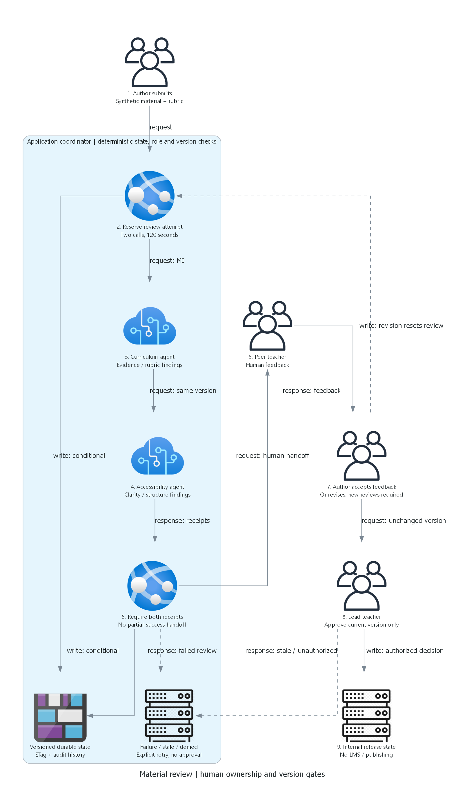

## Overview

> Generated by az-01-conductor agent | 2026-10-29 UTC

Local requirements, provisional architecture, diagrams and a buildable .NET reference application are prepared.
The user accepted the architecture and authorized exact-target read-only Azure preparation.
Readiness found an East US 2 VM restriction and zero B1 quota; Sweden Central's exact B1 quota remains unknown.
No what-if, installation, cloud write, deployment or suitability approval has occurred.
This plan is reference implementation only, not a hack/package plan.

## Resource Inventory

| Resource | Proposed configuration | Dependency/status |
| --- | --- | --- |
| Foundry AIServices account | S0, Basic, private inbound | Design accepted; full regional eligibility pending |
| Direct child project | Two saved prompt agents | Account; native child resource if not covered by AVM |
| Model deployment | gpt-4.1 2025-04-14 GlobalStandard | Both candidates list version/SKU and sufficient quota |
| App plan/site | Linux B1, .NET 10, managed identity | VNet integration and initialization outputs |
| Storage | Standard_LRS Blob; public/shared-key access disabled | Workflow and key containers |
| VNet/subnets/NSGs | Separate app, data, management and Bastion subnets | Overlap and policy checks pending |
| Private endpoints/DNS | Foundry and Blob endpoints, linked service zones | Account/storage must exist |
| Management VM/NIC/disk | Windows D2s v5, no public IP | East US 2 restricted; Sweden Central VM/quota pass |
| Bastion/public IP | Basic/Standard static IP | Human browser entry, not unattended connectivity |
| Logs/Application Insights | Workspace-based, scrubbed events | Rate/retention limits |
| RBAC | Human full access, separate initializer and app roles | Effective grants/role definitions pending |

## Module Structure

Current public MCR tag metadata was inspected on 2026-10-29.
These are candidates for the later IaC implementation, not a claim that the modules have been compiled
or that the whole design is deployable. Recheck exact schemas when pinning code.
The metadata-listing MCP tool was unavailable; the public MCR tags API and public AVM source were used directly.

| AVM resource path below `br/public:avm/res/` | Observed version |
| --- | --- |
| cognitive-services/account | 0.19.1 |
| web/serverfarm | 0.7.0 |
| web/site | 0.24.0 |
| storage/storage-account | 0.33.1 |
| network/virtual-network | 0.10.2 |
| network/bastion-host | 0.8.2 |
| compute/virtual-machine | 0.22.3 |
| network/private-dns-zone | 0.8.1 |
| network/private-endpoint | 0.12.1 |
| network/network-security-group | 0.5.4 |
| network/public-ip-address | 0.13.0 |
| operational-insights/workspace | 0.16.1 |
| insights/component | 0.8.0 |

Plan a resource-group-scoped main entry point with environment, location and actual deploying-human object ID inputs.
Use one `uniqueString(resourceGroup().id)` suffix and required environment/project/security tags.
Do not fill live role IDs, principal IDs, region eligibility or generated secrets with invented values.
No Bicep or azd configuration has been generated at this checkpoint.

## Implementation Tasks

1. Preserve the accepted Basic platform-state boundary, global model processing, public authenticated app
   and private operator design. Do not ask the same design question again.
1. Resolve exact B1 quota and remaining whole-design eligibility from actual evidence;
   current CLI/azd context, human ID, effective ARM permissions and model quota are already observed.
1. Generate AVM-first Bicep, direct child project, least-privilege app/initializer roles and full human roles.
1. Generate azd wiring with explicit target inputs; no copied subscription defaults or reference secrets.
1. Implement installation ordering and a real private execution bridge:
   local build/publish, private management host tools, bounded source transfer through ARM Run Command,
   private agent creation and fixture initialization, then version output capture into app settings.
1. Complete result/grounding acceptance. The adapter now enforces 800 output tokens, rejects incomplete responses,
   pins agent versions and bounds text/time; the current SDK request compiles with zero warnings/errors.
1. Make fixture installation resumable without regenerating or overwriting existing account credentials.
   The current initializer deliberately fails if private access files/state already exist; it is not a rotation tool.
1. Wire safe human-credential resource/data administration probes and separate app-identity acceptance.
1. Build/lint Bicep, build/publish the application, run focused tests and capture exact results.
1. Execute authorized readiness/what-if and present one actual target/cost/write-scope review.
   No provisioning before explicit consent; no composition before working-scenario approval.

### Application already prepared

- .NET 10 Razor Pages: role-aware material dashboard, local sign-in/logout, failure and audit views.
- Blob ETag state store; explicit local development/test store, never a production fallback.
- Two saved-agent Responses calls using managed identity and pinned agent versions.
- Deterministic human handoffs, current-version approval, explicit bounded retries and abandoned-attempt recovery.
- Synthetic company/people provenance and ten materials, including missing-rubric, disagreement and injection fixtures.
- Focused workflow and in-process HTTPS tests; test-only reviewer responses are not deployed evidence.

## Dependency Graph

Control-plane networking and identities precede private endpoints and management host.
Foundry account precedes direct project, model and agent initialization.
Private DNS plus initializer identity grants precede private fixture and saved-agent operations.
Those operations return actual agent versions consumed by the application.
Local app package publication does not itself prove private agent invocation.
Human administration acceptance and workload-identity acceptance are separate completion dependencies.

## Runtime Flow Diagram

Reproduce both images with [the diagram source](./03-architect-diagram.py).
The images represent the proposed reference, not an installed environment.

## Naming Conventions

| Component | Rule |
| --- | --- |
| Workspace | tue28seven; physical output is the adjacent azd-projects workspace |
| Application | TeachingReview.Web |
| Resource group | `rg-` plus the explicitly selected azd environment |
| Globally unique resources | Service prefix, constrained environment/project names and shared unique suffix |
| Company-derived identifier | bellows-college; do not rename the technical project |
| Saved agents | Stable scenario-owned curriculum and accessibility names; runtime version pinned after installation |

## Execution Handoff

The design and original read-only scope are accepted; do not repeat that decision.
No complete eligible region is selected. Resolve Sweden Central's exact B1 quota or obtain permission
to compare additional candidate regions before finalizing a target-specific deployment review.
Keep independent local implementation work separate from the cloud eligibility blocker.
Current result: **locally tested application and accepted design; not deployed**.
