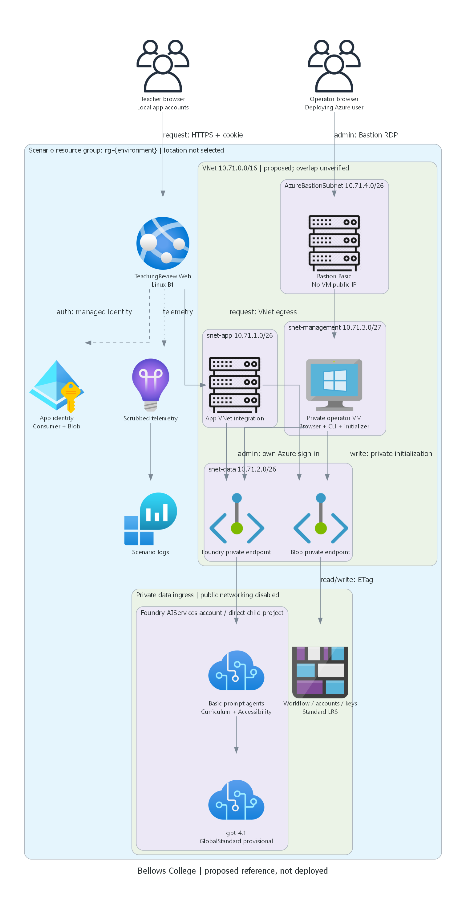
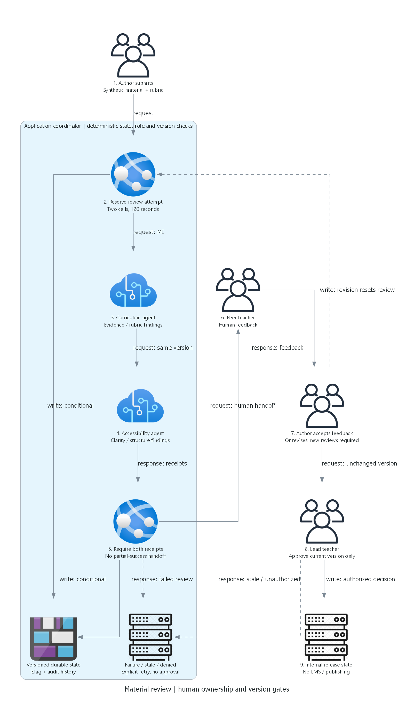

## Installation

> Generated by az-01-conductor agent | 2026-10-29 UTC

Bellows College - Teaching Material Review demonstrates secondary-school instructional-material review.
It is a local reference preparation workspace, not a deployed solution or hack package.
ABC Builder uses the Microsoft Trainer Demo Deploy Catalog's artifact conventions;
this scenario has not been published to that catalog.

Use the existing .NET 10 SDK and repository Python environment.
Dependencies are declared in the application and test projects. No new workstation tool installation was performed.
The default NuGet endpoint failed TLS negotiation in this session; restore succeeded through Microsoft's
public .NET package feed without disabling certificate validation.

From the scenario workspace:

```powershell
dotnet restore tests\TeachingReview.Tests\TeachingReview.Tests.csproj `
  --source https://pkgs.dev.azure.com/dnceng/public/_packaging/dotnet-public/nuget/v3/index.json
dotnet test tests\TeachingReview.Tests\TeachingReview.Tests.csproj --no-restore
```

For an explicit local-only browser session, use a private directory under this workspace:

```powershell
$env:ASPNETCORE_ENVIRONMENT = 'Development'
$env:StorageMode = 'Local'
$env:PrivateDirectory = Join-Path (Get-Location) '.private'
dotnet run --project src\TeachingReview.Web -- --initialize-local
dotnet run --project src\TeachingReview.Web --launch-profile https
```

The initializer generates unique accounts with salted hashes and restrictive private-directory permissions.
Author/peer credentials are in the private participant access file; lead credentials are in the separate
private coach access file. These names describe credential separation, not a hack/event package.
Never publish or export this directory. Do not run initialization again to rotate or overwrite existing state.
The local profile has no simulated AI reviewer: requesting AI review without real Foundry configuration
produces an explicit failed attempt and blocks approval.

## Deploying the scenario in 4 steps:

1. Review the [requirements](./01-requirements.md), [architecture](./02-architecture-assessment.md)
   and [implementation plan](./04-implementation-plan.md).
1. Review the completed exact-target read-only observations. East US 2 fails the operator VM restriction
   and B1 quota checks; Sweden Central passes VM/model checks but has no returned SKU-specific B1 limit.
   Resolve regional eligibility before selecting a deployment target.
1. Complete local AVM-first infrastructure and installation wiring, then review actual what-if,
   cost, targets and Azure write scope. Bicep/azd files do not exist yet; do not run `azd up`.
1. Only after explicit deployment consent, provision, initialize and prove real app/agent/data and operator paths.
   Suitability review and any subsequent hack composition remain separate.

## What is the demo scenario about?

An author submits synthetic lesson material. Two distinct Foundry reviewers assess curriculum evidence
and accessibility/clarity. A peer teacher reviews findings, the author revises and a lead approves a current version.
Edits invalidate old approval eligibility. No LMS publishing, student data, attendance or scheduling is included.





Current progress:

- Requirements: complete for local design.
- Architecture: user accepted the proposed design and narrowly scoped read-only preparation.
- Diagrams: rendered and inspected.
- Application: builds; deterministic workflow and local HTTPS security tests pass.
- Infrastructure/installation: planned, not generated.
- Azure region/quota: partial actual checks; no complete eligible region selected.
- What-if, deployment, runtime and human administration acceptance: not performed.
- Working-scenario suitability approval and hack packages: not started.

Planning cost is approximately USD 330-390/month for the proposed always-on private reference,
including the management path and a small usage allowance. This is not a user-approved budget or quotation.
The VM and Bastion account for most fixed costs.
That estimate is based on East US 2 public prices, not a quotation for a different region.
Design acceptance and read-only preparation do not authorize deployment or installation.

## Feedback and Contributing

Revise the reference in the existing ABC Builder chat; do not silently change confirmed business scope.
Publication and event rollout require separate explicit requests.
Education remains the exact selected industry; later Skillable composition requires an explicit support decision.
